<div align="center">

# TravelBuddy

### One app. The whole road trip. Even where the signal ends.

Plan it, drive it, remember it. On iPhone, Mac, Windows and Linux, fully offline, no account, no cloud.<br>
**One app for the whole trip. It does it all.**<br>
📔 **Not just a road trip planner: a diary maker.** While you travel, your travel diary writes itself.

**Version 1.8 · built for Western Australia**<br>
<sub>More regions and countries will follow.</sub>

**[📱 Try it on your iPhone](https://travelbuddy-v1-wa.netlify.app)** · **[✨ What's new](#-new-in-version-18)**

<sub>🇩🇪 **[Deutsche Version weiter unten](#deutsch)** · the full README in German follows below.</sub>

<br>

**[⬇️ Mac app](https://github.com/Kotdesigner/TravelBuddy/releases/latest)** · **[⬇️ Windows app](https://github.com/Kotdesigner/TravelBuddy/releases/latest)** · **[⬇️ Linux app](https://github.com/Kotdesigner/TravelBuddy/releases/latest)** · **[🌐 Web app for Netlify](#-put-it-online-with-netlify-for-iphone)** · **[🚀 Everything it can do](#-everything-travelbuddy-can-do)** · **[🛠️ Run it yourself](#run-it-without-the-ready-made-apps)**

<br>

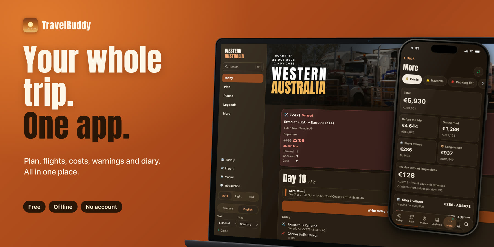

</div>

> All pictures show a made-up **sample trip**. No real travel dates, bookings or documents are shown. Place photos inside the screens are credited in the app.

---

## 📱 Try it now on your iPhone

<table>
<tr>
<td align="center"><a href="https://travelbuddy-v1-wa.netlify.app"></a></td>
<td>

1. Scan the code or open **[travelbuddy-v1-wa.netlify.app](https://travelbuddy-v1-wa.netlify.app)** in **Safari**.
2. Tap **Share**, then **Add to Home Screen**.
3. Open TravelBuddy from your home screen and tap **🧪 Play with a test trip first**.

No account, nothing to install from a store, and your data stays on your phone. On a computer, the link works straight away.

</td>
</tr>
</table>

---

<table>
<tr>
<td align="center">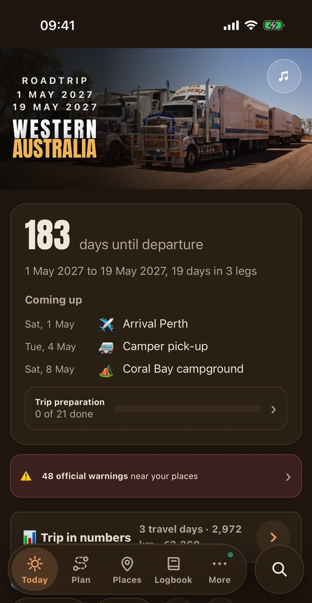<br><b>Today</b></td>
<td align="center">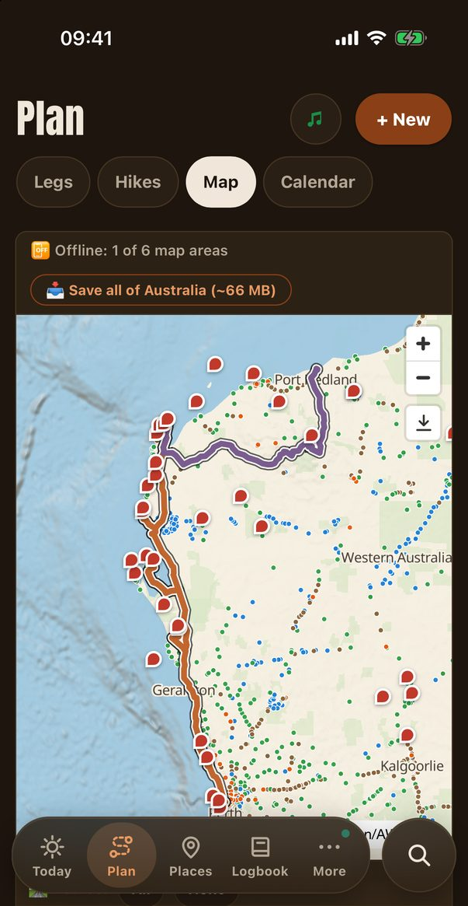<br><b>Offline map</b></td>
<td align="center">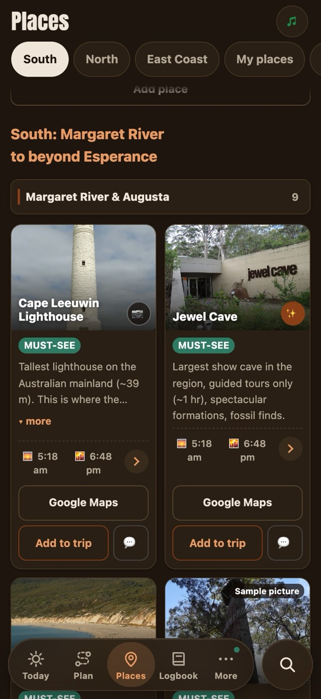<br><b>Places</b></td>
</tr>
<tr>
<td align="center">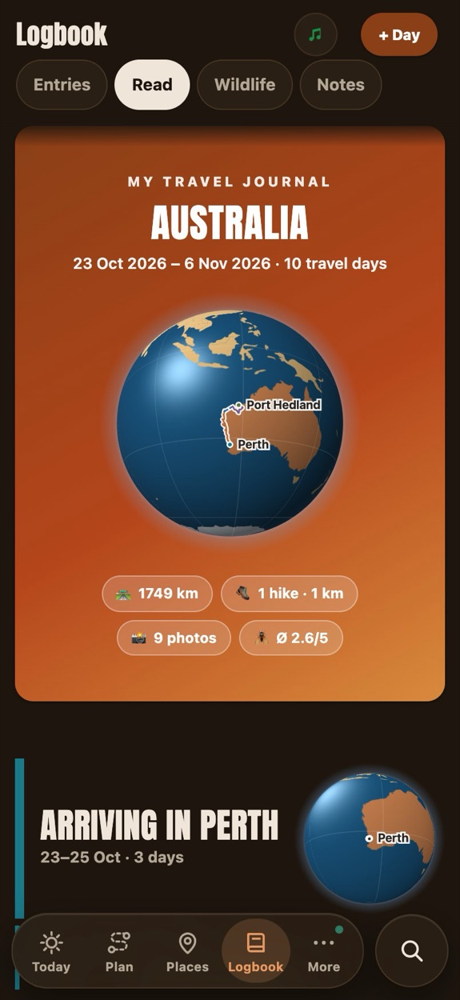<br><b>Your journal</b></td>
<td align="center">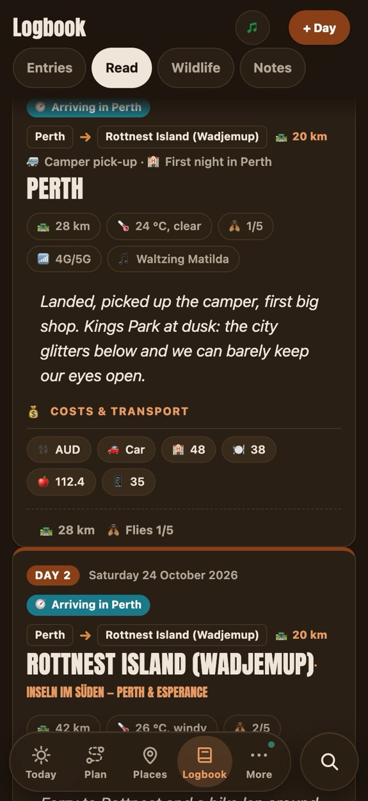<br><b>Every day told</b></td>
<td align="center">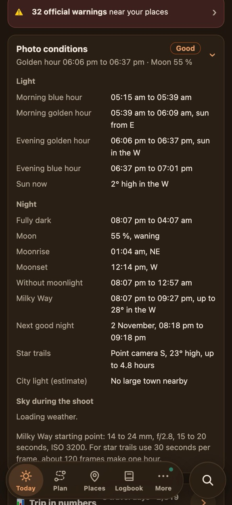<br><b>Photo conditions</b></td>
</tr>
</table>

---

## 📸 New in version 1.8

**Photo conditions on the home screen.** One line tells you right away whether it is worth getting the camera out, with the best time, clouds and moon. Open it for golden and blue hour, moon, Milky Way with time and direction, star trails, sky and tips. Sun, moon and stars work offline.

**A touch of warmth.** When you open the app, the temperature where you are glows briefly on the right edge. The higher it sits, the warmer it is. Only with signal, and you can turn it off.

**Tidier everywhere.** Logbook, notes, hikes, the map and the home screen now share clear panels with equal buttons. Lists of routes stay short over months of travel: current ones first, the rest folded away, with a search.

**Calendar as a real PDF, calmer trip film.** The calendar now creates a file instead of a print job. In the trip film, long flights zoom out early and cars skip the street-by-street detail.

## 🎬 New in version 1.7

**Your trip as a film.** "Play trip" now flies down to street level, slowly at first and then faster. A plane, car, train or boat sets off, the distance fades in, and the camera zooms out only as far as that stretch needs. Tick "In the animated film" for what you want to see and leave out the small hops.

**Design in one place.** More → Design brings together light and dark, language, text, size and all effects, each with its own switch: soft fade, shrinking header, connection glow, weather mood, heat logo and a golden moment before sunset.

**A plan that notices what matters.** Your own location on the offline map, urgent flight and train changes on the home screen, and one radius for you, your places and your routes.

**A logbook closer to the real day.** Several destinations per day, nearby official warnings you pick one by one, and the journal now ends with facts, spending and the cost of each leg.

## 📄 New in version 1.6

**Create your journal as a real file.** TravelBuddy now builds a top quality PDF at 300 dpi right on your device. The collage also comes as JPEG or TIFF. After that you print, save, share or mail it, and a Back button always leads into the app.

**Notes belong to your trip.** Assign a note to a leg, see its time stamp, and find it in the logbook by itself. One tap takes it out again.

**Wildlife for days you missed.** Pick any day or a whole period for a sighting. The logbook tab is now called Entries.

## 📅 New in version 1.5

**The calendar now switches like on iPhone.** Choose list, month or year. The year shows every leg in colour at a glance, tap a month to open it and tap a day to see its events.

**No confusion from the start.** The setup now explains in one illustrated step how a leg, the calendar and the logbook differ.

## 🖼️ New in version 1.4

**Every place picture is now yours to change.** Tap the small **📷** in the corner of any place picture. Choose a photo from your device, open a ready-made image search for that place, or paste a snippet straight from the clipboard. On iPhone, take a screenshot of a picture that is only online and pick it from your photos. Your picture stays on your device. The first time you open Places, TravelBuddy explains this in a short note.

**Now on Linux too.** One executable file for x86-64 and ARM64: unpack it, run `./TravelBuddy`, done.

**Your language from the first second.** On first launch TravelBuddy asks whether you want English or German. English is the default.

**Every photo now has its source.** All 144 place photos come with author, licence and link, right in the app. Where no fitting free photo exists yet, a sample picture of the region stands in, clearly marked, with a button to add a better one.

---

## 🛣️ New in version 1.2

**Everyone chooses their own map.** Right on the first screen the app asks: download the small maps (76 MB) or the large maps with every road, street name and gravel track in Western Australia (281 MB)? It carries on in the background while you look around. Decide later and you can tap **🛣️ Turn on large map** on the map page: the app tells you the size first, then downloads only the part you are travelling in, 33 to 76 MB. Turn it off and the storage is free again. On a website this needs the large package. In the Mac and Windows apps with the large map it is on from the start.

<table>
<tr>
<td align="center">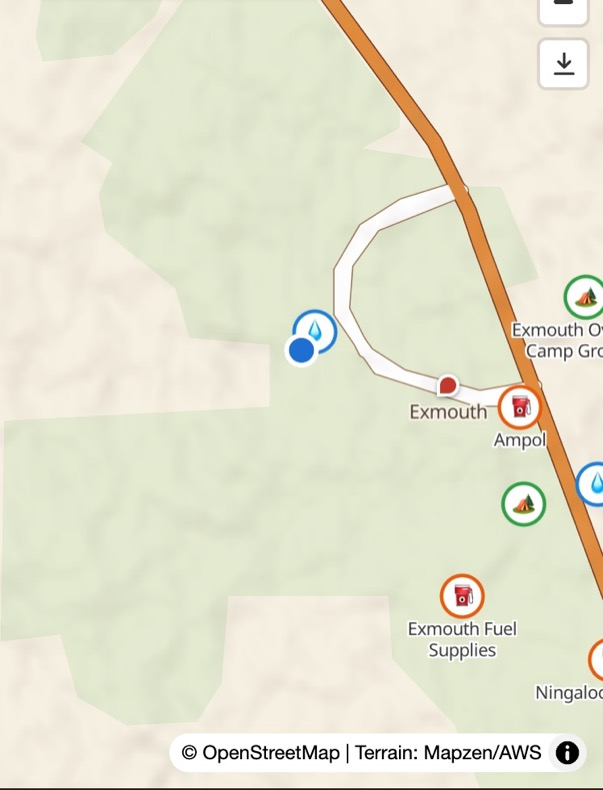<br><b>Small map</b><br>main roads, enough for planning</td>
<td align="center">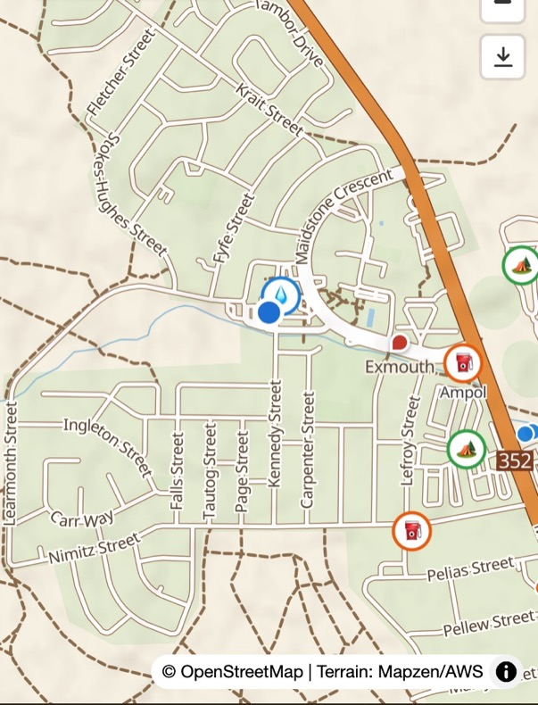<br><b>Large map</b><br>the same spot, every street and track</td>
</tr>
</table>

---

## ✨ New in version 1.1

**TravelBuddy now warns you before you drive into danger, watches your flights and trains, and shows what the trip really costs.**

<table>
<tr>
<td align="center">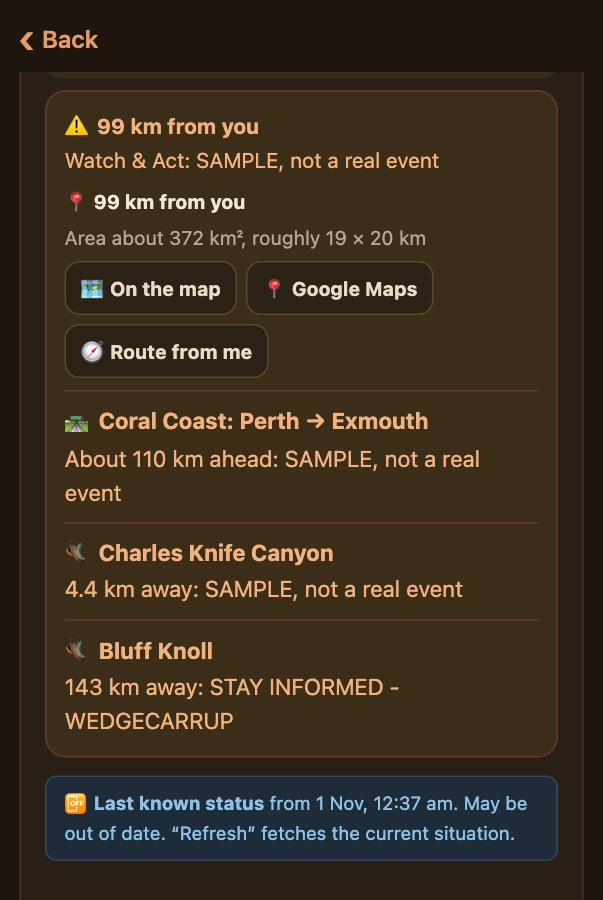<br><b>Warned in time</b><br>about 110 km ahead on your route</td>
<td align="center">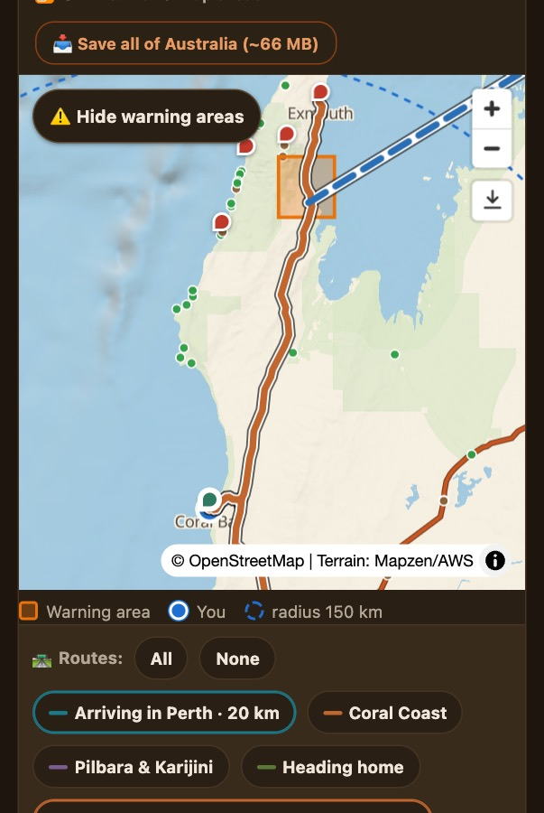<br><b>On your own map</b><br>area, radius and you, offline</td>
<td align="center">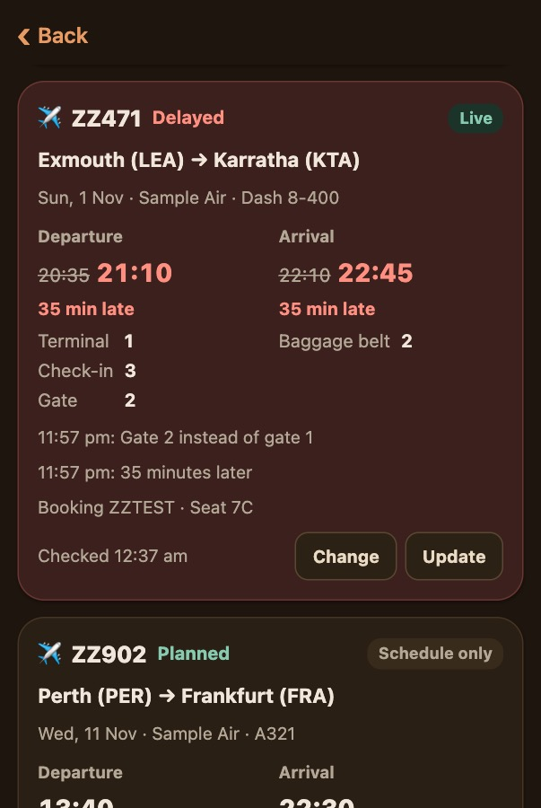<br><b>Flights and trains live</b><br>delay, gate, platform, connection</td>
</tr>
<tr>
<td align="center">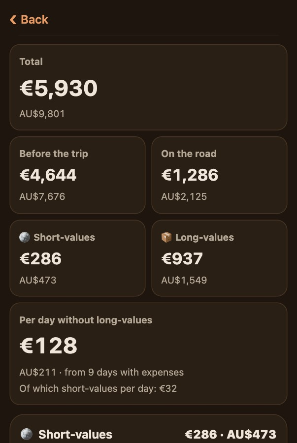<br><b>What it really costs</b><br>short and long values, per stage</td>
<td align="center">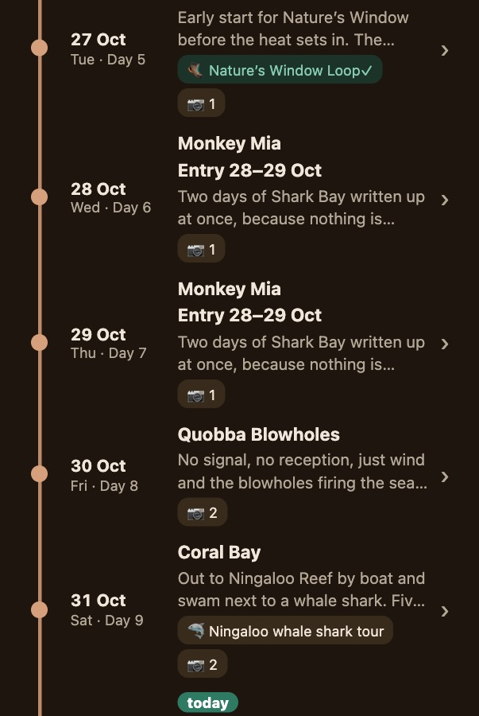<br><b>Several days at once</b><br>one entry, costs count once</td>
<td align="center">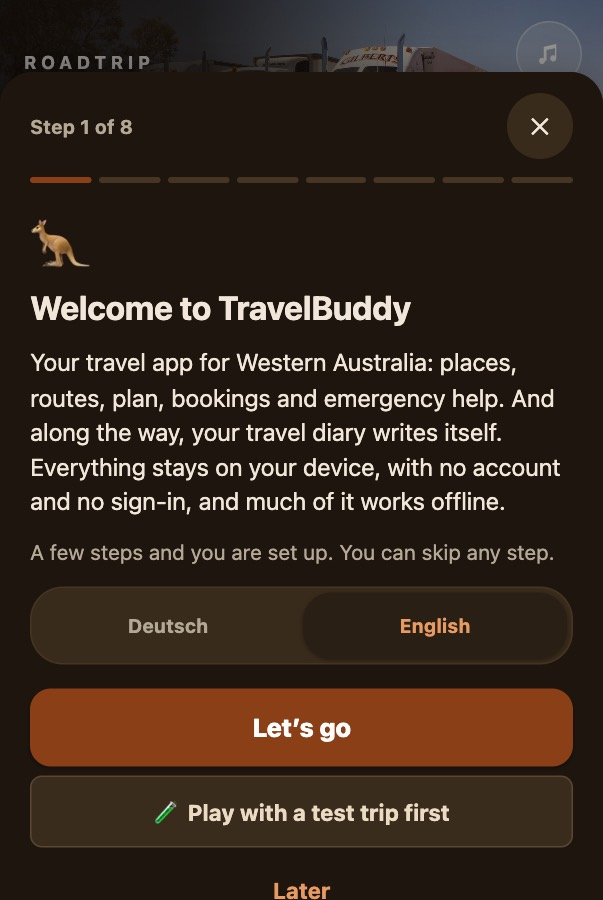<br><b>Test trip</b><br>one tap and the app is full</td>
</tr>
</table>

### 🚨 It warns you before you drive in
TravelBuddy doesn't only look at where you are right now. It checks your **whole route, stretch by stretch**, plus every stage and every hike, and tells you: *about 110 km ahead*. Even a narrow fire zone 700 km down the road gets caught. For every warning you see how large the area is and how far away, open it in **Google Maps**, or see it **on your own offline map** with the area, your radius and your position. One button shows or hides it all. Without signal you see the last status.

Should the weather service ever fail, the official warnings still get through. And with **test mode** you can try all of it at any place you like, with made-up warnings and nothing to reprogram, even while you are in Australia.

### ✈️ Your flights and trains, live
Status, new times, terminal, gate, check-in desk, platform, baggage belt and connection time, on their own page, on **Today** and in a notice 24 hours before departure. Enter a flight or train once, under route, stage or pre-trip costs, with number, booking, seat and ticket. **Every new booking is checked by itself**: rarely at first, more often as departure gets closer, so the free plan lasts. The app checks while it is open.

Flights need your own free [AeroDataBox](https://aerodatabox.com) key from RapidAPI, and it stays on your device. German trains need no key.

### 💰 What the trip really costs
Every expense on its own line, in 23 categories, in euro and AU$ at the daily rate. Sorted into **short values** (what you use up), **long values** (what you keep), transport, stays and experiences, per stage and down to the single item. A new camera doesn't ruin your daily average, because long values stay out of it. And **every list adds up exactly to the total shown**.

### 🗒️ Didn't write every day? No problem.
One entry for several days, on a stage or in the logbook. It appears on each of its days, and its costs count once.

### 🧪 Play first, plan later
One tap fills the app with a made-up 21-day trip that is **always in progress**, because every date counts from today. It never goes stale. Your own data is set aside and comes back exactly as it was. [More below](#ready-in-one-minute).

---

## Why TravelBuddy

Perth to Broome is 2,200 kilometres. In between: roadhouses up to 300 km apart, kangaroos at dusk, bushfires, closed tracks and hours without reception. TravelBuddy is built for exactly that.

| | |
|---|---|
| 📡 **Offline first** | Maps, places, routes, tickets and emergency help work without signal. Plan once, and everything comes along. |
| ⛽ **Knows where it gets tight** | The longest stretch without fuel, long sections without water, the latest departure to arrive before sunset. |
| 🔥 **Warns you in time** | Official fire, flood and storm warnings along your whole route, before you get there, plus road closures. |
| ✈️ **Watches your flights and trains** | Delays, gate, platform and connections, live and by itself. |
| 💰 **Knows what it costs** | Every expense, sorted into short and long values, per stage and per item. |
| 📍 **144 hand-picked places** | With photos, seasonal tips, sun times and labels like "must-see", "hidden gem" or "4WD only". |
| 📷 **Thinks like a photographer** | Golden and blue hour, sunrise, sunset and a star photography rating for every place and every day of your trip. |
| 🎵 **Plays where you are** | Collects music from every place you pass into your own Spotify playlist: local bands, their most-played song first. |
| 📔 **Writes your travel diary** | A logbook with 16 modules, from the fly factor to the roadkill counter, that turns into a travel journal, a trip film and a travel report. |
| 🔒 **Yours alone** | No account, no server, no tracking. All data stays on your device. |

---

## 📔 Not just a planner. A diary maker.

<div align="center">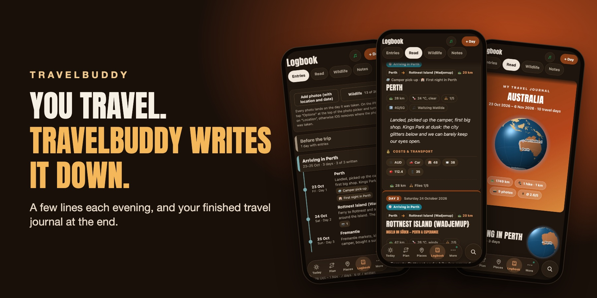</div>

Most travel apps stop when the trip begins. TravelBuddy really gets going then.

Every evening you note a few lines, add your photos, tap in the kilometres and the animals you saw. That's all. From it, TravelBuddy builds your **finished travel diary**: cover, photo grids, quotes, a summary for every day, painted globes for every stage and the big trip summary at the end. Ready to print as a photo book, as a PDF, as a single file for the family, or as a trip film for the group chat.

> **You travel. TravelBuddy writes it down.** At the end you don't hold a list of bookings, you hold the story of your trip.

<div align="center">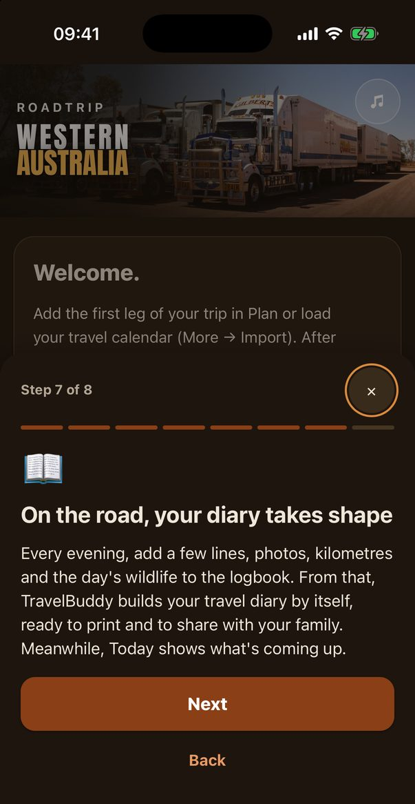</div>

---

## 🚀 Everything TravelBuddy can do

<div align="center">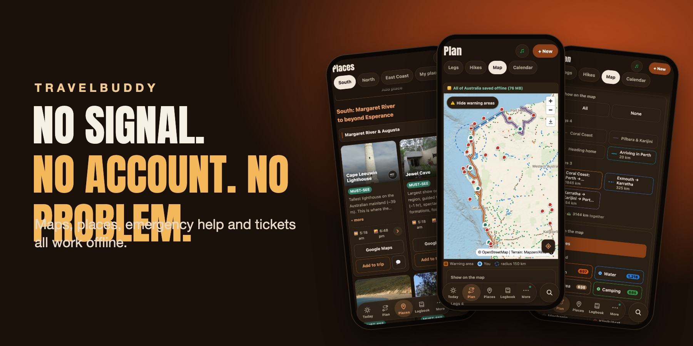</div>

**One app for the whole trip, from the first idea to the last memory. It really does it all.**

Sorted by how much it helps on the road: safety and planning first, photo tools and looks further down.

- 🗺️ **Offline map** for all of Australia, in detail where you travel
- ⛺ **Supplies on the route:** fuel, water, toilets, camps, rest areas, shops, workshops, clinics
- 🔥 **Official warnings** for fire, flood and storms in WA, VIC and QLD
- 🚨 **Warnings along your route:** where you are, on the road ahead, on every stage and hike, even when a route runs through several danger zones
- 🆘 **Emergency mode** fully offline: position, nearest help, emergency numbers
- 🚧 **WA road conditions** with closures right on your route
- ⛽ **Longest stretch without fuel** for every route
- 💧 **Long sections without water** flagged in advance
- 📶 **"Ready to go?" check** before you drive into a dead zone
- 🛫 **Flights and trains live:** status, new times, terminal, gate, check-in desk, platform, baggage belt and connections
- 🔔 **Urgent changes on the home screen:** cancellations, delays and gate or platform changes before your flight or train
- 🛣️ **Real road routes** with kilometres and driving time
- 🕒 **Driving days** with breaks and the latest departure before sunset
- 🌦️ **Weather along the route**, not just at the destination
- 🗺️ **Stages and routes** with dates, stops and drag-to-reorder
- 📐 **Smart stop placement** where a new stop adds the least detour
- 👀 **Sights up to 25 km off the road** suggested along the way
- 📍 **144 hand-picked places** with photos, seasons and insider labels
- ➕ **Add your own places** with photo and description from Wikipedia
- 🧩 **Route ideas** for the south and north loops from Perth
- 🥾 **Hikes** with status, date and photos
- 🧭 **Setup assistant** that sets up your trip with you in one minute
- 🔎 **One search for everything:** places, days, animals, bookings, notes
- 🚫 **No account, no cloud, no ads, no tracking**
- 📖 **Logbook** with 16 modules and 72 fields per day
- 📚 **Automatic travel journal:** your logbook becomes a finished travel magazine by itself
- 📸 **Photos sort themselves** by date, place and route kilometre
- 🎙️ **Voice memos and dictation** straight into the day
- ⛳ **Several destinations per day** in the logbook, shown as a route in your journal
- 🗒️ **Notes by leg with time stamp**, included in the logbook and easy to take out again
- 🗒️ **Entries over several days** on stages and in the logbook, for when you did not write every day
- ⚠️ **Nearby events on the road:** official warnings close to your real position, picked one by one for the journal
- 🏛️ **Official situation of the day** saved automatically in the logbook
- 🖨️ **Photo book ready** to print or as a PDF, short or detailed
- 📄 **Journal as a 300 dpi PDF, collage as PDF, JPEG or TIFF**, then print, save, share or mail
- 🖼️ **Photo library built in:** pick hundreds of photos, each lands on its day by itself
- ☁️ **All your iCloud photos** on the Mac, in photo-book quality
- 👨‍👩‍👧 **Share with family:** the travel report as one file via Messages, WhatsApp, Mail or AirDrop
- 💌 **Opens anywhere:** no app, no account, even offline, without bookings or exact coordinates
- 📥 **Travel calendar import** that sorts bookings in by itself
- 📨 **Booking from email:** paste it, everything is recognised
- 🎫 **Tickets and documents offline** on the device
- 🔐 **Face ID, Touch ID or Windows Hello** to protect your documents
- ✈️ **Trip preparation** with countdown and checklist
- 🪪 **Document expiry warnings** for passport, visa and more
- 💶 **Budget in euro and AU$** at the daily exchange rate
- 🧾 **Costs per day** in 23 categories, as many single items as you like
- 💰 **Cost analysis** by short values, long values, transport, stays and experiences, per stage and down to the single item
- 💶 **Facts and spending at the end of the journal**, plus the cost of each leg
- 🎒 **Outback packing list**
- 📅 **Calendar views like on iPhone:** switch between list, month and year for a quick overview of the whole trip
- 🗓️ **Calendar as a PDF file and a real Excel file**, to save, share or mail
- 📍 **Your location on the offline map** with a button that jumps to you, also without signal
- 🌍 **Trip map and 3D globe** with every stage, route and flight
- 🖨️ **Map as a print image** in any size
- 🔄 **Backup and sync** between Mac and iPhone, merged safely
- 🖥️ **Mac app**, 🪟 **Windows app**, 🐧 **Linux app** and 📱 **iPhone web app**
- 🎵 **Spotify soundtrack:** music from every place lands in your playlist automatically
- 🎸 **Local bands first**, each with their most-played song
- 📴 **Music offline too:** places are noted and caught up later
- 🛣️ **Small or large map, your choice:** every road and track in Western Australia at the tap of a button
- 📡 **Exact location of every warning:** size of the area, distance, Google Maps, and offline on your own map with radius and your position
- 🏷️ **Warning labels on the place pictures:** storm, heavy rain, flooding, thunderstorms, extreme heat or fire show up right on a place's thumbnail, with the distance if the warning is close by
- ✅ **"I'm OK" log** to export and share
- 📸 **Photo conditions on the home screen:** one line shows whether it is worth it here and now, with rating, best time, clouds and moon
- 🌅 **Golden and blue hour** morning and evening, with sun direction
- 🌌 **Milky Way planner:** time window, height, direction and the next good night
- 🌙 **Moon at a glance:** phase, brightness, moonrise and moonset with direction, and the time without moonlight
- ✨ **Star trails:** where to point the camera and how long you can shoot
- ☁️ **Sky for photographers:** clouds by layer, visibility, wind, rain risk and dew warning
- 🏙️ **City light estimate** and meteor showers around their peak
- 📷 **Made for photographers:** golden hour, blue hour and the night sky at every place, planned for any day
- 🌅 **Sun times** with sunrise, sunset and the sun's highest point
- 🌌 **Stargazing check** with moon phase and astronomical darkness
- 🖼️ **Change any picture:** your own photo, an image search or a pasted snippet
- 📝 **Notes and reports** for every place
- 🎬 **Animated film of your trip:** plane, car, train or boat with distance, zoom in proportion to every stretch, and a switch per route for what appears
- 🎬 **Trip film** in portrait format, recorded in the app
- 🎞️ **Animated photo collage**, offline and without AI
- ⛵ **Boating as a transport mode:** a straight line over water, no fuel, its own boat in the film
- 🗂️ **Route picker that grows with you:** current first, folded lists and a search, on the map and the home screen
- 🧭 **Tidy panels** with equal buttons in logbook, notes, hikes and map
- 🦘 **Wildlife album** with 20 animals to collect
- 🪰 **Fly factor, roadkill counter and road trains** for the real outback feeling
- 🛸 **Roadside curiosities counter:** Big Things, shoe fences, odd mailboxes
- 👃 **Senses, people, food, campfire and night sky** captured every day
- 🧠 **Australia quiz** with five levels
- 📘 **Manual** as a PDF in the app
- 🧪 **Test trip to play with:** one tap fills the app with a made-up 21-day trip, one more tap and it is gone
- 📅 **Trip dates in the header image** straight from the start date and length
- 🔠 **Text size and overall size** adjustable in four steps
- 🇬🇧🇩🇪 **English and German**
- ♿ **Accessible**, checked against WCAG 2.2 AA
- 🌓 **Light and dark mode**
- 🎨 **Design page** with light and dark, language, text, size and a switch for every effect
- 🌡️ **Temperature on the edge:** a brief, quiet glow when you open the app, higher means warmer, only with signal
- 🌐 **Lit edge when the app goes online** for GPS, weather, warnings or Spotify
- 🌦️ **Weather mood:** colours adapt slightly to the weather and time of day where you are
- 📌 **Fixed headers** with sub-menus that stay in place and text that fades softly beneath them
- 🎮 **Three hidden games** in the search field (see below)

### 🎮 Easter eggs: three hidden games

Type a secret word into the search field, and a game opens:

<details>
<summary><b>Show the secret words</b> (spoiler)</summary>

<br>

| Type | Game |
|---|---|
| `xoxo` | **Tic-tac-toe** against the computer |
| `sn4ke` | **Snake** with your own high score |
| `4444` | **Connect Four** against a computer that gets stronger the more you win: 7 levels from beginner to grandmaster and 5 playing styles from aggressive to sneaky |

</details>

---

## Ready in one minute

**Just want to look around?** Choose **🧪 Play with a test trip first** on the first screen, or later under More → Test trip. The app fills up with a made-up 21-day trip through Western Australia that is always in progress: nine days are already in the logbook with photos, animals and itemised costs, today is day 10, the next flight leaves in 20 hours and is delayed, a sample warning sits on the route. Flight and warning data in it are invented, nothing is looked up, and you can change anything. **End test trip** removes it all, and your own data, set aside while you played, comes back exactly as it was.

The first time you open TravelBuddy, a setup assistant walks you through eight short steps, and you set up your trip right away: start date and length (shown in the header image straight away), your first stage, a booking pasted from the confirmation email, tickets and documents onto the device. Every step can be skipped.

<table>
<tr>
<td align="center">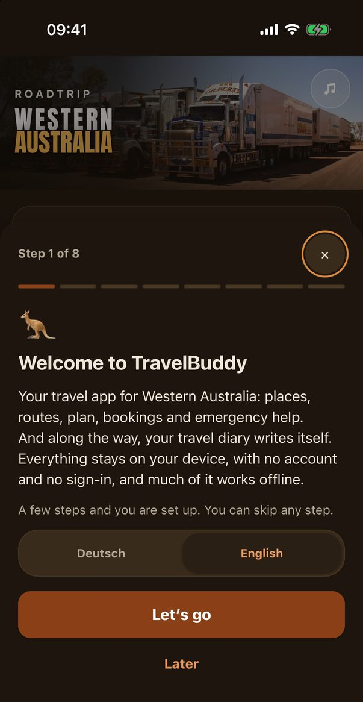<br><b>Welcome</b><br>German or English</td>
<td align="center">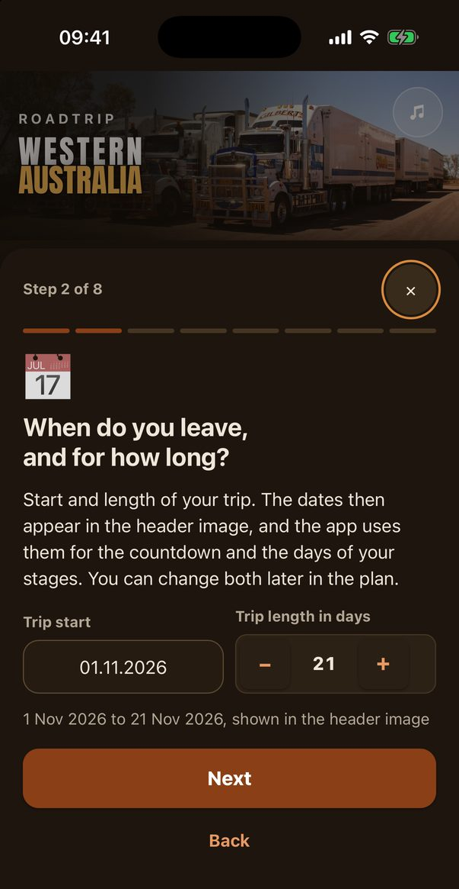<br><b>When and how long</b><br>appears in the header image</td>
<td align="center">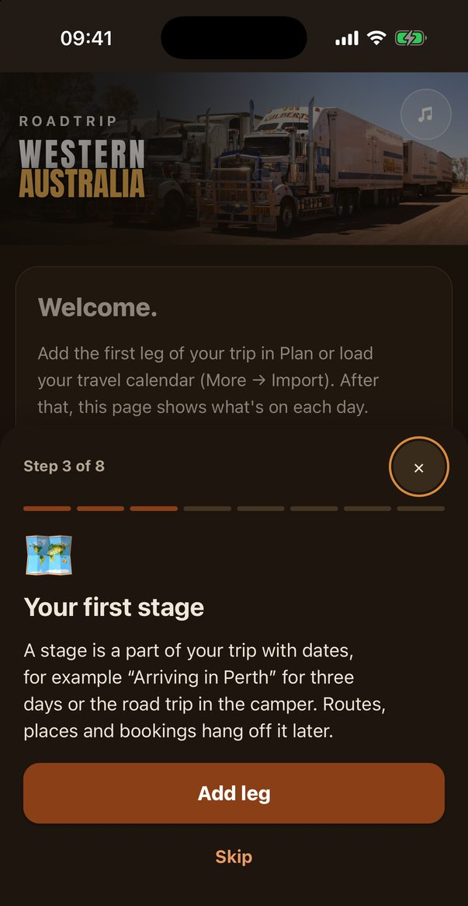<br><b>First stage</b><br>right in the real form</td>
</tr>
<tr>
<td align="center">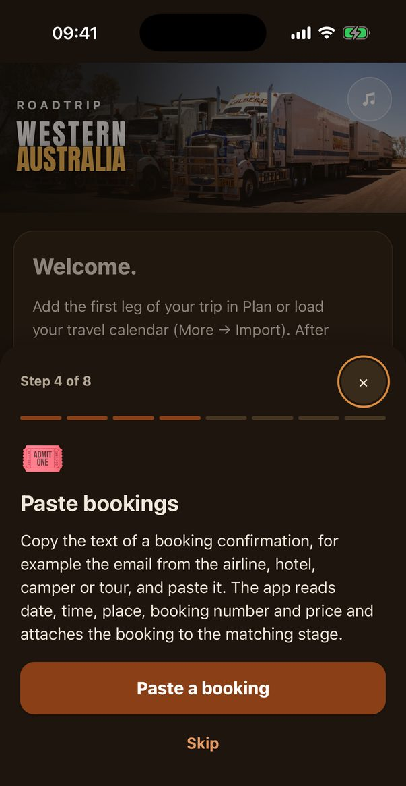<br><b>Bookings</b><br>paste the email text, done</td>
<td align="center">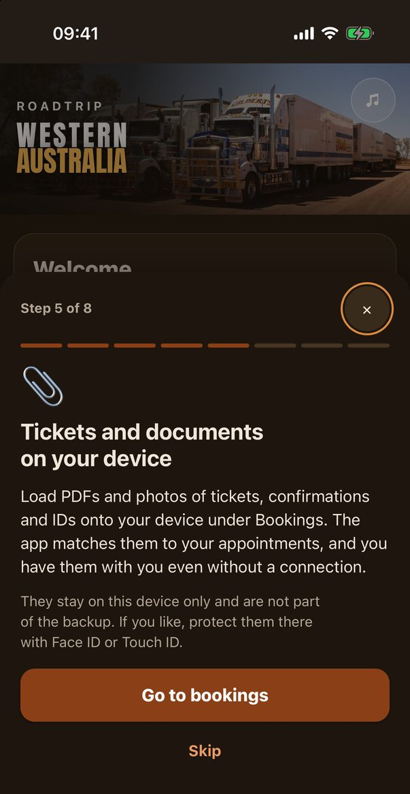<br><b>Tickets and documents</b><br>offline, optionally with Face ID</td>
<td align="center">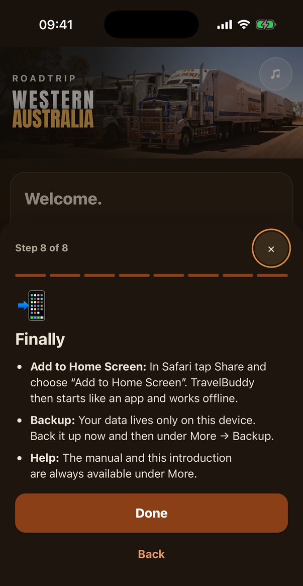<br><b>Finish</b><br>home screen and backup</td>
</tr>
</table>

---

## On the iPhone

<table>
<tr>
<td align="center"><br><b>Today</b><br>trip dates, countdown, what's next</td>
<td align="center">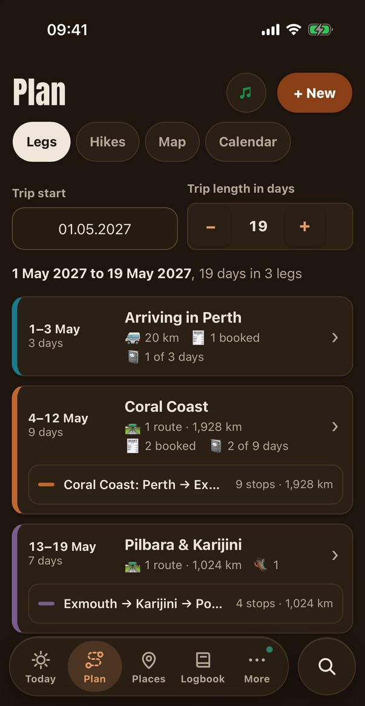<br><b>Plan</b><br>stages, routes, bookings per stage</td>
<td align="center">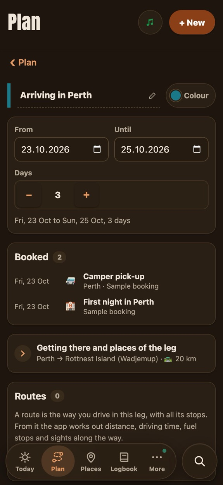<br><b>Route</b><br>stops, km per leg, car or flight</td>
</tr>
<tr>
<td align="center"><br><b>Places</b><br>144 places with photo and season</td>
<td align="center"><br><b>Offline map</b><br>fuel, water, camps, rest areas</td>
<td align="center">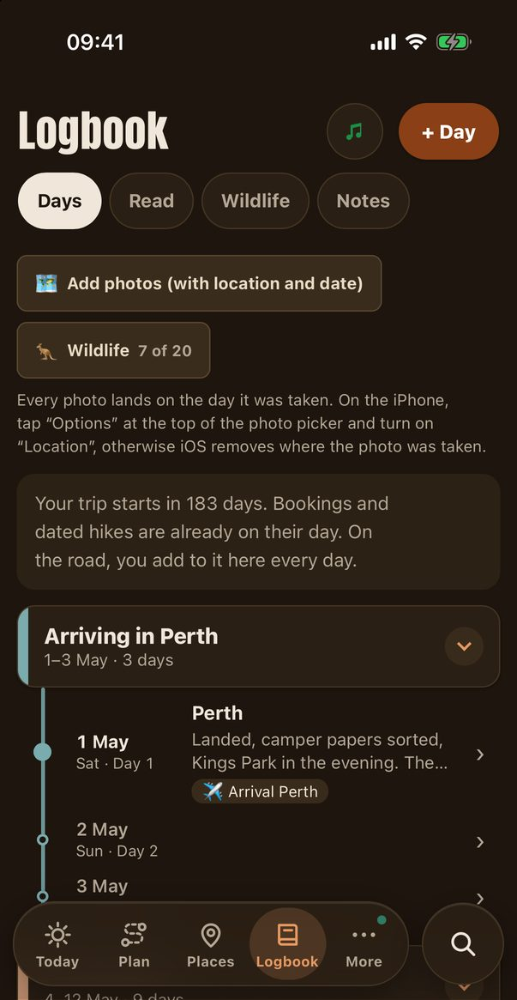<br><b>Logbook</b><br>every travel day on its stage</td>
</tr>
</table>

<div align="center">
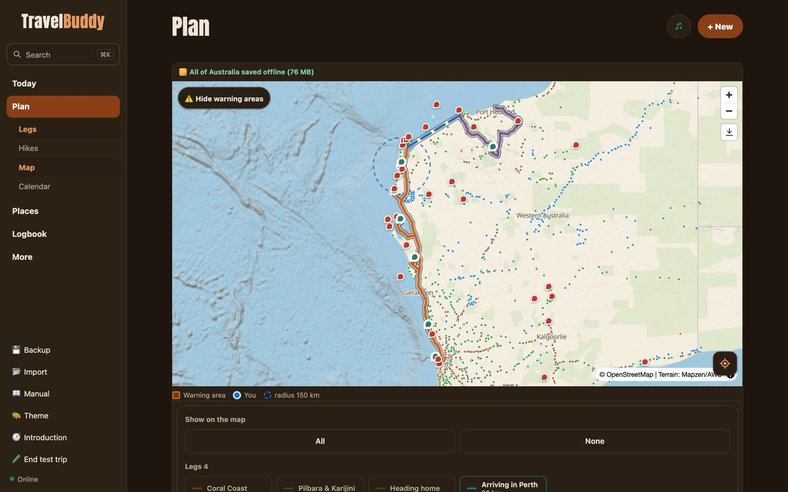
<br><sub>Route with stops on the Mac</sub>
</div>

---

## What it can do

### 🗺️ Plan
- **Stages and routes:** stages are periods with dates, routes are the drives within them. New stops go where they add the least detour, and you can drag to reorder.
- **What the app works out for every route:** distance and driving time, the longest stretch without fuel, long sections without water, sights up to 25 km off the road, weather along the way.
- **Driving days:** distance, driving time with breaks and the latest departure to arrive before sunset. Wildlife is out at dusk.
- **Trip map and 3D globe:** all stages and routes with numbered stops, flights as great circles. **"Play trip"** animates your whole journey.
- **Route ideas** for the south and north loops from Perth, **hikes** with status, the **calendar** as a print PDF and as a real Excel file, the **map as a print image** in the size you need.
- **Import** your travel calendar, and bookings fall into place by themselves.

### 📍 Places
- **144 hand-picked places** with photos, seasonal tips and labels like "must-see", "hidden gem" or "4WD only".
- **Sun and stars at every place:** sunrise and sunset, golden and blue hour, moon phase and how good the night is for star photos (more in [For photographers](#-for-photographers)).
- **Add your own places:** the app suggests matches from OpenStreetMap and fetches coordinates, photo and description from Wikipedia on its own.
- **Your notes and reports** stay with each place. "Plan in" puts a place into your stage.

### 📷 For photographers
TravelBuddy shows the light before you get there, at every one of the 144 places and every place you add.
- **Golden hour** in the morning and evening, to the minute.
- **Blue hour** in the morning and evening.
- **Sunrise, sunset and the sun's highest point** for midday shadows.
- **Plan the light for any day:** pick a date ("Sun times on" in the search), and every place shows the times for that day of your trip.
- **Star photography rating** for every place and night, from excellent to "moon too bright": calculated offline from the moon phase and astronomical darkness, refined online with the cloud cover.
- **Moon phase and brightness** in percent.
- **Weather at the spot:** high and low, wind and humidity (online).
- **Find the shots:** 144 places with photos and seasonal tips, labels like "hidden gem", and sights up to 25 km off your route.
- **In the logbook:** photos sort themselves by capture date and GPS, plus fields for sunset and night sky, the Southern Cross, and the dominant colour of the day. Camera and drone have their own cost categories.
- **Show your pictures:** animated photo collage, travel journal to print and a trip film in portrait format.

### 🚙 On the road
- **Offline map** for all of Australia, in detail the west coast, the east coast, Melbourne, Cairns and the Whitsundays.
- **Supplies:** fuel, water, toilets, camps, rest areas, shops, workshops and clinics along the route, with the route kilometre.
- **Hazards:** warnings from Western Australia, Victoria and Queensland in a radius you choose, plus **WA road conditions** with closures on your route.
- **Warnings along your route:** the app checks your position, the road ahead, every stage and every hike. Each warning shows the size of the area and the distance. You can open it in **Google Maps** or see it offline on your own map, with radius and your position. One button on the map shows or hides the warnings. A test mode lets you try all of this with made-up warnings.
- **Emergency,** fully offline: your GPS position ready to copy and read out, nearest help with distance and direction, emergency numbers, sharing your location and an **"I'm OK" log** you can export.
- **"Ready to go?"** checks before you drive into a dead zone what is really stored offline on this device.

### 📖 The logbook
One entry per day (or several, or one covering a few days), sorted by stage, with text, photos and a **voice memo**, or simply **dictate** it (online). Photos find their day, place and route kilometre on their own from the image data. And then it really starts: **16 modules with 72 fields**, fill in whatever fits.

| Module | What goes in |
|---|---|
| 📊 **Quick stats** | daily km, temperature and weather, the **fly factor**, signal, song of the day, mood, roadkill density, road trains counted |
| 💸 **Costs and transport** | 23 categories from fuel to drone, as many single items as you like, in AU$ or euro, feeding straight into your budget and the cost analysis |
| 👃 **Senses and atmosphere** | "the sound today was …", "I can still smell …", the dominant colour, how the heat and wind felt |
| 🦘 **Roadside and wildlife** | animals seen alive (with photo, they go to your wildlife album), a **roadkill counter** for 12 species, a counter for **roadside curiosities**: Big Things, odd mailboxes, shoe fences, rust buckets, statues, strange warning signs, and how remote it is to the next stop |
| 🚐 **Vanlife** | what the photos don't show, what was cooked on the gas stove (with a taste rating), why tonight's campsite was special |
| 🚿 **Grid, water and emergency** | done without a phone, where and how you showered, where you filled up drinking water |
| 🔧 **Breakdowns and outback grit** | what you fixed with tape, cable ties and WD-40, where the red dust ended up |
| 🌌 **Sky and night** | Southern Cross and Milky Way, the sounds of the night, the campfire |
| ⚠️ **Warning signs and hazards** | the strangest or scariest sign, hazards you faced, and the **official situation** from the authorities captured automatically for that day |
| 🍻 **Encounters and Aussie culture** | the Aussie word you learned, a nice or weird encounter, a tip from locals |
| 💭 **Reflection** | "thought X, turned out Y", the highlight away from the tourists, thought of the day, what you're grateful for |
| 👥 **People** | who you met, new people, the best moment with someone |
| 🕰️ **Memories then and now** | what changed since last time, what you remember from back then |
| ⭐ **Experiences** | highlight of the day, special occasion, activity |
| 🏝️ **Island, beach and nature** | what you saw in the water while snorkelling or diving, sunset and night sky |
| 🍽️ **Food and drink** | best meal or restaurant with a rating, drink of the day |

**What it turns into:**
- **Wildlife album:** 20 animals of Western Australia to collect, each sighting with date, place, note and photo.
- **Read mode** day by day, and **notes** with categories.
- **Travel journal** to print or as a PDF, with painted globes, photos and the **trip summary** (km, days, animals, costs and much more).
- **Animated photo collage** of all your photos, offline and without AI.
- **Trip film** in portrait format, recorded right in the app.
- **Travel report** as a single file for family and friends, deliberately without bookings, costs and exact coordinates.

### 📚 Your travel journal writes itself
- **Automatic travel journal:** from your logbook, TravelBuddy builds a finished travel magazine on its own: cover, photo grids, quote blocks, the summary for every day and painted globes for every stage. You don't have to lay out anything.
- **Two versions:** "short" with picture, text and key figures per day, or "detailed" with every module you filled in, your notes and the full trip summary.
- **Photo book ready:** print it or save it as a PDF, sorted oldest or newest first.
- **Your photo library built in:** pick many photos from your library at once. TravelBuddy reads the capture date and place, puts every photo on its day and stage, and shows you beforehand what will happen. Photos without a date go to a day you choose.
- **On the Mac with all your iCloud photos:** the picker shows your whole library under "Media". Journal photos are kept at 3,000 px, sharp enough for a printed photo book, and stay on your device without bloating the backup.

### 👨‍👩‍👧 Share with family and friends
- **Travel report as one file:** choose stages, whether the journal texts come along and which photos. Globes, photos and fonts are inside the file, so it opens anywhere, even offline, without an app and without an account.
- **Send it straight away** with the share sheet: Messages, WhatsApp, Mail or AirDrop.
- **Private by design:** bookings, booking numbers, documents, costs, emergency contacts and coordinates never get into the report, and codes, phone numbers and email addresses are removed from free texts.
- **Trip film** in portrait format, ready for the family chat or your story: a flight over the globe for every stage, the route drawing itself in, your best photos and the summary at the end.

### 🎵 Spotify: the soundtrack of your trip
TravelBuddy collects the music of the places you pass through, **automatically, while you drive**.
- **Every new place counts:** as soon as you are far enough from the last one (distance, waiting time, radius and tracks per place are up to you), the app looks for music from there.
- **Really local:** bands that come from the area (MusicBrainz), each with its **most-played song first** (Last.fm), plus Spotify playlists of the area and, with a Last.fm key, the country's charts.
- **Your taste first:** favourite genres come first, nothing ends up twice in the playlist.
- **Into your own playlist:** each track is matched exactly on Spotify and added to a playlist in your account, which the app creates for you. A counter on the music icon shows what's new.
- **No signal? No problem:** places are noted offline and caught up as soon as you're back online, or tap "Catch up now".
- **In control:** pick a place by hand, see all tracks by place, take single ones out again, or start over and remove them from the playlist. A log shows every step.
- **Secure:** Spotify login without a password in the app (PKCE), the token stays on your device, and the location history can be deleted at any time.
- Needs **Spotify Premium** and your own free app on developer.spotify.com. It runs while TravelBuddy is open.

### 🎟️ Organise
- **Booking from email:** paste the confirmation, and date, time, place, booking number and price are recognised and attached to the right stage.
- **Tickets and documents** open offline, protected by **Face ID, Touch ID or Windows Hello** if you like. They never leave the device.
- **Trip preparation** with a countdown and a ready-made checklist (weeks before, just before, departure day) plus your own points, **documents** with expiry dates and warnings.
- **Budget in euro and AU$** at the daily rate, pre-trip costs, an outback **packing list**.
- **Flights and trains:** add them under route, stage or pre-trip costs with number, booking, seat and document. Under More → Flights & trains you see status, new times, terminal, gate, check-in desk, platform, baggage belt and connections. It also shows up on the Today page and 24 hours before departure. Flights need your own free [AeroDataBox](https://aerodatabox.com) key from RapidAPI, German trains need none. Without internet you see the last status.
- **Costs:** under More → Costs everything from pre-trip costs and logbook comes together: short values, long values, transport, stays and experiences, per stage and per item. Long values stay out of the daily average. Every list adds up exactly to the total.
- **Backup and sync** between Mac and iPhone: importing merges and shows beforehand what will change. Nothing gets lost.
- **One search for everything:** places, days, animals, bookings, notes.

### ✨ Readable and fun
- **Text size and overall size,** four steps each, set separately. **Light and dark,** German and English, usability checked against WCAG 2.2 AA.
- **Australia quiz** with five levels and a **manual** as a PDF in the app.
- **Three hidden games** in the search field: tic-tac-toe, Snake and Connect Four against a computer that keeps getting stronger. The secret words are [further up](#-easter-eggs-three-hidden-games). 🦘

---

## Offline and online

| Without signal | With signal |
|---|---|
| All your data, plan, logbook, journal | Real road routes for new drives |
| Saved routes with km, driving time and all hints | Weather and weather along the route |
| Offline map, fuel, water, camps along the route | New warnings and road closures |
| Driving days, sun times, emergency, packing list, quiz | Daily exchange rate for expenses |
| Documents on the device, last known hazards | Music on the road |

---

## Download

| | |
|---|---|
| 🖥️ **Mac** | `TravelBuddy-Mac.zip` (small map) or `TravelBuddy-Mac-Grosse-Karte.zip` (every road) from [Releases](https://github.com/Kotdesigner/TravelBuddy/releases/latest): unzip, move to Applications, open. Apple Silicon and Intel, macOS 13 or newer. |
| 🪟 **Windows** | `TravelBuddy-Windows.zip` (small map) or `TravelBuddy-Windows-Grosse-Karte.zip` (every road) from [Releases](https://github.com/Kotdesigner/TravelBuddy/releases/latest): unzip, double-click `TravelBuddy.exe`. Windows 10 and 11 (64-bit). Opens in its own Microsoft Edge window. |
| 🐧 **Linux** | `TravelBuddy-Linux-x64.tar.gz` or `TravelBuddy-Linux-arm64.tar.gz`, each also as `…-Grosse-Karte.tar.gz` (every road), from [Releases](https://github.com/Kotdesigner/TravelBuddy/releases/latest): unpack, run `./TravelBuddy`. Opens in its own window with Chrome, Chromium, Edge or Brave, otherwise in your default browser. |
| 📱 **iPhone and any browser** | `TravelBuddy-Netlify.zip` (small map) or `TravelBuddy-Netlify-Grosse-Karte.zip` (every road) from [Releases](https://github.com/Kotdesigner/TravelBuddy/releases/latest): drag into Netlify's "Deploy manually" ([step by step](#-put-it-online-with-netlify-for-iphone)). Then open the address in Safari and choose "Add to Home Screen". |
| 🔁 **Straight from GitHub** | In Netlify, choose "Import an existing project" and pick this repo. The settings are in `netlify.toml`, and every push publishes the new version. |

**Small or large map?** Every download comes in two versions. The small one (≈ 100 MB) shows Western Australia up to zoom level 10 with the main roads. The large one (≈ 280 MB) goes up to zoom level 14 with every road, gravel road and track, street names and buildings. Your data stays when you switch from one Mac or Windows version to the other.

The Mac and Windows apps need no internet and no extra software. They are not signed by Apple or Microsoft, so the first launch shows a warning:
- **Mac:** System Settings → Privacy & Security → "Open Anyway".
- **Windows:** "Windows protected your PC" → "More info" → "Run anyway".

---

## 🌐 Put it online with Netlify (for iPhone)

iPhones only install web apps from an **HTTPS** address. A free Netlify site is the easiest way to get one. The folder **`dist`** is the complete, ready-built app, offline maps included (about 100 MB). There is nothing to configure: the rules for caching and the offline maps are already inside.

### Small or large map?

| | Download | Size | Offline map of Western Australia |
|---|---|---|---|
| 🗺️ **Small map** | `TravelBuddy-Netlify.zip` | ≈ 100 MB | up to zoom level 10: highways and main roads, towns. Enough for planning and the big picture. |
| 🛣️ **Large map** | `TravelBuddy-Netlify-Grosse-Karte.zip` | ≈ 280 MB | up to zoom level 14: **every road, gravel road and track**, street names and buildings. Best for the road itself. |

The large map is cut into four parts (Southwest & Perth, Central west coast, Pilbara & Coral Coast, Kimberley & Broome). The phone only loads a part once you zoom in there. Saving everything for offline takes about 270 MB on the phone instead of about 66 MB.

With the large package every person chooses for themselves: in the web app the large map stays **off** until they tap **🛣️ Turn on large map** on the map page. Only then does the phone download the part it is in, 33 to 76 MB each. Turning it off frees the storage again. In the Mac and Windows apps the parts are already on the disk, so it starts switched on.

### Option A: ready-made `dist` from Releases (nothing to install)

1. Download **`TravelBuddy-Netlify.zip`** or **`TravelBuddy-Netlify-Grosse-Karte.zip`** from [Releases](https://github.com/Kotdesigner/TravelBuddy/releases/latest). Each is the complete `dist` folder, zipped.
2. Sign up for free at **[app.netlify.com](https://app.netlify.com)** (email or GitHub account).
3. **Sites → Add new site → Deploy manually.**
4. Drag the ZIP file into the box. Netlify unpacks it itself. Wait until it says **Published** (a few minutes, longer for the large map).
5. **Site configuration → Change site name**, for example `travelbuddy-wa`. Your address is then **https://travelbuddy-wa.netlify.app**.

### Option B: build `dist` yourself

```
git clone https://github.com/Kotdesigner/TravelBuddy.git
cd TravelBuddy
npm ci
npm run build
node tests/basic-privat.test.mjs
```

The last command must report "0 gescheitert" (0 failed). For the **large map**, first install [pmtiles](https://github.com/protomaps/go-pmtiles/releases) (Mac: `brew install pmtiles`), then run `sh karten-gross/holen.sh` once (downloads the four parts, about 205 MB) and build with `npm run build:gross` instead of `npm run build`.

Then drag the **`dist` folder itself** into "Deploy manually", not the project folder: `index.html` has to sit at the top level.

### Option C: connect GitHub (updates itself)

1. Fork this repo on GitHub.
2. On Netlify: **Add new site → Import an existing project → GitHub** and pick your fork.
3. Leave all fields as they are. `netlify.toml` already sets the build command `npm ci && npm run build`, the publish folder `dist` and Node 22. Click **Deploy**.

From then on, every change to the app on `main` builds and publishes the new version. This way includes the large map: the parts are too big for the repo, so `scripts/netlify-bau.sh` fetches them from the release. On the first screen everyone chooses: small maps (76 MB) or large maps (281 MB).

### On the iPhone

1. Open your address in **Safari** (not in an in-app browser like WhatsApp or Instagram).
2. **Share → Add to Home Screen**, then always start TravelBuddy from the icon.
3. While online, open **Plan → Map** once and tap **"Save all of Australia"**. The offline maps are then on the phone.
4. Test it: switch on flight mode and open the app. It starts anyway.

### Publishing a new version

Always upload to the **same** site: **Deploys** → drag the new `dist` (or ZIP) in. Never create a new site for an update. Data lives in the browser under exactly one address, so a new address means an empty app. Phones pick up the new version the next time they are online.

### If something doesn't work

| Problem | Fix |
|---|---|
| "Page not found" right after uploading | You uploaded the project folder. Upload `dist` or the ZIP, so `index.html` is at the top level. |
| Maps stay empty | Open `https://<your-site>.netlify.app/karten/wa.pmtiles`. If it doesn't download, the `karten` folder is missing from the upload. |
| The iPhone keeps showing an old version | Open `https://<your-site>.netlify.app/reset.html` and press the button. Your data stays. |
| No "Add to Home Screen" | Open the address in Safari itself, not inside another app. |

More detail (in German): **[docs/VEROEFFENTLICHEN.md](docs/VEROEFFENTLICHEN.md)**.

---

## Run it without the ready-made apps

You don't have to use the downloads. TravelBuddy is a static web app and runs anywhere a browser does.

### What you need

| | Needed for | Where to get it |
|---|---|---|
| **Node.js 20 or newer** (22 LTS recommended), includes npm | building and running | [nodejs.org](https://nodejs.org) |
| **Git** (or "Code → Download ZIP" on this page) | getting the code | [git-scm.com](https://git-scm.com) |
| **A current browser:** Safari 16+, Chrome or Edge 110+, Firefox 115+ | using the app | already on your computer |
| *optional:* **Xcode** | building the Mac app yourself | Mac App Store |
| *optional:* **Go 1.22+** | building the Windows app yourself | [go.dev](https://go.dev) or `brew install go` |

### Start it on your computer

```
git clone https://github.com/Kotdesigner/TravelBuddy.git
cd TravelBuddy
npm ci
npm run build
npm run preview -- --host 127.0.0.1 --port 8990
```

Then open **http://127.0.0.1:8990** in your browser. The setup assistant starts on its own. `npm run dev` starts the development version with live reload instead.

Good to know:
- **Always use the same address.** Your data is stored in the browser under exactly this address (including the port). A different port is a different, empty app.
- **Don't open `dist/index.html` by double-clicking.** Without a server (`file://`), the browser blocks offline storage and the service worker.
- **Any other server needs range requests**, because the offline maps load in pieces. `npm run preview` and `npx serve dist` can do this; `python -m http.server` can't, and the maps stay empty with it.

### On the iPhone

iPhones only install web apps from an **HTTPS** address. Step by step: **[Put it online with Netlify](#-put-it-online-with-netlify-for-iphone)**.

### Build the apps yourself

```
sh mac/baue-mac-app.sh     # → mac/build/TravelBuddy.app and TravelBuddy-Mac.zip (needs Xcode)
sh win/baue-windows.sh     # → win/build/TravelBuddy.exe and TravelBuddy-Windows.zip (needs Go, works on Mac/Linux too)
```

For the large map, run `sh karten-gross/holen.sh` once, then put `KARTE=gross` in front: `KARTE=gross sh mac/baue-mac-app.sh` or `KARTE=gross sh win/baue-windows.sh`. The packages end up in `mac/build-gross/` and `win/build-gross/`.

The Windows build embeds the icon with `rsrc`: install it once with `go install github.com/akavel/rsrc@v0.10.2`.

### Tests

Each test runs on its own, for example `node tests/plan.test.mjs`. There are **over 1,400 automated checks** in 32 test files, including a rule against rounding errors: the parts always add up to exactly the total shown. `node tests/basic-privat.test.mjs` makes sure no personal data ends up in the code or the build.

---

## Privacy

- No account, no server, no ads, no tracking.
- All data stays in your device's storage. Sync Mac and iPhone with a backup file, for example via AirDrop. Importing merges, nothing gets deleted.
- Tickets, IDs and journal photos stay on the device and are not part of the backup.
- Live flight and train data are optional. Only then does the flight number with date go to AeroDataBox via RapidAPI, or the station name to DBF. Your key stays on this device and is not part of the backup.

---

## Tech

| Area | Used |
|---|---|
| App | [Svelte 5](https://svelte.dev) with runes, [Vite](https://vite.dev), installable web app (PWA) with [Workbox](https://developer.chrome.com/docs/workbox) |
| Desktop | Mac: Swift with WKWebView and a built-in server · Windows: Go with an embedded server, window in Microsoft Edge |
| Maps | [MapLibre GL](https://maplibre.org), offline tiles as [PMTiles](https://protomaps.com/docs/pmtiles) from [Protomaps](https://protomaps.com) and [OpenStreetMap](https://www.openstreetmap.org), globe from [Natural Earth](https://www.naturalearthdata.com) |
| Routes | [OSRM](https://project-osrm.org) for road routes, own offline analysis for fuel and water gaps, supplies and driving days |
| Live data | [Open-Meteo](https://open-meteo.com), DFES Emergency WA, VicEmergency, Queensland Fire Department, Main Roads WA, [frankfurter.app](https://frankfurter.app), [AeroDataBox](https://aerodatabox.com) via RapidAPI for flights, [DBF](https://dbf.finalrewind.org) for German trains |
| Places | Nominatim, Wikipedia and Wikimedia Commons |
| Sun and moon | [SunCalc](https://github.com/mourner/suncalc), offline |
| Security | WebAuthn with the PRF extension (Face ID, Touch ID, Windows Hello), AES-GCM, all in the browser |
| Music | Spotify Web API, MusicBrainz, Last.fm |

---

## Roadmap

- [x] **Version 1: Western Australia** with planning, logbook, offline map, supplies and hazards
- [x] Setup assistant on first launch, trip dates in the header, adjustable text and overall size
- [x] Source code here on GitHub, apps for Mac and Windows
- [x] **Version 1.1:** flights and trains live, cost analysis, entries over several days, warnings along the route with offline map, test trip to play with
- [x] **Version 1.2:** choose the small or large map right in the app
- [x] **Version 1.3:** change any place picture, sources for every photo
- [x] **Version 1.4:** Linux app, language choice on first launch, small picture buttons
- [x] **Version 1.5:** calendar with list, month and year views
- [x] **Version 1.6:** journal and collage as files, notes in the logbook, wildlife periods
- [x] **Version 1.7:** animated film with transport modes, design page, location on the map, urgent alerts
- [x] **Version 1.8:** photo conditions on the home screen, temperature on the edge, calendar as a PDF file, tidy panels
- [ ] On the App Store
- [ ] More regions of Australia in detail
- [ ] More countries

<br>

---
---

<a id="deutsch"></a>

<div align="center">

# 🇩🇪 TravelBuddy auf Deutsch

### Dein Roadtrip-Begleiter für die Strecken, auf denen das Netz aufhört.

Planen, fahren, festhalten. Auf iPhone, Mac, Windows und Linux, komplett offline, ohne Konto und ohne Cloud.<br>
**Eine App für die ganze Reise. Sie kann alles.**<br>
📔 **Nicht nur ein Roadtrip-Planer, sondern ein Tagebuch-Macher.** Während du reist, schreibt sich dein Reisetagebuch von selbst.

**Version 1.8 · entwickelt für Western Australia**<br>
<sub>Weitere Regionen und Länder folgen.</sub>

**[📱 Auf dem iPhone ausprobieren](https://travelbuddy-v1-wa.netlify.app)** · **[✨ Was ist neu](#-neu-in-version-18)**

**[⬇️ Mac-App](https://github.com/Kotdesigner/TravelBuddy/releases/latest)** · **[⬇️ Windows-App](https://github.com/Kotdesigner/TravelBuddy/releases/latest)** · **[⬇️ Linux-App](https://github.com/Kotdesigner/TravelBuddy/releases/latest)**

<br>

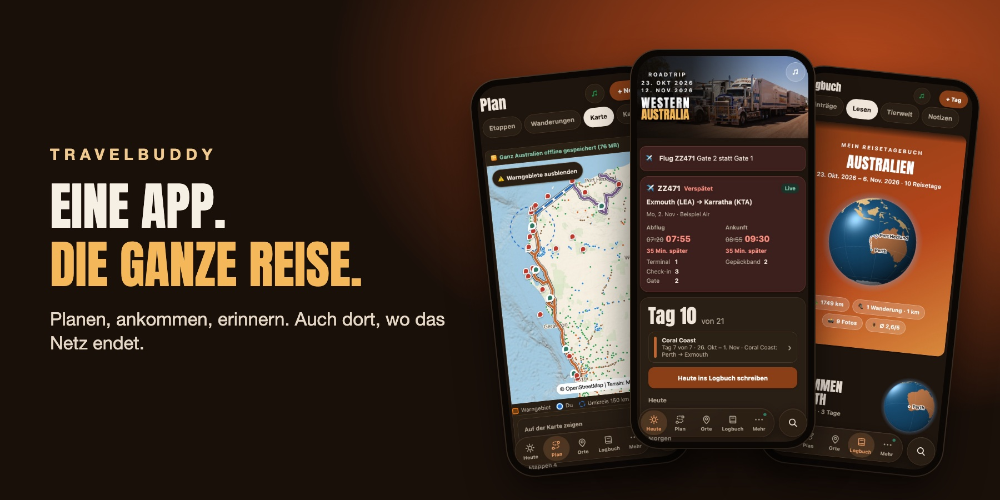

</div>

> Alle Bilder zeigen eine ausgedachte **Beispielreise**. Echte Reisedaten, Buchungen oder Dokumente sind darin nicht zu sehen. Die Ortsfotos auf den Bildschirmen sind in der App nachgewiesen.

## 📱 Gleich auf dem iPhone ausprobieren

<table>
<tr>
<td align="center"><a href="https://travelbuddy-v1-wa.netlify.app"></a></td>
<td>

1. Code scannen oder **[travelbuddy-v1-wa.netlify.app](https://travelbuddy-v1-wa.netlify.app)** in **Safari** öffnen.
2. Auf **Teilen** tippen, dann **Zum Home-Bildschirm**.
3. TravelBuddy vom Home-Bildschirm öffnen und **🧪 Erst mit einer Testreise spielen** tippen.

Kein Konto, kein App Store, und deine Daten bleiben auf deinem Handy. Am Computer funktioniert der Link sofort.

</td>
</tr>
</table>

<table>
<tr>
<td align="center">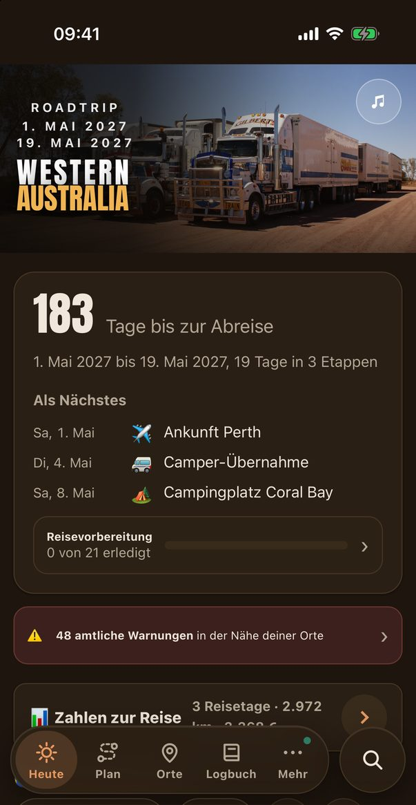<br><b>Heute</b></td>
<td align="center">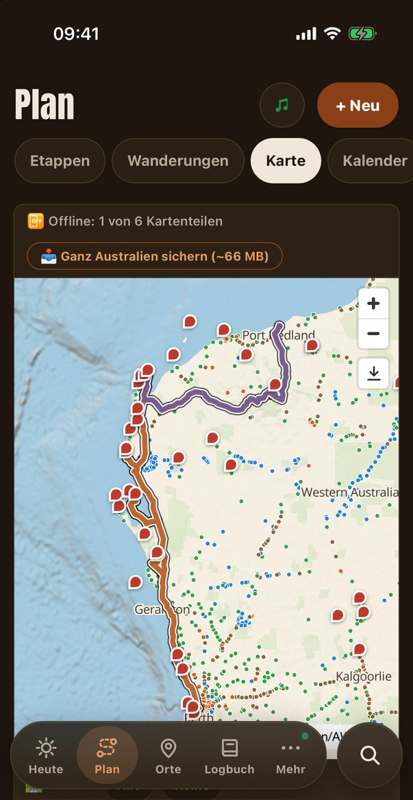<br><b>Offline-Karte</b></td>
<td align="center">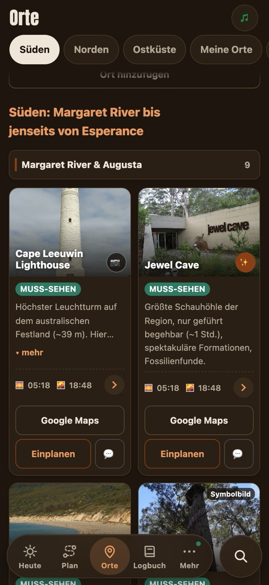<br><b>Orte</b></td>
</tr>
<tr>
<td align="center">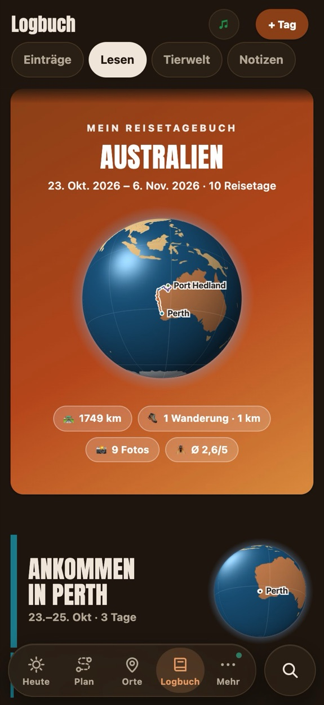<br><b>Dein Tagebuch</b></td>
<td align="center">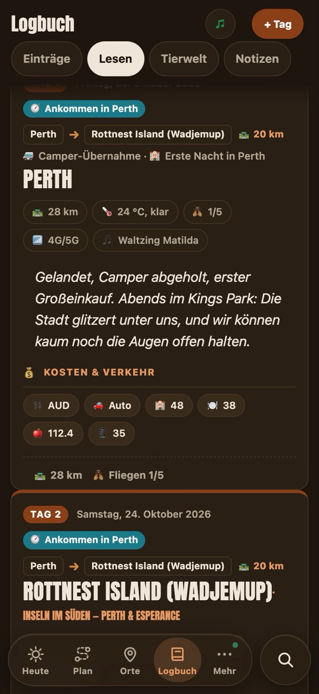<br><b>Jeder Tag erzählt</b></td>
<td align="center">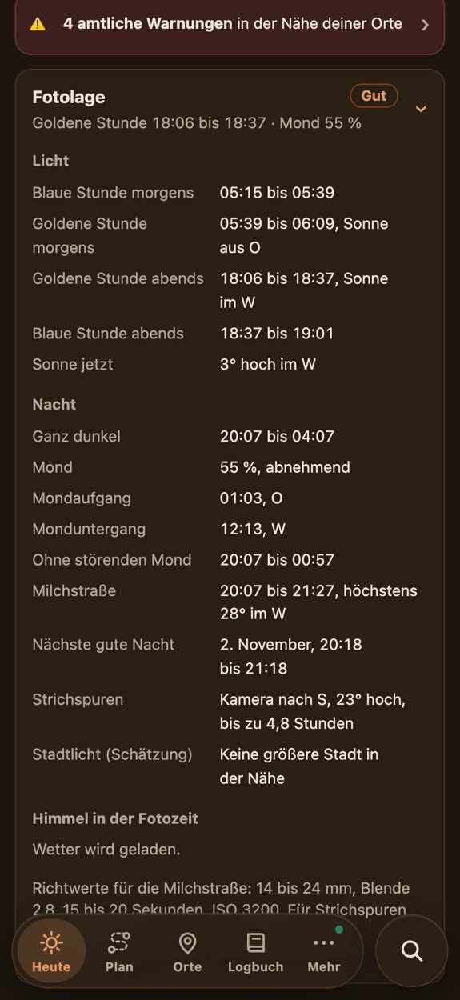<br><b>Fotolage</b></td>
</tr>
</table>

---

## 📸 Neu in Version 1.8

**Fotolage auf der Startseite.** Eine Zeile sagt sofort, ob sich die Kamera lohnt, mit bester Zeit, Wolken und Mond. Aufgeklappt stehen dort goldene und blaue Stunde, Mond, Milchstraße mit Zeit und Richtung, Strichspuren, Himmel und Tipps. Sonne, Mond und Sterne gehen auch offline.

**Ein Hauch Wärme.** Beim Öffnen leuchtet die Temperatur an deinem Standort kurz am rechten Rand auf. Je höher sie steht, desto wärmer ist es. Nur mit Netz und abschaltbar.

**Überall aufgeräumter.** Logbuch, Notizen, Wanderungen, Karte und Startseite haben klare Felder mit gleich großen Knöpfen. Routenlisten bleiben auch nach Monaten kurz: Aktuelles zuerst, der Rest eingeklappt, dazu eine Suche.

**Kalender als echtes PDF, ruhigerer Reisefilm.** Der Kalender erzeugt jetzt eine Datei statt eines Druckauftrags. Im Reisefilm zoomen lange Flüge früher heraus, und das Auto zeigt nicht mehr jede Straße.

## 🎬 Neu in Version 1.7

**Deine Reise als Film.** „Reise abspielen“ zoomt jetzt bis auf Straßenebene heran, erst langsam, dann schneller. Flieger, Auto, Zug oder Boot fahren los, die Entfernung wird eingeblendet, und die Kamera zoomt nur so weit heraus, wie die Strecke es braucht. Mit „Im Animationsfilm“ wählst du, was zu sehen ist, und lässt kleine Wege weg.

**Design an einer Stelle.** Mehr → Design bündelt Hell und Dunkel, Sprache, Schrift, Größe und alle Effekte, jeder mit eigenem Schalter: weiches Ausblenden, schrumpfender Kopf, Lichtrand bei Verbindungen, Wetter-Stimmung, Hitze-Logo und ein goldener Moment vor Sonnenuntergang.

**Ein Plan, der mitdenkt.** Dein Standort auf der Offline-Karte, dringende Änderungen bei Flug und Zug auf der Startseite und ein Umkreis für dich, deine Orte und Routen.

**Ein Logbuch näher am echten Tag.** Mehrere Ziele am Tag, nahe amtliche Warnungen zum einzelnen Auswählen, und das Tagebuch endet jetzt mit Daten, Ausgaben und den Kosten je Etappe.

## 📄 Neu in Version 1.6

**Dein Tagebuch als echte Datei.** TravelBuddy erstellt jetzt direkt auf dem Gerät ein PDF in höchster Qualität mit 300 dpi. Die Kollage gibt es auch als JPEG oder TIFF. Danach druckst, sicherst, teilst oder mailst du die Datei, und ein Zurück-Knopf führt immer in die App.

**Notizen gehören zur Reise.** Ordne eine Notiz einer Etappe zu, sieh ihren Zeitstempel und finde sie von selbst im Logbuch. Ein Tipp nimmt sie wieder heraus.

**Tierwelt für verpasste Tage.** Wähle für eine Sichtung einen beliebigen Tag oder einen ganzen Zeitraum. Der Logbuch-Reiter heißt jetzt Einträge.

## 📅 Neu in Version 1.5

**Der Kalender schaltet jetzt um wie am iPhone.** Wähle Liste, Monat oder Jahr. Das Jahr zeigt alle Etappen farbig auf einen Blick, ein Monat lässt sich antippen, und ein Tag öffnet seine Termine.

**Keine Verwirrung von Anfang an.** Die Einrichtung erklärt jetzt in einem bebilderten Schritt, worin sich Etappe, Kalender und Logbuch unterscheiden.

## 🖼️ Neu in Version 1.4

**Jedes Ortsbild kannst du jetzt selbst ändern.** Tippe auf das kleine **📷** in der Ecke jedes Ortsbilds. Wähle ein Foto vom Gerät, öffne eine fertige Bildersuche für diesen Ort oder füge einen Ausschnitt direkt aus der Zwischenablage ein. Dein Bild bleibt auf deinem Gerät. Am iPhone machst du von einem Bild, das es nur online gibt, einen Screenshot und wählst ihn aus deinen Fotos. Beim ersten Öffnen von Orte erklärt TravelBuddy das in einem kurzen Hinweis.

**Jetzt auch für Linux.** Eine einzige ausführbare Datei für x86-64 und ARM64: entpacken, `./TravelBuddy` starten, fertig.

**Deine Sprache von Anfang an.** Beim ersten Start fragt TravelBuddy, ob du Englisch oder Deutsch möchtest. Grundeinstellung ist Englisch.

**Jedes Foto hat jetzt seine Quelle.** Alle 144 Ortsfotos stehen mit Urheber, Lizenz und Link in der App. Wo es noch kein passendes freies Foto gibt, steht ein Symbolbild der Region, klar gekennzeichnet und mit einem Knopf für ein besseres Bild.

## 🛣️ Neu in Version 1.2

**Jede Person wählt ihre Karte selbst.** Gleich auf dem ersten Bildschirm fragt die App: kleines Kartenmaterial laden (76 MB) oder großes mit jeder Straße, jedem Straßennamen und jeder Schotterpiste in Western Australia (281 MB)? Das läuft im Hintergrund weiter, während du dich umsiehst. Wer später entscheidet, tippt auf der Kartenseite auf **🛣️ Große Karte einschalten**: Die App nennt vorher die Größe und lädt nur den Teil, in dem du unterwegs bist, 33 bis 76 MB. Ausschalten gibt den Speicher wieder frei. Auf einer Webseite braucht das das große Paket. In den Apps für Mac und Windows mit großer Karte ist sie von Anfang an an.

<table>
<tr>
<td align="center"><br><b>Kleine Karte</b><br>Hauptstraßen, reicht zum Planen</td>
<td align="center"><br><b>Große Karte</b><br>dieselbe Stelle, jede Straße und Piste</td>
</tr>
</table>

## ✨ Neu in Version 1.1

**TravelBuddy warnt dich jetzt, bevor du in eine Gefahr hineinfährst, behält deine Flüge und Züge im Blick und zeigt, was die Reise wirklich kostet.**

<table>
<tr>
<td align="center">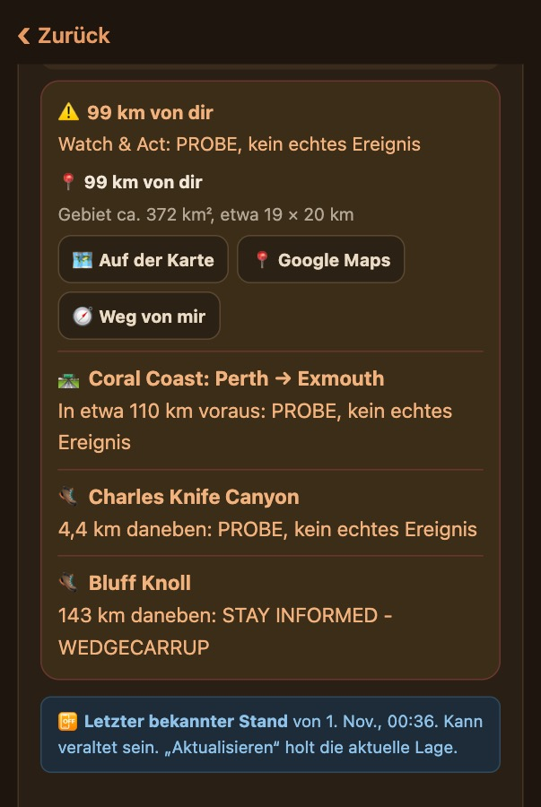<br><b>Rechtzeitig gewarnt</b><br>etwa 110 km voraus auf deiner Route</td>
<td align="center">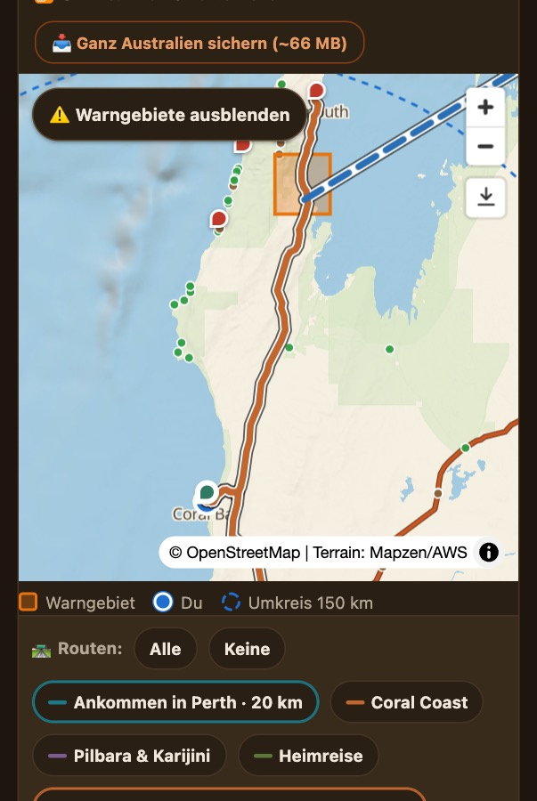<br><b>Auf der eigenen Karte</b><br>Gebiet, Umkreis und du, offline</td>
<td align="center">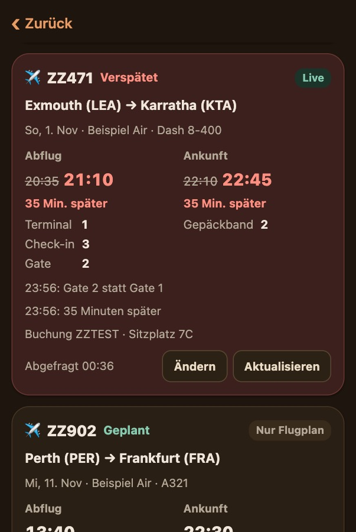<br><b>Flüge und Züge live</b><br>Verspätung, Gate, Gleis, Umstieg</td>
</tr>
<tr>
<td align="center">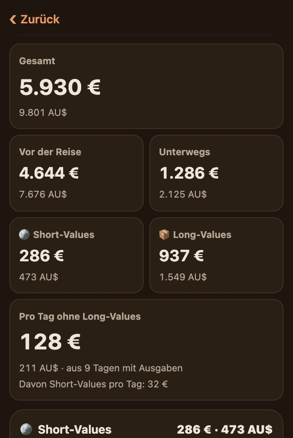<br><b>Was es wirklich kostet</b><br>Short- und Long-Values, je Etappe</td>
<td align="center">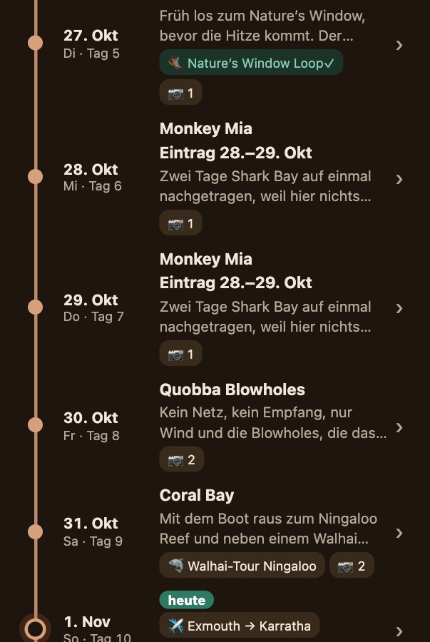<br><b>Mehrere Tage auf einmal</b><br>ein Eintrag, Kosten zählen einmal</td>
<td align="center">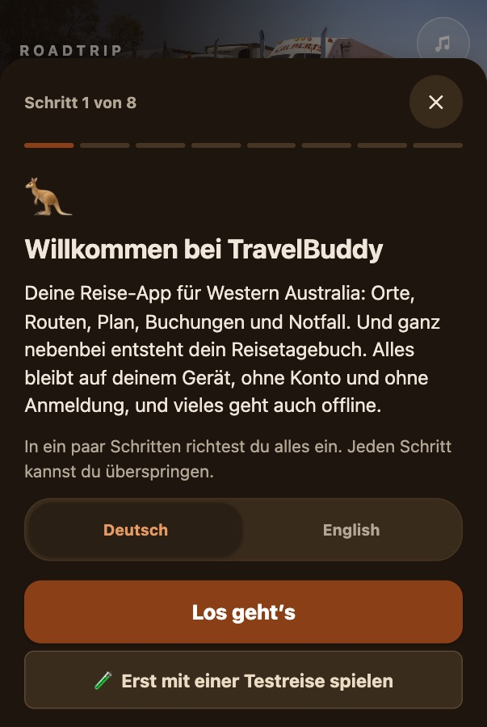<br><b>Testreise</b><br>ein Tipp und die App ist voll</td>
</tr>
</table>

### 🚨 Sie warnt dich, bevor du hineinfährst
TravelBuddy schaut nicht nur, wo du gerade bist. Die App prüft deine **ganze Route Stück für Stück**, dazu jede Etappe und jede Wanderung, und sagt dir: *in etwa 110 km voraus*. Auch ein schmales Feuergebiet 700 km weiter wird erkannt. Zu jeder Warnung siehst du, wie groß das Gebiet ist und wie weit weg, öffnest sie in **Google Maps** oder siehst sie **auf deiner eigenen Offline-Karte** mit Gebiet, Umkreis und Standort. Ein Knopf blendet alles ein und aus. Ohne Netz bleibt der letzte Stand sichtbar.

Fällt der Wetterdienst einmal aus, kommen die amtlichen Warnungen trotzdem durch. Und im **Testmodus** probierst du alles an einem beliebigen Ort mit erfundenen Warnungen aus, ohne etwas umzuprogrammieren, auch mitten in Australien.

### ✈️ Deine Flüge und Züge, live
Status, neue Zeiten, Terminal, Gate, Schalter, Gleis, Gepäckband und Umstiegszeit, auf einer eigenen Seite, auf **Heute** und als Hinweis 24 Stunden vor dem Abflug. Du trägst Flug oder Zug einmal ein, unter Route, Etappe oder Vorabausgaben, mit Nummer, Buchung, Sitzplatz und Ticket. **Jede neue Buchung wird von selbst abgefragt**: erst selten, dann öfter, je näher die Abfahrt rückt, damit der kostenlose Tarif reicht. Die App fragt ab, solange sie offen ist.

Für Flüge brauchst du einen eigenen kostenlosen [AeroDataBox](https://aerodatabox.com)-Schlüssel von RapidAPI, er bleibt auf deinem Gerät. Deutsche Züge brauchen keinen.

### 💰 Was die Reise wirklich kostet
Jede Ausgabe in einer eigenen Zeile, in 23 Kategorien, in Euro und AU$ zum Tageskurs. Sortiert nach **Short-Values** (was verbraucht ist), **Long-Values** (was bleibt), Verkehr, Unterkunft und Erlebnissen, je Etappe und bis zum einzelnen Posten. Eine neue Kamera verdirbt dir nicht den Tagesschnitt, denn Long-Values zählen dort nicht mit. Und **jede Liste ergibt genau die angezeigte Summe**.

### 🗒️ Nicht jeden Tag geschrieben? Kein Problem.
Ein Eintrag für mehrere Tage, an der Etappe oder im Logbuch. Er steht an jedem seiner Tage, seine Kosten zählen einmal.

### 🧪 Erst spielen, dann planen
Ein Tipp füllt die App mit einer ausgedachten 21-Tage-Reise, die **immer gerade läuft**, weil jedes Datum vom heutigen Tag aus zählt. Sie veraltet nie. Deine eigenen Daten kommen zur Seite und sind danach genau wie vorher wieder da. [Mehr dazu weiter unten](#in-einer-minute-startklar).

## Warum TravelBuddy

Zwischen Perth und Broome liegen 2.200 Kilometer. Dazwischen: Roadhouses, die teils 300 km auseinanderliegen, Kängurus in der Dämmerung, Buschfeuer, gesperrte Pisten und stundenlang kein Empfang. Genau dafür ist TravelBuddy gebaut.

| | |
|---|---|
| 📡 **Offline zuerst** | Karten, Orte, Routen, Belege und Notfallhilfe funktionieren ohne Netz. Einmal geplant, ist alles dabei. |
| ⛽ **Rechnet mit, wo es knapp wird** | Die längste Strecke ohne Tankstelle, lange Abschnitte ohne Wasser, die späteste Abfahrt vor Sonnenuntergang. |
| 🔥 **Warnt rechtzeitig** | Amtliche Warnungen zu Feuer, Flut und Unwetter entlang deiner ganzen Route, bevor du dort bist, dazu Straßensperrungen. |
| ✈️ **Behält Flüge und Züge im Blick** | Verspätung, Gate, Gleis und Umstieg, live und von selbst. |
| 💰 **Weiß, was es kostet** | Jede Ausgabe, sortiert nach Short- und Long-Values, je Etappe und je Posten. |
| 📍 **144 handverlesene Orte** | Mit Bildern, Saison-Tipps, Sonnenzeiten und Markierungen wie „Muss-Sehen“, „Geheimtipp“ oder „Nur 4WD“. |
| 📷 **Denkt wie ein Fotograf** | Goldene und blaue Stunde, Auf- und Untergang und eine Bewertung für Sternenfotos an jedem Ort und für jeden Reisetag. |
| 🎵 **Spielt, wo du bist** | Sammelt die Musik jedes Ortes, durch den du kommst, in deine eigene Spotify-Playlist: lokale Bands, ihr meistgehörter Song zuerst. |
| 📔 **Schreibt dein Reisetagebuch** | Logbuch mit 16 Modulen, vom Fliegen-Faktor bis zum Roadkill-Zähler, daraus entstehen Reisetagebuch, Reise-Film und Reisebericht. |
| 🔒 **Gehört dir** | Kein Konto, kein Server, kein Tracking. Alle Daten bleiben auf deinem Gerät. |

## 📔 Nicht nur ein Planer. Ein Tagebuch-Macher.

<div align="center"></div>

Die meisten Reise-Apps hören auf, wenn die Reise beginnt. TravelBuddy legt dann erst richtig los.

Jeden Abend ein paar Zeilen, deine Fotos, die Kilometer und die Tiere, die du gesehen hast. Mehr nicht. Daraus baut TravelBuddy dein **fertiges Reisetagebuch**: Deckblatt, Foto-Raster, Zitate, die Bilanz jedes Tages, gemalte Weltkugeln für jede Etappe und am Ende die große Reise-Bilanz. Fertig zum Drucken als Fotobuch, als PDF, als eine Datei für die Familie oder als Reise-Film für den Gruppenchat.

> **Du reist. TravelBuddy schreibt mit.** Am Ende hältst du keine Liste von Buchungen in der Hand, sondern die Geschichte deiner Reise.

<div align="center">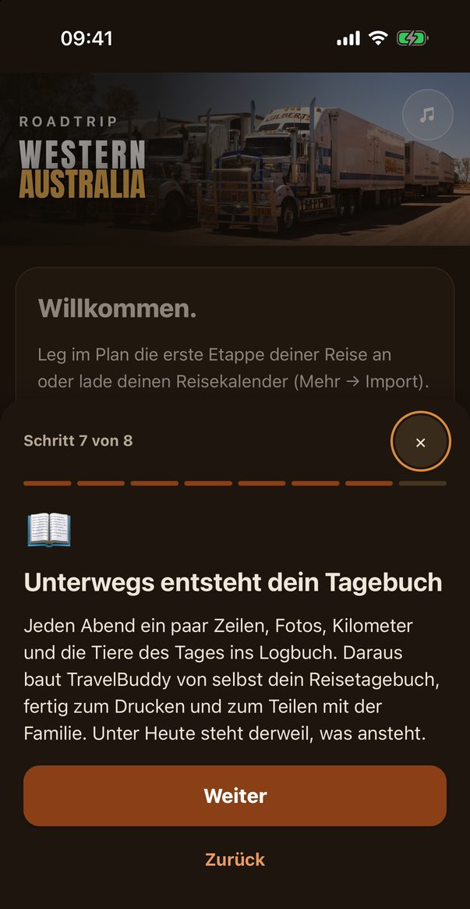</div>

## 🚀 Alles, was TravelBuddy kann

<div align="center">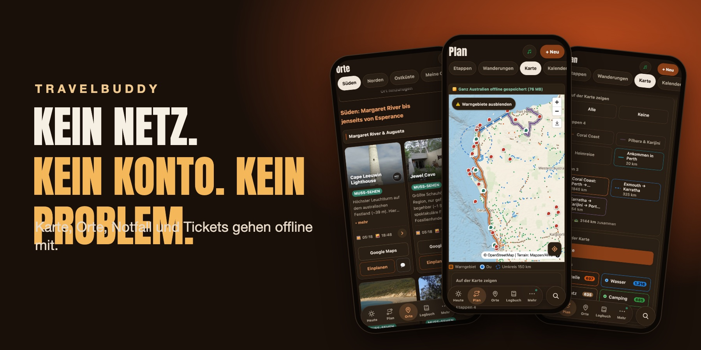</div>

**Eine App für die ganze Reise, von der ersten Idee bis zur letzten Erinnerung. Sie kann wirklich alles.**

Sortiert nach Nutzen unterwegs: Sicherheit und Planung zuerst, Fotohelfer und Optik weiter unten.

- 🗺️ **Offline-Karte** für ganz Australien, im Detail dort, wo du unterwegs bist
- ⛺ **Versorgung an der Route:** Tankstellen, Wasser, Toiletten, Camps, Rastplätze, Läden, Werkstätten, Kliniken
- 🔥 **Amtliche Warnungen** zu Feuer, Flut und Unwetter in WA, VIC und QLD
- 🚨 **Warnungen entlang der Route:** am Standort, auf der Strecke voraus, auf jeder Etappe und Wanderung, auch wenn die Strecke mehrere Gefahrengebiete kreuzt
- 🆘 **Notfall-Modus** komplett offline: Standort, nächste Hilfe, Notrufnummern
- 🚧 **Straßenlage WA** mit Sperrungen direkt auf deiner Route
- ⛽ **Längste Strecke ohne Tankstelle** für jede Route
- 💧 **Lange Abschnitte ohne Wasser**, vorher markiert
- 📶 **Check „Bereit für unterwegs?“** vor der Fahrt ins Funkloch
- 🛫 **Flüge und Züge live:** Status, neue Zeiten, Terminal, Gate, Schalter, Gleis, Gepäckband und Umstieg
- 🔔 **Dringende Änderungen auf der Startseite:** Ausfälle, Verspätungen und Gate- oder Gleiswechsel vor Flug und Zug
- 🛣️ **Echte Straßenrouten** mit Kilometern und Fahrzeit
- 🕒 **Fahrtage** mit Pausen und der spätesten Abfahrt vor Sonnenuntergang
- 🌦️ **Wetter an der Strecke**, nicht nur am Ziel
- 🗺️ **Etappen und Routen** mit Datum, Stopps und Reihenfolge zum Ziehen
- 📐 **Kluge Stopp-Platzierung** dort, wo ein neuer Stopp den kleinsten Umweg macht
- 👀 **Sehenswertes bis 25 km neben der Strecke** als Vorschlag
- 📍 **144 handverlesene Orte** mit Bildern, Saison und Insider-Markierungen
- ➕ **Eigene Orte anlegen** mit Bild und Beschreibung aus Wikipedia
- 🧩 **Routen-Ideen** für die Süd- und Nord-Schleife ab Perth
- 🥾 **Wanderungen** mit Stand, Datum und Fotos
- 🧭 **Einrichtungsassistent**, der deine Reise in einer Minute mit dir anlegt
- 🔎 **Eine Suche für alles:** Orte, Tage, Tiere, Buchungen, Notizen
- 🚫 **Kein Konto, keine Cloud, keine Werbung, kein Tracking**
- 📖 **Logbuch** mit 16 Modulen und 72 Feldern je Tag
- 📚 **Automatisches Reisetagebuch:** Aus dem Logbuch wird von selbst ein fertiges Reisemagazin
- 📸 **Fotos sortieren sich selbst** nach Datum, Ort und Streckenkilometer
- 🎙️ **Sprachnotizen und Diktat** direkt in den Tag
- ⛳ **Mehrere Ziele am Tag** im Logbuch, im Tagebuch als Strecke
- 🗒️ **Notizen je Etappe mit Zeitstempel**, von selbst im Logbuch und wieder herausnehmbar
- 🗒️ **Einträge über mehrere Tage** an Etappe und Logbuch, wenn du nicht jeden Tag schreibst
- ⚠️ **Nahe Ereignisse unterwegs:** amtliche Warnungen nah an deinem echten Standort, einzeln fürs Tagebuch auswählbar
- 🏛️ **Amtliche Lage des Tages**, automatisch im Logbuch gespeichert
- 🖨️ **Fertig fürs Fotobuch** zum Drucken oder als PDF, kurz oder ausführlich
- 📄 **Tagebuch als PDF mit 300 dpi, Kollage als PDF, JPEG oder TIFF**, danach drucken, sichern, teilen oder mailen
- 🖼️ **Fotomediathek eingebunden:** Hunderte Fotos wählen, jedes landet von selbst an seinem Tag
- ☁️ **Alle iCloud-Fotos** am Mac, in Fotobuch-Qualität
- 👨‍👩‍👧 **Mit der Familie teilen:** der Reisebericht als eine Datei über Nachrichten, WhatsApp, Mail oder AirDrop
- 💌 **Öffnet sich überall:** ohne App, ohne Konto, auch offline, ohne Buchungen und genaue Koordinaten
- 📥 **Reisekalender-Import**, der Buchungen selbst einsortiert
- 📨 **Buchung aus Mail:** einfügen, alles wird erkannt
- 🎫 **Tickets und Dokumente offline** auf dem Gerät
- 🔐 **Face ID, Touch ID oder Windows Hello** schützen deine Dokumente
- ✈️ **Reisevorbereitung** mit Countdown und Checkliste
- 🪪 **Warnung vor Ablaufdaten** für Pass, Visum und mehr
- 💶 **Budget in Euro und AU$** zum Tageskurs
- 🧾 **Kosten je Tag** in 23 Kategorien, beliebig viele einzelne Posten
- 💰 **Kostenauswertung** nach Short-Values, Long-Values, Verkehr, Unterkunft und Erlebnissen, je Etappe und bis zum einzelnen Posten
- 💶 **Daten und Ausgaben am Ende des Tagebuchs**, dazu die Kosten je Etappe
- 🎒 **Packliste fürs Outback**
- 📅 **Kalender-Ansichten wie am iPhone:** Liste, Monat und Jahr umschalten, für den schnellen Überblick über die ganze Reise
- 🗓️ **Kalender als PDF-Datei und als echte Excel-Datei**, zum Sichern, Teilen oder Mailen
- 📍 **Dein Standort auf der Offline-Karte** mit Knopf, der zu dir springt, auch ohne Netz
- 🌍 **Reise-Karte und 3D-Weltkugel** mit allen Etappen, Routen und Flügen
- 🖨️ **Karte als Druckbild** in jeder Größe
- 🔄 **Backup und Abgleich** zwischen Mac und iPhone, sicher zusammengeführt
- 🖥️ **Mac-App**, 🪟 **Windows-App**, 🐧 **Linux-App** und 📱 **Web-App fürs iPhone**
- 🎵 **Spotify-Soundtrack:** Musik von jedem Ort landet automatisch in deiner Playlist
- 🎸 **Lokale Bands zuerst**, jeweils mit ihrem meistgehörten Song
- 📴 **Musik auch offline:** Orte werden vorgemerkt und später nachgeholt
- 🛣️ **Kleine oder große Karte, du entscheidest:** jede Straße und Piste in Western Australia auf Knopfdruck
- 📡 **Genaue Lage jeder Warnung:** Größe des Gebiets, Entfernung, Google Maps und offline auf der eigenen Karte mit Umkreis und deinem Standort
- 🏷️ **Warn-Labels auf den Ortsbildern:** Sturm, Starkregen, Überflutung, Gewitter, extreme Hitze oder Feuer stehen direkt auf dem Thumbnail des Orts, bei Warnungen in der Nähe mit Entfernung
- ✅ **„Ich bin OK“-Protokoll** zum Exportieren und Teilen
- 📸 **Fotolage auf der Startseite:** eine Zeile zeigt, ob es sich hier und jetzt lohnt, mit Bewertung, bester Zeit, Wolken und Mond
- 🌅 **Goldene und blaue Stunde** morgens und abends, mit Sonnenrichtung
- 🌌 **Milchstraßen-Planer:** Zeitfenster, Höhe, Richtung und die nächste gute Nacht
- 🌙 **Mond auf einen Blick:** Phase, Helligkeit, Auf- und Untergang mit Richtung und die Zeit ohne Mondlicht
- ✨ **Strichspuren:** wohin die Kamera zeigen soll und wie lange du belichten kannst
- ☁️ **Himmel für Fotografen:** Wolken nach Schichten, Sicht, Wind, Regenrisiko und Taugefahr
- 🏙️ **Stadtlicht als Schätzung** und Sternschnuppen rund um ihren Höhepunkt
- 📷 **Gemacht für Fotografen:** goldene Stunde, blaue Stunde und Nachthimmel an jedem Ort, für jeden Tag planbar
- 🌅 **Sonnenzeiten** mit Auf- und Untergang und dem Höchststand der Sonne
- 🌌 **Sternen-Check** mit Mondphase und astronomischer Dunkelheit
- 🖼️ **Jedes Bild änderbar:** eigenes Foto, Bildersuche oder eingefügter Ausschnitt
- 📝 **Notizen und Berichte** zu jedem Ort
- 🎬 **Animationsfilm deiner Reise:** Flieger, Auto, Zug oder Boot mit Entfernung, Zoom im Verhältnis zur Strecke und ein Schalter je Route für das, was zu sehen ist
- 🎬 **Reise-Film** im Hochformat, in der App aufgenommen
- 🎞️ **Animierte Foto-Kollage**, offline und ohne KI
- ⛵ **Schippern als Verkehrsmittel:** gerade Linie über das Wasser, kein Sprit, im Film ein eigenes Boot
- 🗂️ **Routenauswahl, die mitwächst:** Aktuelles zuerst, eingeklappte Listen und Suche, auf Karte und Startseite
- 🧭 **Aufgeräumte Felder** mit gleich großen Knöpfen in Logbuch, Notizen, Wanderungen und Karte
- 🦘 **Tier-Album** mit 20 Tieren zum Sammeln
- 🪰 **Fliegen-Faktor, Roadkill-Zähler und Road-Trains** fürs echte Outback-Gefühl
- 🛸 **Zähler für Kuriositäten am Straßenrand:** Big Things, Schuh-Zäune, skurrile Briefkästen
- 👃 **Sinne, Menschen, Essen, Lagerfeuer und Nachthimmel**, jeden Tag festgehalten
- 🧠 **Australien-Quiz** mit fünf Stufen
- 📘 **Handbuch** als PDF in der App
- 🧪 **Testreise zum Spielen:** ein Tipp füllt die App mit einer ausgedachten 21-Tage-Reise, noch ein Tipp und sie ist wieder weg
- 📅 **Reisezeitraum im Titelbild**, direkt aus Reisebeginn und Reisedauer
- 🔠 **Schriftgröße und Gesamtgröße** in vier Stufen einstellbar
- 🇩🇪🇬🇧 **Deutsch und Englisch**
- ♿ **Barrierearm**, geprüft nach WCAG 2.2 AA
- 🌓 **Hell und dunkel**
- 🎨 **Design-Seite** mit Hell und Dunkel, Sprache, Schrift, Größe und einem Schalter für jeden Effekt
- 🌡️ **Temperatur am Rand:** kurzes, leises Aufleuchten beim Öffnen, je höher, desto wärmer, nur mit Netz
- 🌐 **Lichtrand bei Verbindungen** für GPS, Wetter, Warnungen oder Spotify
- 🌦️ **Wetter-Stimmung:** Die Farben passen sich leicht an Wetter und Tageszeit an deinem Ort an
- 📌 **Feste Kopfbereiche** mit Untermenü, darunter blendet der Text weich aus
- 🎮 **Drei versteckte Spiele** im Suchfeld (siehe unten)

### 🎮 Easter Eggs: drei versteckte Spiele

Tipp ein geheimes Wort ins Suchfeld, und ein Spiel geht auf:

<details>
<summary><b>Geheime Wörter zeigen</b> (Spoiler)</summary>

<br>

| Eingeben | Spiel |
|---|---|
| `xoxo` | **Tic-Tac-Toe** gegen den Computer |
| `sn4ke` | **Snake** mit eigenem Rekord |
| `4444` | **Vier gewinnt** gegen einen Computer, der stärker wird, je öfter du gewinnst: 7 Stufen vom Anfänger bis zum Großmeister und 5 Spielweisen von angriffslustig bis hinterlistig |

</details>

## In einer Minute startklar

**Erst mal nur umsehen?** Wähle auf dem ersten Bildschirm **🧪 Erst mit einer Testreise spielen** oder später unter Mehr → Testreise. Die App füllt sich mit einer ausgedachten 21-Tage-Reise durch Western Australia, die immer gerade läuft: Neun Tage stehen schon im Logbuch, mit Fotos, Tieren und aufgeschlüsselten Kosten, heute ist Tag 10, der nächste Flug geht in 20 Stunden und ist verspätet, auf der Route liegt eine Probe-Warnung. Flug- und Warndaten darin sind erfunden, abgefragt wird nichts, und du kannst alles ändern. **Testreise beenden** räumt alles wieder ab, und deine eigenen Daten, die solange zur Seite gelegt waren, sind genau wie vorher wieder da.

Beim ersten Öffnen führt dich ein Einrichtungsassistent in acht kurzen Schritten durch alles, und du legst dabei gleich deine Reise an: Reisebeginn und Reisedauer (stehen sofort oben im Titelbild), die erste Etappe, eine Buchung aus der Bestätigungsmail, Tickets und Dokumente aufs Gerät. Jeder Schritt lässt sich überspringen.

<table>
<tr>
<td align="center">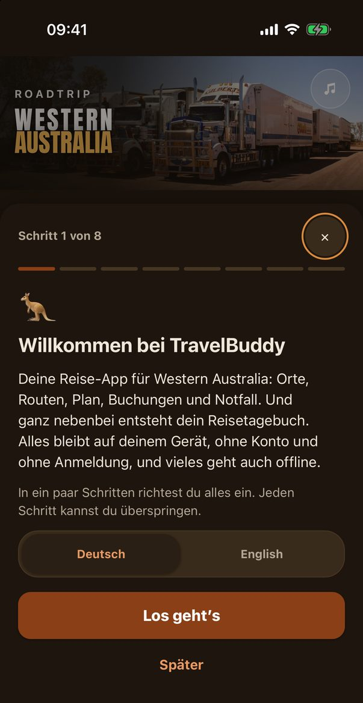<br><b>Willkommen</b><br>Deutsch oder Englisch</td>
<td align="center"><br><b>Wann und wie lange</b><br>steht sofort im Titelbild</td>
<td align="center"><br><b>Erste Etappe</b><br>direkt im echten Formular</td>
</tr>
<tr>
<td align="center">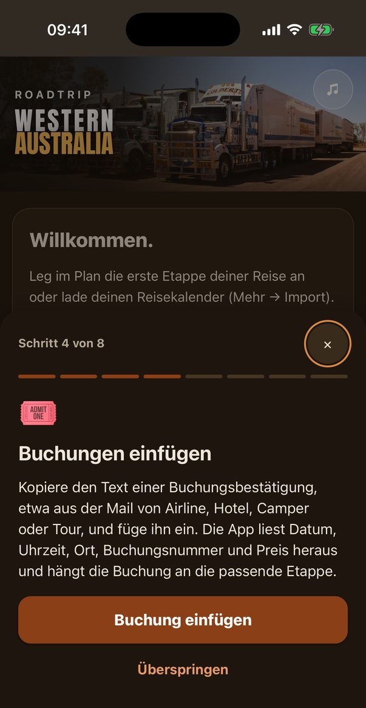<br><b>Buchungen</b><br>Mailtext einfügen, fertig</td>
<td align="center"><br><b>Tickets und Dokumente</b><br>offline, auf Wunsch mit Face ID</td>
<td align="center">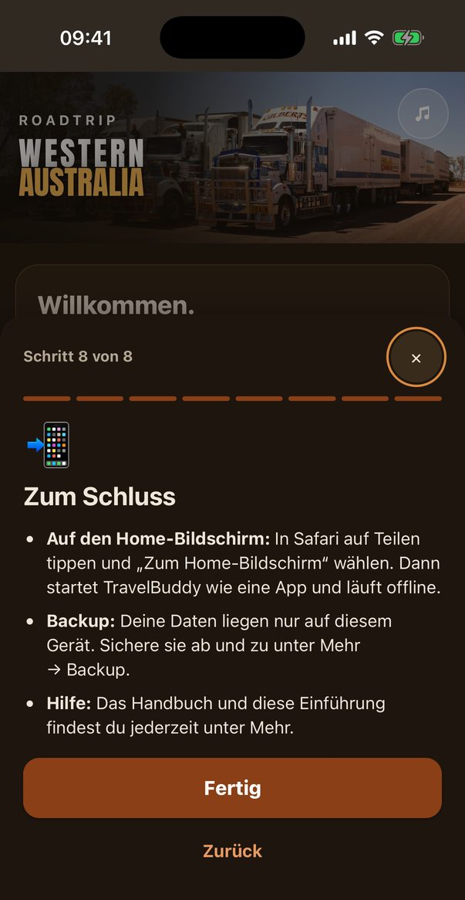<br><b>Abschluss</b><br>Home-Bildschirm und Sicherung</td>
</tr>
</table>

---

## Auf dem iPhone

<table>
<tr>
<td align="center"><br><b>Heute</b><br>Reisedaten, Countdown, als Nächstes</td>
<td align="center"><br><b>Plan</b><br>Etappen, Routen, Buchungen je Etappe</td>
<td align="center">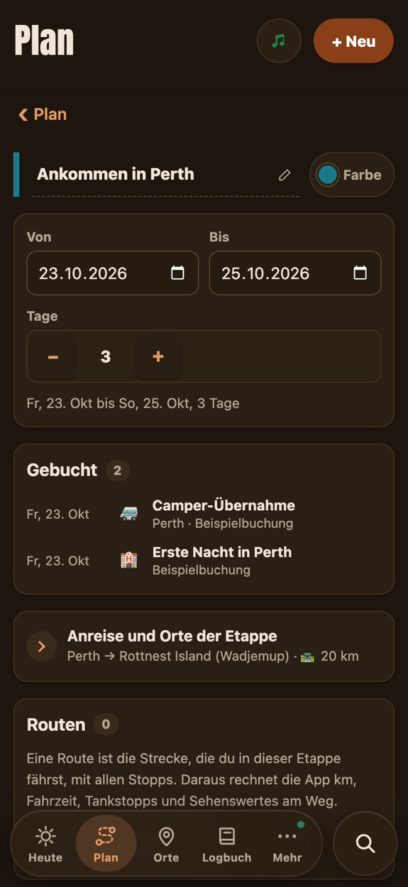<br><b>Route</b><br>Stopps, km je Abschnitt, Auto oder Flug</td>
</tr>
<tr>
<td align="center"><br><b>Orte</b><br>144 Orte mit Bild und Saison</td>
<td align="center"><br><b>Offline-Karte</b><br>Tanken, Wasser, Camps, Rastplätze</td>
<td align="center">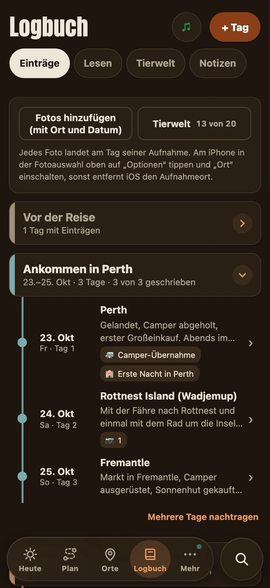<br><b>Logbuch</b><br>jeder Reisetag an seiner Etappe</td>
</tr>
</table>

<div align="center">
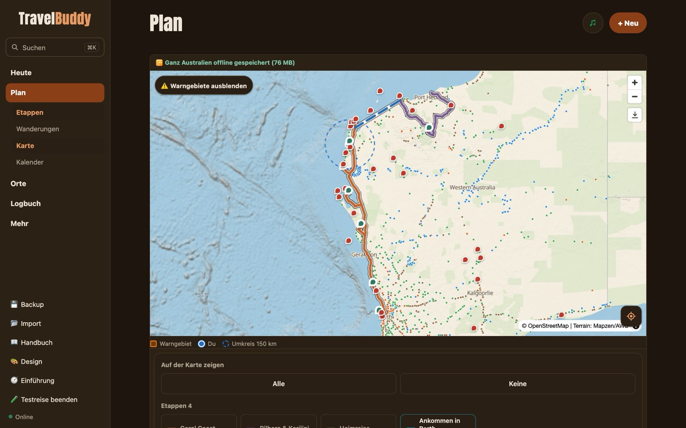
<br><sub>Route mit Stopps auf dem Mac</sub>
</div>

---

## Was die App kann

### 🗺️ Planen
- **Etappen und Routen:** Etappen sind Zeitabschnitte mit Datum, Routen die Strecken darin. Neue Stopps landen dort, wo sie den kleinsten Umweg machen, die Reihenfolge lässt sich ziehen.
- **Was die App an jeder Route rechnet:** Kilometer und Fahrzeit, die längste Strecke ohne Tankstelle, lange Strecken ohne Wasser, Sehenswertes bis 25 km neben der Strecke, Wetter an der Strecke.
- **Fahrtage:** Strecke, Fahrzeit mit Pausen und die späteste Abfahrt, um vor Sonnenuntergang anzukommen. In der Dämmerung ist viel Wild unterwegs.
- **Reise-Karte und 3D-Weltkugel:** alle Etappen und Routen mit nummerierten Stopps, Flüge als Großkreise. **„Reise abspielen“** lässt die ganze Reise ablaufen.
- **Routen-Ideen** für die Süd- und Nord-Schleife ab Perth, **Wanderungen** mit Stand, der **Kalender** als Druck-PDF und als echte Excel-Datei, die **Karte als Druckbild** in der gewünschten Größe.
- **Reisekalender importieren**, und die Buchungen sortieren sich von selbst ein.

### 📍 Orte
- **144 handverlesene Orte** mit Bildern, Saison-Tipps und Markierungen wie „Muss-Sehen“, „Geheimtipp“ oder „Nur 4WD“.
- **Sonne und Sterne an jedem Ort:** Auf- und Untergang, goldene und blaue Stunde, Mondphase und wie gut die Nacht für Sternenfotos ist (mehr unter [Für Fotografen](#-für-fotografen)).
- **Eigene Orte anlegen:** Die App schlägt passende Treffer aus OpenStreetMap vor und holt Koordinaten, Bild und Beschreibung selbst aus Wikipedia.
- **Eigene Notizen und Berichte** bleiben am Ort. „Einplanen“ legt einen Ort in deine Etappe.

### 📷 Für Fotografen
TravelBuddy zeigt das Licht, bevor du dort bist, an jedem der 144 Orte und an jedem Ort, den du selbst anlegst.
- **Goldene Stunde** morgens und abends, auf die Minute.
- **Blaue Stunde** morgens und abends.
- **Sonnenaufgang, Sonnenuntergang und Höchststand** für die Schatten am Mittag.
- **Licht für jeden Tag planen:** Datum wählen („Sonnenzeiten am“ in der Suche), und jeder Ort zeigt die Zeiten für diesen Reisetag.
- **Bewertung für Sternenfotos** an jedem Ort und in jeder Nacht, von exzellent bis „Mond zu hell“: offline berechnet aus Mondphase und astronomischer Dunkelheit, online verfeinert mit der Bewölkung.
- **Mondphase und Helligkeit** in Prozent.
- **Wetter am Ort:** Höchst- und Tiefstwert, Wind und Luftfeuchte (online).
- **Motive finden:** 144 Orte mit Bildern und Saison-Tipps, Markierungen wie „Geheimtipp“ und Sehenswertes bis 25 km neben deiner Route.
- **Im Logbuch:** Fotos sortieren sich nach Aufnahmedatum und GPS ein, dazu Felder für Sonnenuntergang und Nachthimmel, das Kreuz des Südens und die dominierende Farbe des Tages. Kamera und Drohne haben eigene Kostenkategorien.
- **Bilder zeigen:** animierte Foto-Kollage, Reisetagebuch zum Drucken und Reise-Film im Hochformat.

### 🚙 Unterwegs
- **Offline-Karte** für ganz Australien, im Detail Westküste, Ostküste, Melbourne, Cairns und Whitsundays.
- **Versorgung:** Tankstellen, Wasserstellen, Toiletten, Camps, Rastplätze, Läden, Werkstätten und Kliniken entlang der Route mit Streckenkilometer.
- **Gefahrenlage:** Warnungen aus Western Australia, Victoria und Queensland im Umkreis deiner Wahl, dazu die **Straßenlage WA** mit Sperrungen auf deiner Route.
- **Warnungen entlang der Route:** Die App prüft deinen Standort, die Strecke voraus, jede Etappe und jede Wanderung. Zu jeder Warnung stehen die Größe des Gebiets und die Entfernung da. Du öffnest sie in **Google Maps** oder siehst sie offline auf der eigenen Karte mit Umkreis und deinem Standort. Ein Knopf auf der Karte blendet die Warnungen ein und aus. Im Testmodus probierst du das mit erfundenen Warnungen aus.
- **Notfall,** komplett offline: GPS-Standort zum Kopieren und Vorlesen, nächste Hilfe mit Entfernung und Richtung, Notrufnummern, Standort teilen und ein **„Ich bin OK“-Protokoll** zum Exportieren.
- **„Bereit für unterwegs?“** prüft vor der Fahrt ins Funkloch, was wirklich offline auf diesem Gerät liegt.

### 📖 Das Logbuch
Ein Eintrag je Tag (oder mehrere, oder einer über ein paar Tage), sortiert nach Etappe, mit Text, Fotos und **Sprachnotiz**, oder einfach **diktiert** (online). Fotos finden ihren Tag, ihren Ort und den Streckenkilometer anhand ihrer Bilddaten von selbst. Und dann geht es erst los: **16 Module mit 72 Feldern**, ausgefüllt wird, was passt.

| Modul | Was hineinkommt |
|---|---|
| 📊 **Quick-Stats** | Tageskilometer, Temperatur und Wetter, der **Fliegen-Faktor**, Empfang, Song des Tages, Stimmung, Roadkill-Dichte, gezählte Road-Trains |
| 💸 **Kosten und Verkehr** | 23 Kategorien von Sprit bis Drohne, beliebig viele einzelne Posten, in AU$ oder Euro, direkt im Budget und in der Kostenauswertung |
| 👃 **Sinneseindrücke und Atmosphäre** | „Der Sound heute war …“, „Ich rieche sofort wieder …“, die dominierende Farbe, gefühlte Hitze, Luft und Wind |
| 🦘 **Straßenrand und Wildlife** | lebend gesehene Tiere (mit Foto, sie landen im Tier-Album), ein **Roadkill-Zähler** für 12 Arten, ein Zähler für **Kuriositäten am Straßenrand**: Big Things, skurrile Briefkästen, Schuh-Zäune, Rostlauben, Statuen, kuriose Warnschilder, dazu wie abgeschieden es bis zum nächsten Stopp ist |
| 🚐 **Vanlife-Alltag** | was die Fotos nicht zeigen, was auf dem Gaskocher gekocht wurde (mit Geschmacksnote), warum der Stellplatz besonders war |
| 🚿 **Netz, Wasser und Notfall** | ohne Handy gemacht, wie und wo geduscht, wo Trinkwasser aufgefüllt |
| 🔧 **Pannen und Outback-Härte** | was mit Tape, Kabelbindern und WD-40 improvisiert wurde, wo der rote Staub gelandet ist |
| 🌌 **Himmel und Nachtleben** | Kreuz des Südens und Milchstraße, die Geräusche der Nacht, das Lagerfeuer |
| ⚠️ **Warnschilder und Gefahren** | das kurioseste oder gruseligste Schild, Gefahren, denen du begegnet bist, und die **amtliche Lage** der Behörden für diesen Tag, automatisch festgehalten |
| 🍻 **Begegnungen und Aussie-Kultur** | das gelernte Aussie-Wort, eine nette oder skurrile Begegnung, der Geheimtipp von Locals |
| 💭 **Reflexion und Fazit** | „Dachte X, war aber Y“, das Highlight abseits der Touristen, der Gedanke des Tages, wofür du dankbar bist |
| 👥 **Menschen und Wiedersehen** | wen du getroffen hast, neue Leute, der schönste Moment mit jemandem |
| 🕰️ **Erinnerungen früher und heute** | was sich verändert hat, woran du dich von damals erinnerst |
| ⭐ **Erlebnisse und Highlights** | Highlight des Tages, besonderer Anlass, Unternehmung |
| 🏝️ **Insel, Strand und Natur** | was du beim Schnorcheln oder Tauchen gesehen hast, Sonnenuntergang und Nachthimmel |
| 🍽️ **Essen und Genuss** | bestes Essen oder Restaurant mit Bewertung, Drink des Tages |

**Was daraus wird:**
- **Tier-Album:** 20 Tiere Westaustraliens zum Sammeln, jede Sichtung mit Datum, Ort, Notiz und Foto.
- **Lesemodus** Tag für Tag und **Notizen** mit Kategorien.
- **Reisetagebuch** zum Drucken oder als PDF, mit gemalten Weltkugeln, Fotos und der **Reise-Bilanz** (Kilometer, Tage, Tiere, Kosten und vieles mehr).
- **Animierte Foto-Kollage** aus allen Fotos, offline und ohne KI.
- **Reise-Film** im Hochformat, direkt in der App aufgenommen.
- **Reisebericht** als eine Datei für Familie und Freunde, bewusst ohne Buchungen, Kosten und genaue Koordinaten.

### 📚 Das Reisetagebuch schreibt sich selbst
- **Automatisches Reisetagebuch:** Aus deinem Logbuch baut TravelBuddy von selbst ein fertiges Reisemagazin: Deckblatt, Foto-Raster, Zitat-Blöcke, die Bilanz jedes Tages und gemalte Weltkugeln für jede Etappe. Gestalten musst du nichts.
- **Zwei Fassungen:** „kurz“ mit Bild, Text und Kennzahlen je Tag oder „ausführlich“ mit allen ausgefüllten Modulen, deinen Notizen und der ganzen Reise-Bilanz.
- **Fertig fürs Fotobuch:** drucken oder als PDF sichern, älteste oder neueste zuerst.
- **Deine Fotomediathek eingebunden:** viele Fotos auf einmal aus der Mediathek wählen. TravelBuddy liest Aufnahmedatum und Ort, legt jedes Foto an seinen Tag und seine Etappe und zeigt vorher, was passiert. Fotos ohne Datum landen an einem Tag deiner Wahl.
- **Am Mac mit allen iCloud-Fotos:** Das Auswahlfenster zeigt unter „Medien“ die ganze Mediathek. Tagebuchfotos bleiben in 3.000 px, scharf genug fürs gedruckte Fotobuch, und liegen nur auf deinem Gerät, ohne das Backup aufzublähen.

### 👨‍👩‍👧 Mit Familie und Freunden teilen
- **Reisebericht als eine Datei:** Etappen wählen, ob die Tagebuchtexte mitkommen und welche Fotos. Weltkugeln, Fotos und Schrift stecken in der Datei, sie öffnet sich überall, auch offline, ohne App und ohne Konto.
- **Sofort verschicken** über das Teilen-Menü: Nachrichten, WhatsApp, Mail oder AirDrop.
- **Privat aus Prinzip:** Buchungen, Buchungsnummern, Dokumente, Kosten, Notfallkontakte und Koordinaten kommen gar nicht erst in den Bericht, und aus Freitexten werden Codes, Telefonnummern und Mailadressen entfernt.
- **Reise-Film** im Hochformat, fertig für den Familien-Chat oder die Story: je Etappe ein Flug über die Weltkugel, die Route zeichnet sich ein, deine besten Fotos und am Ende die Bilanz.

### 🎵 Spotify: der Soundtrack deiner Reise
TravelBuddy sammelt die Musik der Orte, durch die du kommst, **automatisch, während du fährst**.
- **Jeder neue Ort zählt:** Sobald du weit genug vom letzten entfernt bist (Abstand, Wartezeit, Umkreis und Titel je Ort stellst du selbst ein), sucht die App Musik von dort.
- **Wirklich von hier:** Bands, die aus der Gegend stammen (MusicBrainz), jeweils mit ihrem **meistgehörten Song zuerst** (Last.fm), dazu Spotify-Playlists der Gegend und mit Last.fm-Schlüssel die Charts des Landes.
- **Dein Geschmack zuerst:** Lieblingsstile kommen nach vorn, nichts landet doppelt in der Playlist.
- **In deine eigene Playlist:** Jeder Titel wird auf Spotify genau gefunden und in eine Playlist in deinem Konto gelegt, die die App für dich anlegt. Ein Zähler am Musik-Symbol zeigt, was neu ist.
- **Kein Netz? Kein Problem:** Orte werden offline vorgemerkt und nachgeholt, sobald wieder Netz da ist, oder per „Jetzt nachholen“.
- **Alles im Griff:** Ort von Hand wählen, alle Titel nach Ort ansehen, einzelne wieder herausnehmen oder von vorne anfangen und sie aus der Playlist entfernen. Ein Protokoll zeigt jeden Schritt.
- **Sicher:** Anmeldung bei Spotify ohne Passwort in der App (PKCE), das Token bleibt auf deinem Gerät, der Standortverlauf lässt sich jederzeit löschen.
- Braucht **Spotify Premium** und eine eigene, kostenlose App auf developer.spotify.com. Läuft, solange TravelBuddy offen ist.

### 🎟️ Organisieren
- **Buchung aus Mail:** Bestätigung einfügen, Datum, Uhrzeit, Ort, Buchungsnummer und Preis werden erkannt und an die passende Etappe gehängt.
- **Tickets und Dokumente** öffnen sich auch offline, auf Wunsch geschützt mit **Face ID, Touch ID oder Windows Hello**. Sie verlassen nie das Gerät.
- **Reisevorbereitung** mit Countdown und fertiger Checkliste (Wochen vorher, kurz vorher, Abreisetag) plus eigenen Punkten, **Dokumente** mit Ablaufdatum und Warnung.
- **Budget in Euro und AU$** zum Tageskurs, Vorab-Ausgaben, **Packliste** fürs Outback.
- **Flüge und Züge:** Du trägst sie unter Route, Etappe oder Vorabausgaben ein, mit Nummer, Buchung, Sitzplatz und Dokument. Unter Mehr → Flüge & Bahn stehen Status, neue Zeiten, Terminal, Gate, Schalter, Gleis, Gepäckband und Umstieg. Das zeigt auch die Heute-Seite, und 24 Stunden vor dem Abflug kommt ein Hinweis. Für Flüge brauchst du einen eigenen kostenlosen [AeroDataBox](https://aerodatabox.com)-Schlüssel von RapidAPI, für deutsche Züge keinen. Ohne Netz siehst du den letzten Stand.
- **Kosten:** Unter Mehr → Kosten läuft alles aus Vorabausgaben und Logbuch zusammen: Short-Values, Long-Values, Verkehr, Unterkunft und Erlebnisse, je Etappe und je Posten. Long-Values zählen nicht in den Tagesschnitt. Jede Liste ergibt genau die Gesamtsumme.
- **Backup und Abgleich** zwischen Mac und iPhone: Der Import führt zusammen und zeigt vorher, was sich ändert. Nichts geht verloren.
- **Eine Suche für alles:** Orte, Tage, Tiere, Buchungen, Notizen.

### ✨ Lesbar und mit Spaß
- **Schriftgröße und Gesamtgröße** in je vier Stufen, getrennt einstellbar. **Hell und dunkel,** Deutsch und Englisch, Bedienung nach WCAG 2.2 AA geprüft.
- **Australien-Quiz** mit fünf Stufen und **Handbuch** als PDF in der App.
- **Drei versteckte Spiele** im Suchfeld: Tic-Tac-Toe, Snake und Vier gewinnt gegen einen Computer, der immer stärker wird. Die geheimen Wörter stehen [weiter oben](#-easter-eggs-drei-versteckte-spiele). 🦘

## Offline und online

| Ohne Netz | Mit Netz |
|---|---|
| Alle eigenen Daten, Plan, Logbuch, Tagebuch | Echte Straßenroute für neue Strecken |
| Gespeicherte Routen mit km, Fahrzeit und allen Hinweisen | Wetter und Wetter an der Strecke |
| Offline-Karte, Tankstellen, Wasser, Camps entlang der Route | Neue Warnungen und Straßensperrungen |
| Fahrtage, Sonnenzeiten, Notfall, Packliste, Quiz | Tageskurs für die Ausgaben |
| Belege auf dem Gerät, letzter Stand der Gefahrenlage | Musik unterwegs |

## Herunterladen

| | |
|---|---|
| 🖥️ **Mac** | `TravelBuddy-Mac.zip` (kleine Karte) oder `TravelBuddy-Mac-Grosse-Karte.zip` (jede Straße) unter [Releases](https://github.com/Kotdesigner/TravelBuddy/releases/latest): entpacken, in „Programme“ ziehen, öffnen. Apple Silicon und Intel, ab macOS 13. |
| 🪟 **Windows** | `TravelBuddy-Windows.zip` (kleine Karte) oder `TravelBuddy-Windows-Grosse-Karte.zip` (jede Straße) unter [Releases](https://github.com/Kotdesigner/TravelBuddy/releases/latest): entpacken, Doppelklick auf `TravelBuddy.exe`. Windows 10 und 11 (64 Bit). Öffnet sich in einem eigenen Fenster von Microsoft Edge. |
| 🐧 **Linux** | `TravelBuddy-Linux-x64.tar.gz` oder `TravelBuddy-Linux-arm64.tar.gz`, jeweils auch als `…-Grosse-Karte.tar.gz` (jede Straße), unter [Releases](https://github.com/Kotdesigner/TravelBuddy/releases/latest): entpacken, `./TravelBuddy` starten. Öffnet sich mit Chrome, Chromium, Edge oder Brave im eigenen Fenster, sonst im Standardbrowser. |
| 📱 **iPhone und jeder Browser** | `TravelBuddy-Netlify.zip` (kleine Karte) oder `TravelBuddy-Netlify-Grosse-Karte.zip` (jede Straße) unter [Releases](https://github.com/Kotdesigner/TravelBuddy/releases/latest): bei Netlify unter „Deploy manually“ hineinziehen ([Schritt für Schritt](#-mit-netlify-ins-netz-stellen-für-das-iphone)). Danach die Adresse in Safari öffnen und „Zum Home-Bildschirm“. |
| 🔁 **Direkt aus GitHub** | Bei Netlify „Import an existing project“ und dieses Repo wählen. Die Einstellungen stehen in `netlify.toml`, jeder Push veröffentlicht die neue Fassung. |

**Kleine oder große Karte?** Jeder Download kommt in zwei Fassungen. Die kleine (≈ 100 MB) zeigt Western Australia bis Zoomstufe 10 mit den Hauptstraßen. Die große (≈ 280 MB) geht bis Zoomstufe 14 mit jeder Straße, Schotterpiste und jedem Track, Straßennamen und Gebäuden. Deine Daten bleiben erhalten, wenn du am Mac oder unter Windows von einer Fassung zur anderen wechselst.

Mac- und Windows-App brauchen kein Internet und keine weiteren Programme. Sie sind nicht von Apple oder Microsoft signiert, deshalb kommt beim ersten Start eine Warnung:
- **Mac:** Systemeinstellungen → Datenschutz & Sicherheit → „Trotzdem öffnen“.
- **Windows:** „Der Computer wurde durch Windows geschützt“ → „Weitere Informationen“ → „Trotzdem ausführen“.

---

## 🌐 Mit Netlify ins Netz stellen (für das iPhone)

Web-Apps installiert das iPhone nur von einer **HTTPS**-Adresse. Am einfachsten bekommst du die mit einer kostenlosen Netlify-Seite. Der Ordner **`dist`** ist die fertig gebaute App, samt Offline-Karten (etwa 100 MB). Einstellen musst du nichts: Die Regeln für Zwischenspeicher und Offline-Karten stecken schon drin.

### Kleine oder große Karte?

| | Download | Größe | Offline-Karte von Western Australia |
|---|---|---|---|
| 🗺️ **Kleine Karte** | `TravelBuddy-Netlify.zip` | ≈ 100 MB | bis Zoomstufe 10: Highways und Hauptstraßen, Orte. Reicht zum Planen und für den Überblick. |
| 🛣️ **Große Karte** | `TravelBuddy-Netlify-Grosse-Karte.zip` | ≈ 280 MB | bis Zoomstufe 14: **jede Straße, Schotterpiste und jeder Track**, Straßennamen und Gebäude. Am besten für unterwegs. |

Die große Karte ist in vier Teile geschnitten (Südwesten & Perth, Mittlere Westküste, Pilbara & Coral Coast, Kimberley & Broome). Das Handy lädt einen Teil erst, wenn du dort hineinzoomst. Alles offline sichern braucht auf dem Handy dann etwa 270 MB statt etwa 66 MB.

Mit dem großen Paket entscheidet jede Person selbst: In der Web-App bleibt die große Karte **aus**, bis man auf der Kartenseite **🛣️ Große Karte einschalten** tippt. Erst dann lädt das Handy den Teil, in dem es gerade ist, je 33 bis 76 MB. Ausschalten gibt den Speicher wieder frei. In den Apps für Mac und Windows liegen die Teile schon auf der Platte, dort ist sie von Anfang an an.

### Weg A: fertiges `dist` aus den Releases (nichts installieren)

1. **`TravelBuddy-Netlify.zip`** oder **`TravelBuddy-Netlify-Grosse-Karte.zip`** unter [Releases](https://github.com/Kotdesigner/TravelBuddy/releases/latest) herunterladen. Beides ist der komplette Ordner `dist` als ZIP.
2. Kostenlos anmelden auf **[app.netlify.com](https://app.netlify.com)** (mit E-Mail oder GitHub-Konto).
3. **Sites → Add new site → Deploy manually.**
4. Die ZIP-Datei in das Feld ziehen. Netlify packt sie selbst aus. Warten, bis **Published** dasteht (ein paar Minuten, bei der großen Karte länger).
5. **Site configuration → Change site name**, zum Beispiel `travelbuddy-wa`. Deine Adresse ist dann **https://travelbuddy-wa.netlify.app**.

### Weg B: `dist` selbst bauen

```
git clone https://github.com/Kotdesigner/TravelBuddy.git
cd TravelBuddy
npm ci
npm run build
node tests/basic-privat.test.mjs
```

Der letzte Befehl muss „0 gescheitert“ melden. Für die **große Karte** vorher [pmtiles](https://github.com/protomaps/go-pmtiles/releases) installieren (Mac: `brew install pmtiles`), einmal `sh karten-gross/holen.sh` ausführen (lädt die vier Teile, etwa 205 MB) und mit `npm run build:gross` statt `npm run build` bauen.

Dann den **Ordner `dist` selbst** in „Deploy manually“ ziehen, nicht den Projektordner: `index.html` muss ganz oben liegen.

### Weg C: GitHub verbinden (aktualisiert sich selbst)

1. Dieses Repo auf GitHub forken.
2. Bei Netlify: **Add new site → Import an existing project → GitHub** und deinen Fork wählen.
3. Alle Felder so lassen. `netlify.toml` setzt schon den Build-Befehl `npm ci && npm run build`, den Ordner `dist` und Node 22. Auf **Deploy** klicken.

Ab dann baut und veröffentlicht jede Änderung an der App auf `main` die neue Fassung. Dieser Weg bringt die große Karte mit: Die Teile sind zu groß fürs Repo, deshalb holt `scripts/netlify-bau.sh` sie aus dem Release. Auf dem ersten Bildschirm wählt dann jede Person: kleines Kartenmaterial (76 MB) oder großes (281 MB).

### Am iPhone

1. Die Adresse in **Safari** öffnen (nicht im Browser von WhatsApp oder Instagram).
2. **Teilen → Zum Home-Bildschirm**, TravelBuddy danach immer über das Symbol starten.
3. Einmal mit Internet **Plan → Karte** öffnen und **„Ganz Australien sichern“** tippen. Dann liegen die Offline-Karten auf dem Handy.
4. Ausprobieren: Flugmodus an und die App öffnen. Sie startet trotzdem.

### Neue Fassung veröffentlichen

Immer auf **dieselbe** Seite laden: **Deploys** → das neue `dist` (oder die ZIP) hineinziehen. Für ein Update nie eine neue Seite anlegen. Die Daten liegen im Browser unter genau einer Adresse, eine neue Adresse ist eine leere App. Die Handys holen sich die neue Fassung, sobald sie wieder online sind.

### Wenn etwas nicht klappt

| Problem | Lösung |
|---|---|
| „Page not found“ direkt nach dem Hochladen | Du hast den Projektordner hochgeladen. `dist` oder die ZIP nehmen, damit `index.html` ganz oben liegt. |
| Karten bleiben leer | `https://<deine-seite>.netlify.app/karten/wa.pmtiles` öffnen. Lädt das nicht, fehlt der Ordner `karten` im Upload. |
| Das iPhone zeigt weiter eine alte Fassung | `https://<deine-seite>.netlify.app/reset.html` öffnen und den Knopf drücken. Deine Daten bleiben. |
| Kein „Zum Home-Bildschirm“ | Die Adresse direkt in Safari öffnen, nicht in einer anderen App. |

Mehr Einzelheiten: **[docs/VEROEFFENTLICHEN.md](docs/VEROEFFENTLICHEN.md)**.

---

## Ohne die fertigen Apps ausführen

Die Downloads sind kein Muss. TravelBuddy ist eine statische Web-App und läuft überall, wo ein Browser läuft.

### Was du brauchst

| | Wofür | Woher |
|---|---|---|
| **Node.js 20 oder neuer** (empfohlen 22 LTS), mit npm | Bauen und Starten | [nodejs.org](https://nodejs.org) |
| **Git** (oder auf dieser Seite „Code → Download ZIP“) | Code holen | [git-scm.com](https://git-scm.com) |
| **Ein aktueller Browser:** Safari 16+, Chrome oder Edge 110+, Firefox 115+ | die App benutzen | ist schon da |
| *freiwillig:* **Xcode** | Mac-App selbst bauen | Mac App Store |
| *freiwillig:* **Go 1.22+** | Windows-App selbst bauen | [go.dev](https://go.dev) oder `brew install go` |

### Auf dem eigenen Rechner starten

```
git clone https://github.com/Kotdesigner/TravelBuddy.git
cd TravelBuddy
npm ci
npm run build
npm run preview -- --host 127.0.0.1 --port 8990
```

Dann **http://127.0.0.1:8990** im Browser öffnen. Der Einrichtungsassistent startet von selbst. `npm run dev` startet stattdessen die Entwicklungsfassung, die sich bei jeder Änderung neu lädt.

Gut zu wissen:
- **Immer dieselbe Adresse benutzen.** Deine Daten liegen im Browser unter genau dieser Adresse, samt Port. Ein anderer Port ist eine andere, leere App.
- **`dist/index.html` nicht per Doppelklick öffnen.** Ohne Server (`file://`) sperrt der Browser Offline-Speicher und Service Worker.
- **Ein anderer Server muss Range-Anfragen können**, weil die Offline-Karten stückweise laden. `npm run preview` und `npx serve dist` können das, `python -m http.server` nicht, damit bleiben die Karten leer.

### Auf dem iPhone

Web-Apps installiert das iPhone nur von einer **HTTPS**-Adresse. Schritt für Schritt: **[Mit Netlify ins Netz stellen](#-mit-netlify-ins-netz-stellen-für-das-iphone)**.

### Die Apps selbst bauen

```
sh mac/baue-mac-app.sh     # → mac/build/TravelBuddy.app und TravelBuddy-Mac.zip (braucht Xcode)
sh win/baue-windows.sh     # → win/build/TravelBuddy.exe und TravelBuddy-Windows.zip (braucht Go, geht auch auf Mac/Linux)
```

Für die große Karte einmal `sh karten-gross/holen.sh` ausführen und dann `KARTE=gross` davorsetzen: `KARTE=gross sh mac/baue-mac-app.sh` oder `KARTE=gross sh win/baue-windows.sh`. Die Pakete liegen dann in `mac/build-gross/` und `win/build-gross/`.

Das Symbol der Windows-App bettet `rsrc` ein: einmal `go install github.com/akavel/rsrc@v0.10.2`.

### Tests

Tests laufen einzeln, zum Beispiel `node tests/plan.test.mjs`. Es sind **über 1.400 automatische Prüfungen** in 32 Testdateien, darunter eine Regel gegen Rundungsfehler: Teile ergeben immer genau die angezeigte Summe. `node tests/basic-privat.test.mjs` wacht darüber, dass keine persönlichen Daten im Code oder im Build landen.

## Datenschutz

- Kein Konto, kein Server, keine Werbung, kein Tracking.
- Alle Daten bleiben im Speicher deines Geräts. Mac und iPhone gleichst du über eine Backup-Datei ab, zum Beispiel per AirDrop. Beim Import wird zusammengeführt, nichts wird gelöscht.
- Tickets, Ausweise und Fotos fürs Tagebuch bleiben auf dem Gerät und kommen nicht ins Backup.
- Live-Daten zu Flug und Bahn sind freiwillig. Nur dann geht die Flugnummer mit Datum über RapidAPI an AeroDataBox oder der Bahnhof an DBF. Dein Schlüssel bleibt auf diesem Gerät und kommt nicht ins Backup.

## Fahrplan

- [x] **Version 1: Western Australia** mit Planung, Logbuch, Offline-Karte, Versorgung und Gefahrenlage
- [x] Einrichtungsassistent beim ersten Öffnen, Reisezeitraum im Titelbild, Schrift- und Gesamtgröße einstellbar
- [x] Quellcode hier auf GitHub, Apps für Mac und Windows
- [x] **Version 1.1:** Flüge und Züge live, Kostenauswertung, Einträge über mehrere Tage, Warnungen entlang der Route mit Offline-Karte, Testreise zum Ausprobieren
- [x] **Version 1.2:** kleine oder große Karte direkt in der App wählen
- [x] **Version 1.3:** jedes Ortsbild selbst ändern, Quellen zu jedem Foto
- [x] **Version 1.4:** Linux-App, Sprachwahl beim ersten Start, kleine Bild-Knöpfe
- [x] **Version 1.5:** Kalender mit den Ansichten Liste, Monat und Jahr
- [x] **Version 1.6:** Tagebuch und Kollage als Datei, Notizen im Logbuch, Zeiträume in der Tierwelt
- [x] **Version 1.7:** Animationsfilm mit Verkehrsmitteln, Design-Seite, Standort auf der Karte, dringende Meldungen
- [x] **Version 1.8:** Fotolage auf der Startseite, Temperatur am Rand, Kalender als PDF-Datei, aufgeräumte Felder
- [ ] Im App Store
- [ ] Weitere Regionen Australiens im Detail
- [ ] Weitere Länder

---

## Daten und Bilder · Data and images

Kartendaten © [OpenStreetMap](https://www.openstreetmap.org/copyright)-Mitwirkende · Kacheln [Protomaps](https://protomaps.com) · Ortsfotos von Wikimedia Commons und Flickr unter freien Lizenzen, zum Teil verkleinert (Urheber, Lizenz und Link je Foto in der App unter Datenschutz & Impressum) · Das Titelbild der App ist ein eigenes Foto · Lizenzen der Bibliotheken und Schriften: `public/lizenzen.txt` · Grenzen und Küsten: Natural Earth.

<div align="center">

**TravelBuddy by [Kotdesigner](https://github.com/Kotdesigner)**

</div>
