<div align="center">

# TravelBuddy

### The road trip companion for the stretches where the signal ends.

Plan it, drive it, remember it. On iPhone, Mac and Windows, fully offline, no account, no cloud.<br>
**One app for the whole trip. It does it all.**

**Version 1 · built for Western Australia**<br>
<sub>More regions and countries will follow.</sub>

<sub>🇩🇪 **[Deutsche Version weiter unten](#deutsch)** · the full README in German follows below.</sub>

<br>

**[⬇️ Mac app](https://github.com/Kotdesigner/TravelBuddy/releases/latest)** · **[⬇️ Windows app](https://github.com/Kotdesigner/TravelBuddy/releases/latest)** · **[🌐 Web app for Netlify](https://github.com/Kotdesigner/TravelBuddy/releases/latest)** · **[🚀 Everything it can do](#-everything-travelbuddy-can-do)** · **[🛠️ Run it yourself](#run-it-without-the-ready-made-apps)**

<br>

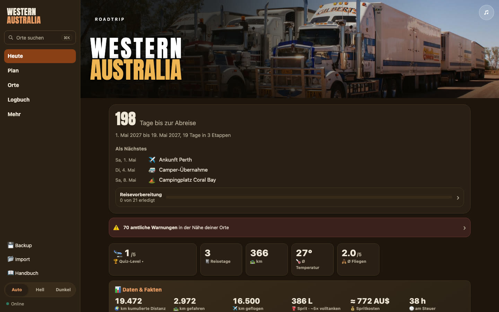

</div>

> All pictures show a made-up **sample trip**. No real travel dates, bookings or documents are shown.

---

## Why TravelBuddy

Perth to Broome is 2,200 kilometres. In between: roadhouses up to 300 km apart, kangaroos at dusk, bushfires, closed tracks and hours without reception. TravelBuddy is built for exactly that.

| | |
|---|---|
| 📡 **Offline first** | Maps, places, routes, tickets and emergency help work without signal. Plan once, and everything comes along. |
| ⛽ **Knows where it gets tight** | The longest stretch without fuel, long sections without water, the latest departure to arrive before sunset. |
| 🔥 **Warns you in time** | Official fire, flood and storm warnings, plus road closures on your route. |
| 📍 **144 hand-picked places** | With photos, seasonal tips, sun times and labels like "must-see", "hidden gem" or "4WD only". |
| 📷 **Thinks like a photographer** | Golden and blue hour, sunrise, sunset and a star photography rating for every place and every day of your trip. |
| 🎵 **Plays where you are** | Collects music from every place you pass into your own Spotify playlist: local bands, their most-played song first. |
| 📖 **Keeps what you experience** | A logbook with 16 modules, from the fly factor to the roadkill counter, that turns into a travel journal, a trip film and a travel report. |
| 🔒 **Yours alone** | No account, no server, no tracking. All data stays on your device. |

---

## 🚀 Everything TravelBuddy can do

**One app for the whole trip, from the first idea to the last memory. It really does it all.**

- 🧭 **Setup assistant** that sets up your trip with you in one minute
- 📅 **Trip dates in the header image** straight from the start date and length
- 🗺️ **Stages and routes** with dates, stops and drag-to-reorder
- 📐 **Smart stop placement** where a new stop adds the least detour
- 🛣️ **Real road routes** with kilometres and driving time
- ⛽ **Longest stretch without fuel** for every route
- 💧 **Long sections without water** flagged in advance
- 👀 **Sights up to 25 km off the road** suggested along the way
- 🌦️ **Weather along the route**, not just at the destination
- 🕒 **Driving days** with breaks and the latest departure before sunset
- 🌍 **Trip map and 3D globe** with every stage, route and flight
- ▶️ **"Play trip"** animates your whole journey on the map
- 🧩 **Route ideas** for the south and north loops from Perth
- 🥾 **Hikes** with status, date and photos
- 🗓️ **Calendar** as a print PDF and as a real Excel file
- 🖨️ **Map as a print image** in any size
- 📥 **Travel calendar import** that sorts bookings in by itself
- 📍 **144 hand-picked places** with photos, seasons and insider labels
- ➕ **Add your own places** with photo and description from Wikipedia
- 📷 **Made for photographers:** golden hour, blue hour and the night sky at every place, planned for any day
- 🌅 **Sun times** with sunrise, sunset and the sun's highest point
- 🌌 **Stargazing check** with moon phase and astronomical darkness
- 📝 **Notes and reports** for every place
- 🗺️ **Offline map** for all of Australia, in detail where you travel
- ⛺ **Supplies on the route:** fuel, water, toilets, camps, rest areas, shops, workshops, clinics
- 🔥 **Official warnings** for fire, flood and storms in WA, VIC and QLD
- 🚧 **WA road conditions** with closures right on your route
- 🆘 **Emergency mode** fully offline: position, nearest help, emergency numbers
- ✅ **"I'm OK" log** to export and share
- 📶 **"Ready to go?" check** before you drive into a dead zone
- 📖 **Logbook** with 16 modules and 72 fields per day
- 🎙️ **Voice memos and dictation** straight into the day
- 📸 **Photos sort themselves** by date, place and route kilometre
- 🪰 **Fly factor, roadkill counter and road trains** for the real outback feeling
- 🛸 **Roadside curiosities counter:** Big Things, shoe fences, odd mailboxes
- 🦘 **Wildlife album** with 20 animals to collect
- 👃 **Senses, people, food, campfire and night sky** captured every day
- 🏛️ **Official situation of the day** saved automatically in the logbook
- 📚 **Automatic travel journal:** your logbook becomes a finished travel magazine by itself
- 🖨️ **Photo book ready** to print or as a PDF, short or detailed
- 🖼️ **Photo library built in:** pick hundreds of photos, each lands on its day by itself
- ☁️ **All your iCloud photos** on the Mac, in photo-book quality
- 🎞️ **Animated photo collage**, offline and without AI
- 🎬 **Trip film** in portrait format, recorded in the app
- 👨‍👩‍👧 **Share with family:** the travel report as one file via Messages, WhatsApp, Mail or AirDrop
- 💌 **Opens anywhere:** no app, no account, even offline, without bookings or exact coordinates
- 🎵 **Spotify soundtrack:** music from every place lands in your playlist automatically
- 🎸 **Local bands first**, each with their most-played song
- 📴 **Music offline too:** places are noted and caught up later
- 📨 **Booking from email:** paste it, everything is recognised
- 🎫 **Tickets and documents offline** on the device
- 🔐 **Face ID, Touch ID or Windows Hello** to protect your documents
- ✈️ **Trip preparation** with countdown and checklist
- 🪪 **Document expiry warnings** for passport, visa and more
- 💶 **Budget in euro and AU$** at the daily exchange rate
- 🧾 **Costs per day** in 18 categories, straight into the budget
- 🎒 **Outback packing list**
- 🔄 **Backup and sync** between Mac and iPhone, merged safely
- 🔎 **One search for everything:** places, days, animals, bookings, notes
- 🔠 **Text size and overall size** adjustable in four steps
- 🌓 **Light and dark mode**
- 🇬🇧🇩🇪 **English and German**
- ♿ **Accessible**, checked against WCAG 2.2 AA
- 🧠 **Australia quiz** with five levels
- 📘 **Manual** as a PDF in the app
- 🎮 **Three hidden games** in the search field (see below)
- 🖥️ **Mac app**, 🪟 **Windows app** and 📱 **iPhone web app**
- 🚫 **No account, no cloud, no ads, no tracking**

### 🎮 Easter eggs: three hidden games

Type a secret word into the search field, and a game opens:

<details>
<summary><b>Show the secret words</b> (spoiler)</summary>

<br>

| Type | Game |
|---|---|
| `xoxo` | **Tic-tac-toe** against the computer |
| `sn4ke` | **Snake** with your own high score |
| `4444` | **Connect Four** against a computer that gets stronger the more you win: 7 levels from beginner to grandmaster and 5 playing styles from aggressive to sneaky |

</details>

---

## Ready in one minute

The first time you open TravelBuddy, a setup assistant walks you through eight short steps, and you set up your trip right away: start date and length (shown in the header image straight away), your first stage, a booking pasted from the confirmation email, tickets and documents onto the device. Every step can be skipped.

<table>
<tr>
<td align="center"><br><b>Welcome</b><br>German or English</td>
<td align="center">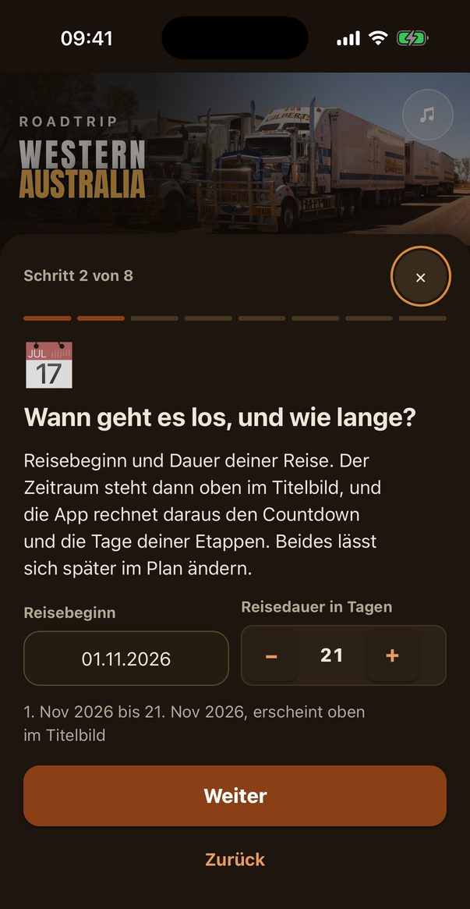<br><b>When and how long</b><br>appears in the header image</td>
<td align="center">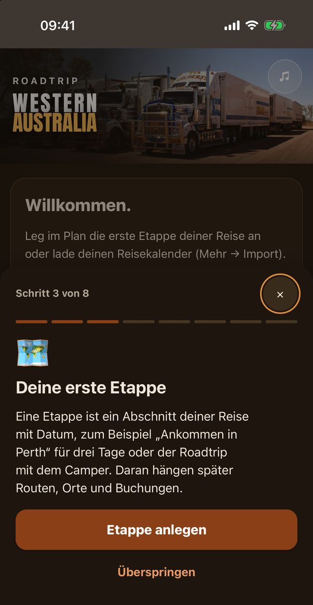<br><b>First stage</b><br>right in the real form</td>
</tr>
<tr>
<td align="center"><br><b>Bookings</b><br>paste the email text, done</td>
<td align="center">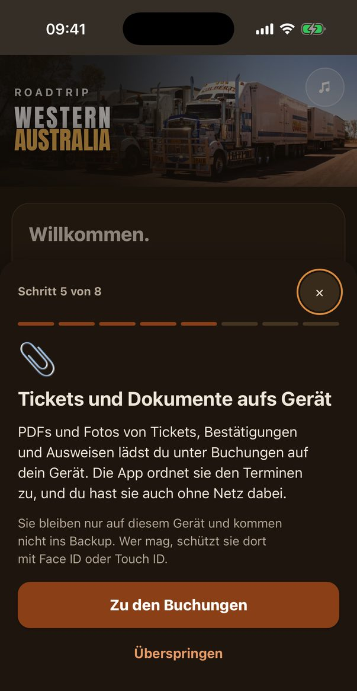<br><b>Tickets and documents</b><br>offline, optionally with Face ID</td>
<td align="center"><br><b>Finish</b><br>home screen and backup</td>
</tr>
</table>

---

## On the iPhone

<table>
<tr>
<td align="center">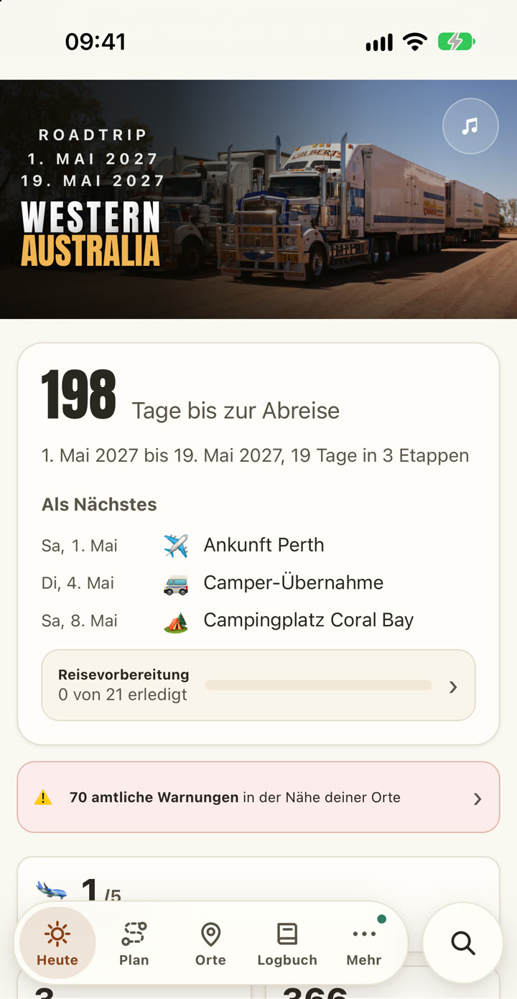<br><b>Today</b><br>trip dates, countdown, what's next</td>
<td align="center">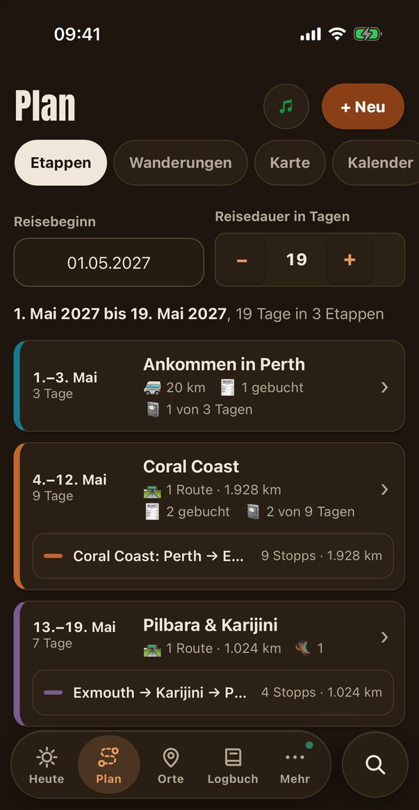<br><b>Plan</b><br>stages, routes, bookings per stage</td>
<td align="center">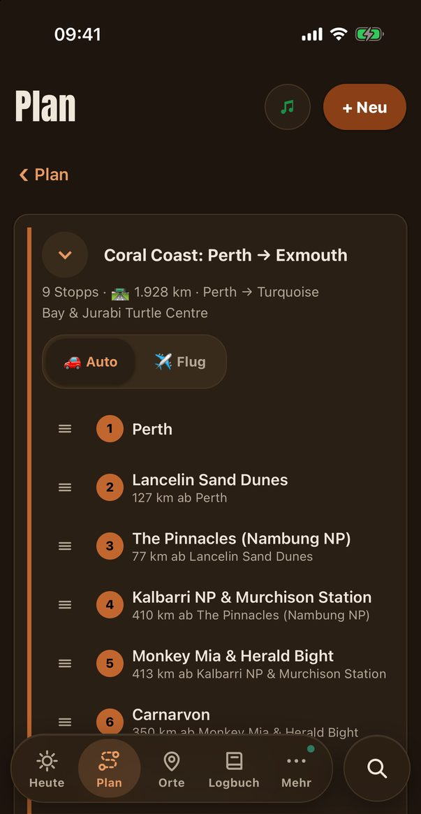<br><b>Route</b><br>stops, km per leg, car or flight</td>
</tr>
<tr>
<td align="center">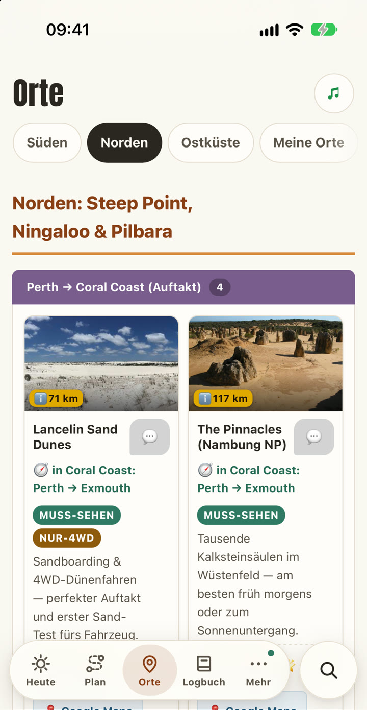<br><b>Places</b><br>144 places with photo and season</td>
<td align="center">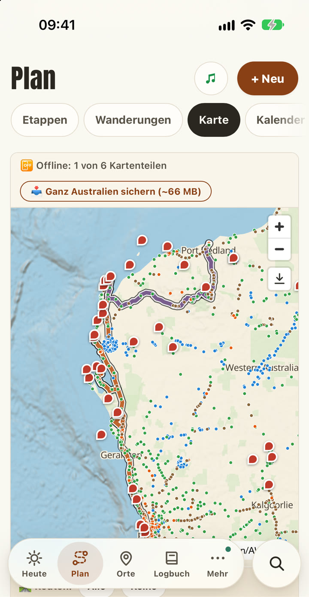<br><b>Offline map</b><br>fuel, water, camps, rest areas</td>
<td align="center">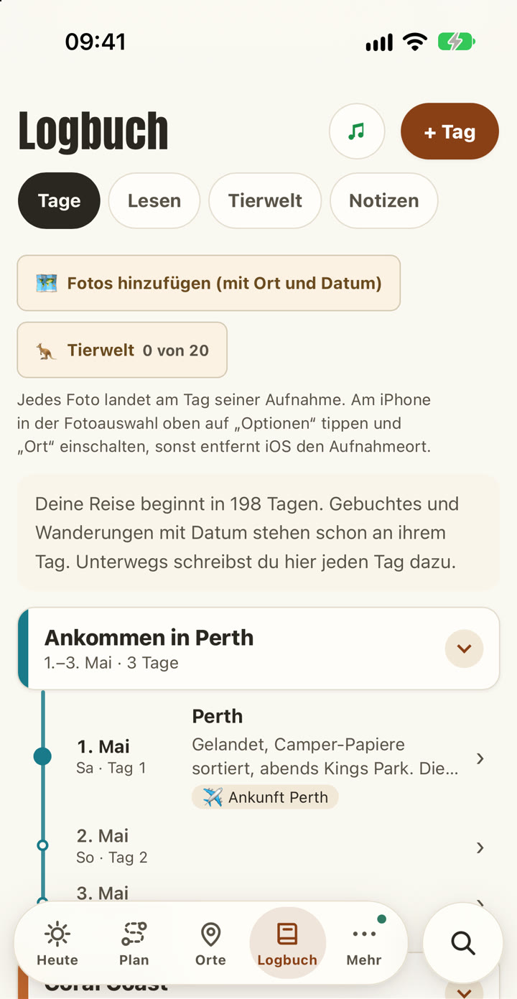<br><b>Logbook</b><br>every travel day on its stage</td>
</tr>
</table>

<div align="center">
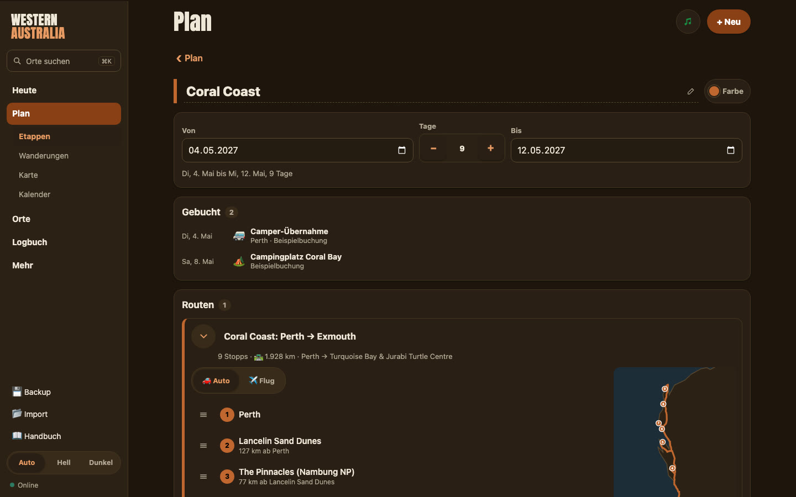
<br><sub>Route with stops on the Mac</sub>
</div>

---

## What it can do

### 🗺️ Plan
- **Stages and routes:** stages are periods with dates, routes are the drives within them. New stops go where they add the least detour, and you can drag to reorder.
- **What the app works out for every route:** distance and driving time, the longest stretch without fuel, long sections without water, sights up to 25 km off the road, weather along the way.
- **Driving days:** distance, driving time with breaks and the latest departure to arrive before sunset. Wildlife is out at dusk.
- **Trip map and 3D globe:** all stages and routes with numbered stops, flights as great circles. **"Play trip"** animates your whole journey.
- **Route ideas** for the south and north loops from Perth, **hikes** with status, the **calendar** as a print PDF and as a real Excel file, the **map as a print image** in the size you need.
- **Import** your travel calendar, and bookings fall into place by themselves.

### 📍 Places
- **144 hand-picked places** with photos, seasonal tips and labels like "must-see", "hidden gem" or "4WD only".
- **Sun and stars at every place:** sunrise and sunset, golden and blue hour, moon phase and how good the night is for star photos (more in [For photographers](#-for-photographers)).
- **Add your own places:** the app suggests matches from OpenStreetMap and fetches coordinates, photo and description from Wikipedia on its own.
- **Your notes and reports** stay with each place. "Plan in" puts a place into your stage.

### 📷 For photographers
TravelBuddy shows the light before you get there, at every one of the 144 places and every place you add.
- **Golden hour** in the morning and evening, to the minute.
- **Blue hour** in the morning and evening.
- **Sunrise, sunset and the sun's highest point** for midday shadows.
- **Plan the light for any day:** pick a date ("Sun times on" in the search), and every place shows the times for that day of your trip.
- **Star photography rating** for every place and night, from excellent to "moon too bright": calculated offline from the moon phase and astronomical darkness, refined online with the cloud cover.
- **Moon phase and brightness** in percent.
- **Weather at the spot:** high and low, wind and humidity (online).
- **Find the shots:** 144 places with photos and seasonal tips, labels like "hidden gem", and sights up to 25 km off your route.
- **In the logbook:** photos sort themselves by capture date and GPS, plus fields for sunset and night sky, the Southern Cross, and the dominant colour of the day. Camera and drone have their own cost categories.
- **Show your pictures:** animated photo collage, travel journal to print and a trip film in portrait format.

### 🚙 On the road
- **Offline map** for all of Australia, in detail the west coast, the east coast, Melbourne, Cairns and the Whitsundays.
- **Supplies:** fuel, water, toilets, camps, rest areas, shops, workshops and clinics along the route, with the route kilometre.
- **Hazards:** warnings from Western Australia, Victoria and Queensland in a radius you choose, plus **WA road conditions** with closures on your route.
- **Emergency,** fully offline: your GPS position ready to copy and read out, nearest help with distance and direction, emergency numbers, sharing your location and an **"I'm OK" log** you can export.
- **"Ready to go?"** checks before you drive into a dead zone what is really stored offline on this device.

### 📖 The logbook
One entry per day (or several), sorted by stage, with text, photos and a **voice memo**, or simply **dictate** it (online). Photos find their day, place and route kilometre on their own from the image data. And then it really starts: **16 modules with 72 fields**, fill in whatever fits.

| Module | What goes in |
|---|---|
| 📊 **Quick stats** | daily km, temperature and weather, the **fly factor**, signal, song of the day, mood, roadkill density, road trains counted |
| 💸 **Costs and transport** | 18 categories from fuel to drone, in AU$ or euro, feeding straight into your budget |
| 👃 **Senses and atmosphere** | "the sound today was …", "I can still smell …", the dominant colour, how the heat and wind felt |
| 🦘 **Roadside and wildlife** | animals seen alive (with photo, they go to your wildlife album), a **roadkill counter** for 12 species, a counter for **roadside curiosities**: Big Things, odd mailboxes, shoe fences, rust buckets, statues, strange warning signs, and how remote it is to the next stop |
| 🚐 **Vanlife** | what the photos don't show, what was cooked on the gas stove (with a taste rating), why tonight's campsite was special |
| 🚿 **Grid, water and emergency** | done without a phone, where and how you showered, where you filled up drinking water |
| 🔧 **Breakdowns and outback grit** | what you fixed with tape, cable ties and WD-40, where the red dust ended up |
| 🌌 **Sky and night** | Southern Cross and Milky Way, the sounds of the night, the campfire |
| ⚠️ **Warning signs and hazards** | the strangest or scariest sign, hazards you faced, and the **official situation** from the authorities captured automatically for that day |
| 🍻 **Encounters and Aussie culture** | the Aussie word you learned, a nice or weird encounter, a tip from locals |
| 💭 **Reflection** | "thought X, turned out Y", the highlight away from the tourists, thought of the day, what you're grateful for |
| 👥 **People** | who you met, new people, the best moment with someone |
| 🕰️ **Memories then and now** | what changed since last time, what you remember from back then |
| ⭐ **Experiences** | highlight of the day, special occasion, activity |
| 🏝️ **Island, beach and nature** | what you saw in the water while snorkelling or diving, sunset and night sky |
| 🍽️ **Food and drink** | best meal or restaurant with a rating, drink of the day |

**What it turns into:**
- **Wildlife album:** 20 animals of Western Australia to collect, each sighting with date, place, note and photo.
- **Read mode** day by day, and **notes** with categories.
- **Travel journal** to print or as a PDF, with painted globes, photos and the **trip summary** (km, days, animals, costs and much more).
- **Animated photo collage** of all your photos, offline and without AI.
- **Trip film** in portrait format, recorded right in the app.
- **Travel report** as a single file for family and friends, deliberately without bookings, costs and exact coordinates.

### 📚 Your travel journal writes itself
- **Automatic travel journal:** from your logbook, TravelBuddy builds a finished travel magazine on its own: cover, photo grids, quote blocks, the summary for every day and painted globes for every stage. You don't have to lay out anything.
- **Two versions:** "short" with picture, text and key figures per day, or "detailed" with every module you filled in, your notes and the full trip summary.
- **Photo book ready:** print it or save it as a PDF, sorted oldest or newest first.
- **Your photo library built in:** pick many photos from your library at once. TravelBuddy reads the capture date and place, puts every photo on its day and stage, and shows you beforehand what will happen. Photos without a date go to a day you choose.
- **On the Mac with all your iCloud photos:** the picker shows your whole library under "Media". Journal photos are kept at 3,000 px, sharp enough for a printed photo book, and stay on your device without bloating the backup.

### 👨‍👩‍👧 Share with family and friends
- **Travel report as one file:** choose stages, whether the journal texts come along and which photos. Globes, photos and fonts are inside the file, so it opens anywhere, even offline, without an app and without an account.
- **Send it straight away** with the share sheet: Messages, WhatsApp, Mail or AirDrop.
- **Private by design:** bookings, booking numbers, documents, costs, emergency contacts and coordinates never get into the report, and codes, phone numbers and email addresses are removed from free texts.
- **Trip film** in portrait format, ready for the family chat or your story: a flight over the globe for every stage, the route drawing itself in, your best photos and the summary at the end.

### 🎵 Spotify: the soundtrack of your trip
TravelBuddy collects the music of the places you pass through, **automatically, while you drive**.
- **Every new place counts:** as soon as you are far enough from the last one (distance, waiting time, radius and tracks per place are up to you), the app looks for music from there.
- **Really local:** bands that come from the area (MusicBrainz), each with its **most-played song first** (Last.fm), plus Spotify playlists of the area and, with a Last.fm key, the country's charts.
- **Your taste first:** favourite genres come first, nothing ends up twice in the playlist.
- **Into your own playlist:** each track is matched exactly on Spotify and added to a playlist in your account, which the app creates for you. A counter on the music icon shows what's new.
- **No signal? No problem:** places are noted offline and caught up as soon as you're back online, or tap "Catch up now".
- **In control:** pick a place by hand, see all tracks by place, take single ones out again, or start over and remove them from the playlist. A log shows every step.
- **Secure:** Spotify login without a password in the app (PKCE), the token stays on your device, and the location history can be deleted at any time.
- Needs **Spotify Premium** and your own free app on developer.spotify.com. It runs while TravelBuddy is open.

### 🎟️ Organise
- **Booking from email:** paste the confirmation, and date, time, place, booking number and price are recognised and attached to the right stage.
- **Tickets and documents** open offline, protected by **Face ID, Touch ID or Windows Hello** if you like. They never leave the device.
- **Trip preparation** with a countdown and a ready-made checklist (weeks before, just before, departure day) plus your own points, **documents** with expiry dates and warnings.
- **Budget in euro and AU$** at the daily rate, pre-trip costs, an outback **packing list**.
- **Backup and sync** between Mac and iPhone: importing merges and shows beforehand what will change. Nothing gets lost.
- **One search for everything:** places, days, animals, bookings, notes.

### ✨ Readable and fun
- **Text size and overall size,** four steps each, set separately. **Light and dark,** German and English, usability checked against WCAG 2.2 AA.
- **Australia quiz** with five levels and a **manual** as a PDF in the app.
- **Three hidden games** in the search field: tic-tac-toe, Snake and Connect Four against a computer that keeps getting stronger. The secret words are [further up](#-easter-eggs-three-hidden-games). 🦘

---

## Offline and online

| Without signal | With signal |
|---|---|
| All your data, plan, logbook, journal | Real road routes for new drives |
| Saved routes with km, driving time and all hints | Weather and weather along the route |
| Offline map, fuel, water, camps along the route | New warnings and road closures |
| Driving days, sun times, emergency, packing list, quiz | Daily exchange rate for expenses |
| Documents on the device, last known hazards | Music on the road |

---

## Download

| | |
|---|---|
| 🖥️ **Mac** | `TravelBuddy-Mac.zip` from [Releases](https://github.com/Kotdesigner/TravelBuddy/releases/latest): unzip, move to Applications, open. Apple Silicon and Intel, macOS 13 or newer. |
| 🪟 **Windows** | `TravelBuddy-Windows.zip` from [Releases](https://github.com/Kotdesigner/TravelBuddy/releases/latest): unzip, double-click `TravelBuddy.exe`. Windows 10 and 11 (64-bit). Opens in its own Microsoft Edge window. |
| 📱 **iPhone and any browser** | `TravelBuddy-Netlify.zip` from [Releases](https://github.com/Kotdesigner/TravelBuddy/releases/latest): drag into Netlify's "Deploy manually". Then open the address in Safari and choose "Add to Home Screen". |
| 🔁 **Straight from GitHub** | In Netlify, choose "Import an existing project" and pick this repo. The settings are in `netlify.toml`, and every push publishes the new version. |

The Mac and Windows apps need no internet and no extra software. They are not signed by Apple or Microsoft, so the first launch shows a warning:
- **Mac:** System Settings → Privacy & Security → "Open Anyway".
- **Windows:** "Windows protected your PC" → "More info" → "Run anyway".

---

## Run it without the ready-made apps

You don't have to use the downloads. TravelBuddy is a static web app and runs anywhere a browser does.

### What you need

| | Needed for | Where to get it |
|---|---|---|
| **Node.js 20 or newer** (22 LTS recommended), includes npm | building and running | [nodejs.org](https://nodejs.org) |
| **Git** (or "Code → Download ZIP" on this page) | getting the code | [git-scm.com](https://git-scm.com) |
| **A current browser:** Safari 16+, Chrome or Edge 110+, Firefox 115+ | using the app | already on your computer |
| *optional:* **Xcode** | building the Mac app yourself | Mac App Store |
| *optional:* **Go 1.22+** | building the Windows app yourself | [go.dev](https://go.dev) or `brew install go` |

### Start it on your computer

```
git clone https://github.com/Kotdesigner/TravelBuddy.git
cd TravelBuddy
npm ci
npm run build
npm run preview -- --host 127.0.0.1 --port 8990
```

Then open **http://127.0.0.1:8990** in your browser. The setup assistant starts on its own. `npm run dev` starts the development version with live reload instead.

Good to know:
- **Always use the same address.** Your data is stored in the browser under exactly this address (including the port). A different port is a different, empty app.
- **Don't open `dist/index.html` by double-clicking.** Without a server (`file://`), the browser blocks offline storage and the service worker.
- **Any other server needs range requests**, because the offline maps load in pieces. `npm run preview` and `npx serve dist` can do this; `python -m http.server` can't, and the maps stay empty with it.

### On the iPhone

iPhones only install web apps from an **HTTPS** address. The simplest free way is Netlify: connect this repo or drag the `dist` folder in. Step by step: **[docs/VEROEFFENTLICHEN.md](docs/VEROEFFENTLICHEN.md)** (German).

### Build the apps yourself

```
sh mac/baue-mac-app.sh     # → mac/build/TravelBuddy.app and TravelBuddy-Mac.zip (needs Xcode)
sh win/baue-windows.sh     # → win/build/TravelBuddy.exe and TravelBuddy-Windows.zip (needs Go, works on Mac/Linux too)
```

The Windows build embeds the icon with `rsrc`: install it once with `go install github.com/akavel/rsrc@v0.10.2`.

### Tests

Each test runs on its own, for example `node tests/plan.test.mjs`. There are **over 1,200 automated checks** in 27 test files, including a rule against rounding errors: the parts always add up to exactly the total shown. `node tests/basic-privat.test.mjs` makes sure no personal data ends up in the code or the build.

---

## Privacy

- No account, no server, no ads, no tracking.
- All data stays in your device's storage. Sync Mac and iPhone with a backup file, for example via AirDrop. Importing merges, nothing gets deleted.
- Tickets, IDs and journal photos stay on the device and are not part of the backup.

---

## Tech

| Area | Used |
|---|---|
| App | [Svelte 5](https://svelte.dev) with runes, [Vite](https://vite.dev), installable web app (PWA) with [Workbox](https://developer.chrome.com/docs/workbox) |
| Desktop | Mac: Swift with WKWebView and a built-in server · Windows: Go with an embedded server, window in Microsoft Edge |
| Maps | [MapLibre GL](https://maplibre.org), offline tiles as [PMTiles](https://protomaps.com/docs/pmtiles) from [Protomaps](https://protomaps.com) and [OpenStreetMap](https://www.openstreetmap.org), globe from [Natural Earth](https://www.naturalearthdata.com) |
| Routes | [OSRM](https://project-osrm.org) for road routes, own offline analysis for fuel and water gaps, supplies and driving days |
| Live data | [Open-Meteo](https://open-meteo.com), DFES Emergency WA, VicEmergency, Queensland Fire Department, Main Roads WA, [frankfurter.app](https://frankfurter.app) |
| Places | Nominatim, Wikipedia and Wikimedia Commons |
| Sun and moon | [SunCalc](https://github.com/mourner/suncalc), offline |
| Security | WebAuthn with the PRF extension (Face ID, Touch ID, Windows Hello), AES-GCM, all in the browser |
| Music | Spotify Web API, MusicBrainz, Last.fm |

---

## Roadmap

- [x] **Version 1: Western Australia** with planning, logbook, offline map, supplies and hazards
- [x] Setup assistant on first launch, trip dates in the header, adjustable text and overall size
- [x] Source code here on GitHub, apps for Mac and Windows
- [ ] On the App Store
- [ ] More regions of Australia in detail
- [ ] More countries

<br>

---
---

<a id="deutsch"></a>

<div align="center">

# 🇩🇪 TravelBuddy auf Deutsch

### Dein Roadtrip-Begleiter für die Strecken, auf denen das Netz aufhört.

Planen, fahren, festhalten. Auf iPhone, Mac und Windows, komplett offline, ohne Konto und ohne Cloud.<br>
**Eine App für die ganze Reise. Sie kann alles.**

**Version 1 · entwickelt für Western Australia**<br>
<sub>Weitere Regionen und Länder folgen.</sub>

</div>

> Alle Bilder oben zeigen eine ausgedachte **Beispielreise**. Echte Reisedaten, Buchungen oder Dokumente sind darin nicht zu sehen.

## Warum TravelBuddy

Zwischen Perth und Broome liegen 2.200 Kilometer. Dazwischen: Roadhouses, die teils 300 km auseinanderliegen, Kängurus in der Dämmerung, Buschfeuer, gesperrte Pisten und stundenlang kein Empfang. Genau dafür ist TravelBuddy gebaut.

| | |
|---|---|
| 📡 **Offline zuerst** | Karten, Orte, Routen, Belege und Notfallhilfe funktionieren ohne Netz. Einmal geplant, ist alles dabei. |
| ⛽ **Rechnet mit, wo es knapp wird** | Die längste Strecke ohne Tankstelle, lange Abschnitte ohne Wasser, die späteste Abfahrt vor Sonnenuntergang. |
| 🔥 **Warnt rechtzeitig** | Amtliche Warnungen zu Feuer, Flut und Unwetter, dazu Straßensperrungen auf deiner Route. |
| 📍 **144 handverlesene Orte** | Mit Bildern, Saison-Tipps, Sonnenzeiten und Markierungen wie „Muss-Sehen“, „Geheimtipp“ oder „Nur 4WD“. |
| 📷 **Denkt wie ein Fotograf** | Goldene und blaue Stunde, Auf- und Untergang und eine Bewertung für Sternenfotos an jedem Ort und für jeden Reisetag. |
| 🎵 **Spielt, wo du bist** | Sammelt die Musik jedes Ortes, durch den du kommst, in deine eigene Spotify-Playlist: lokale Bands, ihr meistgehörter Song zuerst. |
| 📖 **Hält fest, was du erlebst** | Logbuch mit 16 Modulen, vom Fliegen-Faktor bis zum Roadkill-Zähler, daraus entstehen Reisetagebuch, Reise-Film und Reisebericht. |
| 🔒 **Gehört dir** | Kein Konto, kein Server, kein Tracking. Alle Daten bleiben auf deinem Gerät. |

## 🚀 Alles, was TravelBuddy kann

**Eine App für die ganze Reise, von der ersten Idee bis zur letzten Erinnerung. Sie kann wirklich alles.**

- 🧭 **Einrichtungsassistent**, der deine Reise in einer Minute mit dir anlegt
- 📅 **Reisezeitraum im Titelbild**, direkt aus Reisebeginn und Reisedauer
- 🗺️ **Etappen und Routen** mit Datum, Stopps und Reihenfolge zum Ziehen
- 📐 **Kluge Stopp-Platzierung** dort, wo ein neuer Stopp den kleinsten Umweg macht
- 🛣️ **Echte Straßenrouten** mit Kilometern und Fahrzeit
- ⛽ **Längste Strecke ohne Tankstelle** für jede Route
- 💧 **Lange Abschnitte ohne Wasser**, vorher markiert
- 👀 **Sehenswertes bis 25 km neben der Strecke** als Vorschlag
- 🌦️ **Wetter an der Strecke**, nicht nur am Ziel
- 🕒 **Fahrtage** mit Pausen und der spätesten Abfahrt vor Sonnenuntergang
- 🌍 **Reise-Karte und 3D-Weltkugel** mit allen Etappen, Routen und Flügen
- ▶️ **„Reise abspielen“** lässt die ganze Reise auf der Karte ablaufen
- 🧩 **Routen-Ideen** für die Süd- und Nord-Schleife ab Perth
- 🥾 **Wanderungen** mit Stand, Datum und Fotos
- 🗓️ **Kalender** als Druck-PDF und als echte Excel-Datei
- 🖨️ **Karte als Druckbild** in jeder Größe
- 📥 **Reisekalender-Import**, der Buchungen selbst einsortiert
- 📍 **144 handverlesene Orte** mit Bildern, Saison und Insider-Markierungen
- ➕ **Eigene Orte anlegen** mit Bild und Beschreibung aus Wikipedia
- 📷 **Gemacht für Fotografen:** goldene Stunde, blaue Stunde und Nachthimmel an jedem Ort, für jeden Tag planbar
- 🌅 **Sonnenzeiten** mit Auf- und Untergang und dem Höchststand der Sonne
- 🌌 **Sternen-Check** mit Mondphase und astronomischer Dunkelheit
- 📝 **Notizen und Berichte** zu jedem Ort
- 🗺️ **Offline-Karte** für ganz Australien, im Detail dort, wo du unterwegs bist
- ⛺ **Versorgung an der Route:** Tankstellen, Wasser, Toiletten, Camps, Rastplätze, Läden, Werkstätten, Kliniken
- 🔥 **Amtliche Warnungen** zu Feuer, Flut und Unwetter in WA, VIC und QLD
- 🚧 **Straßenlage WA** mit Sperrungen direkt auf deiner Route
- 🆘 **Notfall-Modus** komplett offline: Standort, nächste Hilfe, Notrufnummern
- ✅ **„Ich bin OK“-Protokoll** zum Exportieren und Teilen
- 📶 **Check „Bereit für unterwegs?“** vor der Fahrt ins Funkloch
- 📖 **Logbuch** mit 16 Modulen und 72 Feldern je Tag
- 🎙️ **Sprachnotizen und Diktat** direkt in den Tag
- 📸 **Fotos sortieren sich selbst** nach Datum, Ort und Streckenkilometer
- 🪰 **Fliegen-Faktor, Roadkill-Zähler und Road-Trains** fürs echte Outback-Gefühl
- 🛸 **Zähler für Kuriositäten am Straßenrand:** Big Things, Schuh-Zäune, skurrile Briefkästen
- 🦘 **Tier-Album** mit 20 Tieren zum Sammeln
- 👃 **Sinne, Menschen, Essen, Lagerfeuer und Nachthimmel**, jeden Tag festgehalten
- 🏛️ **Amtliche Lage des Tages**, automatisch im Logbuch gespeichert
- 📚 **Automatisches Reisetagebuch:** Aus dem Logbuch wird von selbst ein fertiges Reisemagazin
- 🖨️ **Fertig fürs Fotobuch** zum Drucken oder als PDF, kurz oder ausführlich
- 🖼️ **Fotomediathek eingebunden:** Hunderte Fotos wählen, jedes landet von selbst an seinem Tag
- ☁️ **Alle iCloud-Fotos** am Mac, in Fotobuch-Qualität
- 🎞️ **Animierte Foto-Kollage**, offline und ohne KI
- 🎬 **Reise-Film** im Hochformat, in der App aufgenommen
- 👨‍👩‍👧 **Mit der Familie teilen:** der Reisebericht als eine Datei über Nachrichten, WhatsApp, Mail oder AirDrop
- 💌 **Öffnet sich überall:** ohne App, ohne Konto, auch offline, ohne Buchungen und genaue Koordinaten
- 🎵 **Spotify-Soundtrack:** Musik von jedem Ort landet automatisch in deiner Playlist
- 🎸 **Lokale Bands zuerst**, jeweils mit ihrem meistgehörten Song
- 📴 **Musik auch offline:** Orte werden vorgemerkt und später nachgeholt
- 📨 **Buchung aus Mail:** einfügen, alles wird erkannt
- 🎫 **Tickets und Dokumente offline** auf dem Gerät
- 🔐 **Face ID, Touch ID oder Windows Hello** schützen deine Dokumente
- ✈️ **Reisevorbereitung** mit Countdown und Checkliste
- 🪪 **Warnung vor Ablaufdaten** für Pass, Visum und mehr
- 💶 **Budget in Euro und AU$** zum Tageskurs
- 🧾 **Kosten je Tag** in 18 Kategorien, direkt im Budget
- 🎒 **Packliste fürs Outback**
- 🔄 **Backup und Abgleich** zwischen Mac und iPhone, sicher zusammengeführt
- 🔎 **Eine Suche für alles:** Orte, Tage, Tiere, Buchungen, Notizen
- 🔠 **Schriftgröße und Gesamtgröße** in vier Stufen einstellbar
- 🌓 **Hell und dunkel**
- 🇩🇪🇬🇧 **Deutsch und Englisch**
- ♿ **Barrierearm**, geprüft nach WCAG 2.2 AA
- 🧠 **Australien-Quiz** mit fünf Stufen
- 📘 **Handbuch** als PDF in der App
- 🎮 **Drei versteckte Spiele** im Suchfeld (siehe unten)
- 🖥️ **Mac-App**, 🪟 **Windows-App** und 📱 **Web-App fürs iPhone**
- 🚫 **Kein Konto, keine Cloud, keine Werbung, kein Tracking**

### 🎮 Easter Eggs: drei versteckte Spiele

Tipp ein geheimes Wort ins Suchfeld, und ein Spiel geht auf:

<details>
<summary><b>Geheime Wörter zeigen</b> (Spoiler)</summary>

<br>

| Eingeben | Spiel |
|---|---|
| `xoxo` | **Tic-Tac-Toe** gegen den Computer |
| `sn4ke` | **Snake** mit eigenem Rekord |
| `4444` | **Vier gewinnt** gegen einen Computer, der stärker wird, je öfter du gewinnst: 7 Stufen vom Anfänger bis zum Großmeister und 5 Spielweisen von angriffslustig bis hinterlistig |

</details>

## In einer Minute startklar

Beim ersten Öffnen führt dich ein Einrichtungsassistent in acht kurzen Schritten durch alles, und du legst dabei gleich deine Reise an: Reisebeginn und Reisedauer (stehen sofort oben im Titelbild), die erste Etappe, eine Buchung aus der Bestätigungsmail, Tickets und Dokumente aufs Gerät. Jeder Schritt lässt sich überspringen. Die Bilder dazu stehen oben im englischen Teil.

## Was die App kann

### 🗺️ Planen
- **Etappen und Routen:** Etappen sind Zeitabschnitte mit Datum, Routen die Strecken darin. Neue Stopps landen dort, wo sie den kleinsten Umweg machen, die Reihenfolge lässt sich ziehen.
- **Was die App an jeder Route rechnet:** Kilometer und Fahrzeit, die längste Strecke ohne Tankstelle, lange Strecken ohne Wasser, Sehenswertes bis 25 km neben der Strecke, Wetter an der Strecke.
- **Fahrtage:** Strecke, Fahrzeit mit Pausen und die späteste Abfahrt, um vor Sonnenuntergang anzukommen. In der Dämmerung ist viel Wild unterwegs.
- **Reise-Karte und 3D-Weltkugel:** alle Etappen und Routen mit nummerierten Stopps, Flüge als Großkreise. **„Reise abspielen“** lässt die ganze Reise ablaufen.
- **Routen-Ideen** für die Süd- und Nord-Schleife ab Perth, **Wanderungen** mit Stand, der **Kalender** als Druck-PDF und als echte Excel-Datei, die **Karte als Druckbild** in der gewünschten Größe.
- **Reisekalender importieren**, und die Buchungen sortieren sich von selbst ein.

### 📍 Orte
- **144 handverlesene Orte** mit Bildern, Saison-Tipps und Markierungen wie „Muss-Sehen“, „Geheimtipp“ oder „Nur 4WD“.
- **Sonne und Sterne an jedem Ort:** Auf- und Untergang, goldene und blaue Stunde, Mondphase und wie gut die Nacht für Sternenfotos ist (mehr unter [Für Fotografen](#-für-fotografen)).
- **Eigene Orte anlegen:** Die App schlägt passende Treffer aus OpenStreetMap vor und holt Koordinaten, Bild und Beschreibung selbst aus Wikipedia.
- **Eigene Notizen und Berichte** bleiben am Ort. „Einplanen“ legt einen Ort in deine Etappe.

### 📷 Für Fotografen
TravelBuddy zeigt das Licht, bevor du dort bist, an jedem der 144 Orte und an jedem Ort, den du selbst anlegst.
- **Goldene Stunde** morgens und abends, auf die Minute.
- **Blaue Stunde** morgens und abends.
- **Sonnenaufgang, Sonnenuntergang und Höchststand** für die Schatten am Mittag.
- **Licht für jeden Tag planen:** Datum wählen („Sonnenzeiten am“ in der Suche), und jeder Ort zeigt die Zeiten für diesen Reisetag.
- **Bewertung für Sternenfotos** an jedem Ort und in jeder Nacht, von exzellent bis „Mond zu hell“: offline berechnet aus Mondphase und astronomischer Dunkelheit, online verfeinert mit der Bewölkung.
- **Mondphase und Helligkeit** in Prozent.
- **Wetter am Ort:** Höchst- und Tiefstwert, Wind und Luftfeuchte (online).
- **Motive finden:** 144 Orte mit Bildern und Saison-Tipps, Markierungen wie „Geheimtipp“ und Sehenswertes bis 25 km neben deiner Route.
- **Im Logbuch:** Fotos sortieren sich nach Aufnahmedatum und GPS ein, dazu Felder für Sonnenuntergang und Nachthimmel, das Kreuz des Südens und die dominierende Farbe des Tages. Kamera und Drohne haben eigene Kostenkategorien.
- **Bilder zeigen:** animierte Foto-Kollage, Reisetagebuch zum Drucken und Reise-Film im Hochformat.

### 🚙 Unterwegs
- **Offline-Karte** für ganz Australien, im Detail Westküste, Ostküste, Melbourne, Cairns und Whitsundays.
- **Versorgung:** Tankstellen, Wasserstellen, Toiletten, Camps, Rastplätze, Läden, Werkstätten und Kliniken entlang der Route mit Streckenkilometer.
- **Gefahrenlage:** Warnungen aus Western Australia, Victoria und Queensland im Umkreis deiner Wahl, dazu die **Straßenlage WA** mit Sperrungen auf deiner Route.
- **Notfall,** komplett offline: GPS-Standort zum Kopieren und Vorlesen, nächste Hilfe mit Entfernung und Richtung, Notrufnummern, Standort teilen und ein **„Ich bin OK“-Protokoll** zum Exportieren.
- **„Bereit für unterwegs?“** prüft vor der Fahrt ins Funkloch, was wirklich offline auf diesem Gerät liegt.

### 📖 Das Logbuch
Ein Eintrag je Tag (oder mehrere), sortiert nach Etappe, mit Text, Fotos und **Sprachnotiz**, oder einfach **diktiert** (online). Fotos finden ihren Tag, ihren Ort und den Streckenkilometer anhand ihrer Bilddaten von selbst. Und dann geht es erst los: **16 Module mit 72 Feldern**, ausgefüllt wird, was passt.

| Modul | Was hineinkommt |
|---|---|
| 📊 **Quick-Stats** | Tageskilometer, Temperatur und Wetter, der **Fliegen-Faktor**, Empfang, Song des Tages, Stimmung, Roadkill-Dichte, gezählte Road-Trains |
| 💸 **Kosten und Verkehr** | 18 Kategorien von Sprit bis Drohne, in AU$ oder Euro, direkt im Budget |
| 👃 **Sinneseindrücke und Atmosphäre** | „Der Sound heute war …“, „Ich rieche sofort wieder …“, die dominierende Farbe, gefühlte Hitze, Luft und Wind |
| 🦘 **Straßenrand und Wildlife** | lebend gesehene Tiere (mit Foto, sie landen im Tier-Album), ein **Roadkill-Zähler** für 12 Arten, ein Zähler für **Kuriositäten am Straßenrand**: Big Things, skurrile Briefkästen, Schuh-Zäune, Rostlauben, Statuen, kuriose Warnschilder, dazu wie abgeschieden es bis zum nächsten Stopp ist |
| 🚐 **Vanlife-Alltag** | was die Fotos nicht zeigen, was auf dem Gaskocher gekocht wurde (mit Geschmacksnote), warum der Stellplatz besonders war |
| 🚿 **Netz, Wasser und Notfall** | ohne Handy gemacht, wie und wo geduscht, wo Trinkwasser aufgefüllt |
| 🔧 **Pannen und Outback-Härte** | was mit Tape, Kabelbindern und WD-40 improvisiert wurde, wo der rote Staub gelandet ist |
| 🌌 **Himmel und Nachtleben** | Kreuz des Südens und Milchstraße, die Geräusche der Nacht, das Lagerfeuer |
| ⚠️ **Warnschilder und Gefahren** | das kurioseste oder gruseligste Schild, Gefahren, denen du begegnet bist, und die **amtliche Lage** der Behörden für diesen Tag, automatisch festgehalten |
| 🍻 **Begegnungen und Aussie-Kultur** | das gelernte Aussie-Wort, eine nette oder skurrile Begegnung, der Geheimtipp von Locals |
| 💭 **Reflexion und Fazit** | „Dachte X, war aber Y“, das Highlight abseits der Touristen, der Gedanke des Tages, wofür du dankbar bist |
| 👥 **Menschen und Wiedersehen** | wen du getroffen hast, neue Leute, der schönste Moment mit jemandem |
| 🕰️ **Erinnerungen früher und heute** | was sich verändert hat, woran du dich von damals erinnerst |
| ⭐ **Erlebnisse und Highlights** | Highlight des Tages, besonderer Anlass, Unternehmung |
| 🏝️ **Insel, Strand und Natur** | was du beim Schnorcheln oder Tauchen gesehen hast, Sonnenuntergang und Nachthimmel |
| 🍽️ **Essen und Genuss** | bestes Essen oder Restaurant mit Bewertung, Drink des Tages |

**Was daraus wird:**
- **Tier-Album:** 20 Tiere Westaustraliens zum Sammeln, jede Sichtung mit Datum, Ort, Notiz und Foto.
- **Lesemodus** Tag für Tag und **Notizen** mit Kategorien.
- **Reisetagebuch** zum Drucken oder als PDF, mit gemalten Weltkugeln, Fotos und der **Reise-Bilanz** (Kilometer, Tage, Tiere, Kosten und vieles mehr).
- **Animierte Foto-Kollage** aus allen Fotos, offline und ohne KI.
- **Reise-Film** im Hochformat, direkt in der App aufgenommen.
- **Reisebericht** als eine Datei für Familie und Freunde, bewusst ohne Buchungen, Kosten und genaue Koordinaten.

### 📚 Das Reisetagebuch schreibt sich selbst
- **Automatisches Reisetagebuch:** Aus deinem Logbuch baut TravelBuddy von selbst ein fertiges Reisemagazin: Deckblatt, Foto-Raster, Zitat-Blöcke, die Bilanz jedes Tages und gemalte Weltkugeln für jede Etappe. Gestalten musst du nichts.
- **Zwei Fassungen:** „kurz“ mit Bild, Text und Kennzahlen je Tag oder „ausführlich“ mit allen ausgefüllten Modulen, deinen Notizen und der ganzen Reise-Bilanz.
- **Fertig fürs Fotobuch:** drucken oder als PDF sichern, älteste oder neueste zuerst.
- **Deine Fotomediathek eingebunden:** viele Fotos auf einmal aus der Mediathek wählen. TravelBuddy liest Aufnahmedatum und Ort, legt jedes Foto an seinen Tag und seine Etappe und zeigt vorher, was passiert. Fotos ohne Datum landen an einem Tag deiner Wahl.
- **Am Mac mit allen iCloud-Fotos:** Das Auswahlfenster zeigt unter „Medien“ die ganze Mediathek. Tagebuchfotos bleiben in 3.000 px, scharf genug fürs gedruckte Fotobuch, und liegen nur auf deinem Gerät, ohne das Backup aufzublähen.

### 👨‍👩‍👧 Mit Familie und Freunden teilen
- **Reisebericht als eine Datei:** Etappen wählen, ob die Tagebuchtexte mitkommen und welche Fotos. Weltkugeln, Fotos und Schrift stecken in der Datei, sie öffnet sich überall, auch offline, ohne App und ohne Konto.
- **Sofort verschicken** über das Teilen-Menü: Nachrichten, WhatsApp, Mail oder AirDrop.
- **Privat aus Prinzip:** Buchungen, Buchungsnummern, Dokumente, Kosten, Notfallkontakte und Koordinaten kommen gar nicht erst in den Bericht, und aus Freitexten werden Codes, Telefonnummern und Mailadressen entfernt.
- **Reise-Film** im Hochformat, fertig für den Familien-Chat oder die Story: je Etappe ein Flug über die Weltkugel, die Route zeichnet sich ein, deine besten Fotos und am Ende die Bilanz.

### 🎵 Spotify: der Soundtrack deiner Reise
TravelBuddy sammelt die Musik der Orte, durch die du kommst, **automatisch, während du fährst**.
- **Jeder neue Ort zählt:** Sobald du weit genug vom letzten entfernt bist (Abstand, Wartezeit, Umkreis und Titel je Ort stellst du selbst ein), sucht die App Musik von dort.
- **Wirklich von hier:** Bands, die aus der Gegend stammen (MusicBrainz), jeweils mit ihrem **meistgehörten Song zuerst** (Last.fm), dazu Spotify-Playlists der Gegend und mit Last.fm-Schlüssel die Charts des Landes.
- **Dein Geschmack zuerst:** Lieblingsstile kommen nach vorn, nichts landet doppelt in der Playlist.
- **In deine eigene Playlist:** Jeder Titel wird auf Spotify genau gefunden und in eine Playlist in deinem Konto gelegt, die die App für dich anlegt. Ein Zähler am Musik-Symbol zeigt, was neu ist.
- **Kein Netz? Kein Problem:** Orte werden offline vorgemerkt und nachgeholt, sobald wieder Netz da ist, oder per „Jetzt nachholen“.
- **Alles im Griff:** Ort von Hand wählen, alle Titel nach Ort ansehen, einzelne wieder herausnehmen oder von vorne anfangen und sie aus der Playlist entfernen. Ein Protokoll zeigt jeden Schritt.
- **Sicher:** Anmeldung bei Spotify ohne Passwort in der App (PKCE), das Token bleibt auf deinem Gerät, der Standortverlauf lässt sich jederzeit löschen.
- Braucht **Spotify Premium** und eine eigene, kostenlose App auf developer.spotify.com. Läuft, solange TravelBuddy offen ist.

### 🎟️ Organisieren
- **Buchung aus Mail:** Bestätigung einfügen, Datum, Uhrzeit, Ort, Buchungsnummer und Preis werden erkannt und an die passende Etappe gehängt.
- **Tickets und Dokumente** öffnen sich auch offline, auf Wunsch geschützt mit **Face ID, Touch ID oder Windows Hello**. Sie verlassen nie das Gerät.
- **Reisevorbereitung** mit Countdown und fertiger Checkliste (Wochen vorher, kurz vorher, Abreisetag) plus eigenen Punkten, **Dokumente** mit Ablaufdatum und Warnung.
- **Budget in Euro und AU$** zum Tageskurs, Vorab-Ausgaben, **Packliste** fürs Outback.
- **Backup und Abgleich** zwischen Mac und iPhone: Der Import führt zusammen und zeigt vorher, was sich ändert. Nichts geht verloren.
- **Eine Suche für alles:** Orte, Tage, Tiere, Buchungen, Notizen.

### ✨ Lesbar und mit Spaß
- **Schriftgröße und Gesamtgröße** in je vier Stufen, getrennt einstellbar. **Hell und dunkel,** Deutsch und Englisch, Bedienung nach WCAG 2.2 AA geprüft.
- **Australien-Quiz** mit fünf Stufen und **Handbuch** als PDF in der App.
- **Drei versteckte Spiele** im Suchfeld: Tic-Tac-Toe, Snake und Vier gewinnt gegen einen Computer, der immer stärker wird. Die geheimen Wörter stehen [weiter oben](#-easter-eggs-drei-versteckte-spiele). 🦘

## Offline und online

| Ohne Netz | Mit Netz |
|---|---|
| Alle eigenen Daten, Plan, Logbuch, Tagebuch | Echte Straßenroute für neue Strecken |
| Gespeicherte Routen mit km, Fahrzeit und allen Hinweisen | Wetter und Wetter an der Strecke |
| Offline-Karte, Tankstellen, Wasser, Camps entlang der Route | Neue Warnungen und Straßensperrungen |
| Fahrtage, Sonnenzeiten, Notfall, Packliste, Quiz | Tageskurs für die Ausgaben |
| Belege auf dem Gerät, letzter Stand der Gefahrenlage | Musik unterwegs |

## Herunterladen

| | |
|---|---|
| 🖥️ **Mac** | `TravelBuddy-Mac.zip` unter [Releases](https://github.com/Kotdesigner/TravelBuddy/releases/latest): entpacken, in „Programme“ ziehen, öffnen. Apple Silicon und Intel, ab macOS 13. |
| 🪟 **Windows** | `TravelBuddy-Windows.zip` unter [Releases](https://github.com/Kotdesigner/TravelBuddy/releases/latest): entpacken, Doppelklick auf `TravelBuddy.exe`. Windows 10 und 11 (64 Bit). Öffnet sich in einem eigenen Fenster von Microsoft Edge. |
| 📱 **iPhone und jeder Browser** | `TravelBuddy-Netlify.zip` unter [Releases](https://github.com/Kotdesigner/TravelBuddy/releases/latest): bei Netlify unter „Deploy manually“ hineinziehen. Danach die Adresse in Safari öffnen und „Zum Home-Bildschirm“. |
| 🔁 **Direkt aus GitHub** | Bei Netlify „Import an existing project“ und dieses Repo wählen. Die Einstellungen stehen in `netlify.toml`, jeder Push veröffentlicht die neue Fassung. |

Mac- und Windows-App brauchen kein Internet und keine weiteren Programme. Sie sind nicht von Apple oder Microsoft signiert, deshalb kommt beim ersten Start eine Warnung:
- **Mac:** Systemeinstellungen → Datenschutz & Sicherheit → „Trotzdem öffnen“.
- **Windows:** „Der Computer wurde durch Windows geschützt“ → „Weitere Informationen“ → „Trotzdem ausführen“.

## Ohne die fertigen Apps ausführen

Die Downloads sind kein Muss. TravelBuddy ist eine statische Web-App und läuft überall, wo ein Browser läuft.

### Was du brauchst

| | Wofür | Woher |
|---|---|---|
| **Node.js 20 oder neuer** (empfohlen 22 LTS), mit npm | Bauen und Starten | [nodejs.org](https://nodejs.org) |
| **Git** (oder auf dieser Seite „Code → Download ZIP“) | Code holen | [git-scm.com](https://git-scm.com) |
| **Ein aktueller Browser:** Safari 16+, Chrome oder Edge 110+, Firefox 115+ | die App benutzen | ist schon da |
| *freiwillig:* **Xcode** | Mac-App selbst bauen | Mac App Store |
| *freiwillig:* **Go 1.22+** | Windows-App selbst bauen | [go.dev](https://go.dev) oder `brew install go` |

### Auf dem eigenen Rechner starten

```
git clone https://github.com/Kotdesigner/TravelBuddy.git
cd TravelBuddy
npm ci
npm run build
npm run preview -- --host 127.0.0.1 --port 8990
```

Dann **http://127.0.0.1:8990** im Browser öffnen. Der Einrichtungsassistent startet von selbst. `npm run dev` startet stattdessen die Entwicklungsfassung, die sich bei jeder Änderung neu lädt.

Gut zu wissen:
- **Immer dieselbe Adresse benutzen.** Deine Daten liegen im Browser unter genau dieser Adresse, samt Port. Ein anderer Port ist eine andere, leere App.
- **`dist/index.html` nicht per Doppelklick öffnen.** Ohne Server (`file://`) sperrt der Browser Offline-Speicher und Service Worker.
- **Ein anderer Server muss Range-Anfragen können**, weil die Offline-Karten stückweise laden. `npm run preview` und `npx serve dist` können das, `python -m http.server` nicht, damit bleiben die Karten leer.

### Auf dem iPhone

Web-Apps installiert das iPhone nur von einer **HTTPS**-Adresse. Am einfachsten und kostenlos geht das mit Netlify: dieses Repo verbinden oder den Ordner `dist` hineinziehen. Schritt für Schritt: **[docs/VEROEFFENTLICHEN.md](docs/VEROEFFENTLICHEN.md)**.

### Die Apps selbst bauen

```
sh mac/baue-mac-app.sh     # → mac/build/TravelBuddy.app und TravelBuddy-Mac.zip (braucht Xcode)
sh win/baue-windows.sh     # → win/build/TravelBuddy.exe und TravelBuddy-Windows.zip (braucht Go, geht auch auf Mac/Linux)
```

Das Symbol der Windows-App bettet `rsrc` ein: einmal `go install github.com/akavel/rsrc@v0.10.2`.

### Tests

Tests laufen einzeln, zum Beispiel `node tests/plan.test.mjs`. Es sind **über 1.200 automatische Prüfungen** in 27 Testdateien, darunter eine Regel gegen Rundungsfehler: Teile ergeben immer genau die angezeigte Summe. `node tests/basic-privat.test.mjs` wacht darüber, dass keine persönlichen Daten im Code oder im Build landen.

## Datenschutz

- Kein Konto, kein Server, keine Werbung, kein Tracking.
- Alle Daten bleiben im Speicher deines Geräts. Mac und iPhone gleichst du über eine Backup-Datei ab, zum Beispiel per AirDrop. Beim Import wird zusammengeführt, nichts wird gelöscht.
- Tickets, Ausweise und Fotos fürs Tagebuch bleiben auf dem Gerät und kommen nicht ins Backup.

## Fahrplan

- [x] **Version 1: Western Australia** mit Planung, Logbuch, Offline-Karte, Versorgung und Gefahrenlage
- [x] Einrichtungsassistent beim ersten Öffnen, Reisezeitraum im Titelbild, Schrift- und Gesamtgröße einstellbar
- [x] Quellcode hier auf GitHub, Apps für Mac und Windows
- [ ] Im App Store
- [ ] Weitere Regionen Australiens im Detail
- [ ] Weitere Länder

---

## Daten und Bilder · Data and images

Kartendaten © [OpenStreetMap](https://www.openstreetmap.org/copyright)-Mitwirkende · Kacheln [Protomaps](https://protomaps.com) · Ortsfotos von Wikimedia Commons (CC BY-SA, Nachweis in der App) · Grenzen und Küsten: Natural Earth.

<div align="center">

**Roadtrip-Designer by Kotdesigner**

</div>
