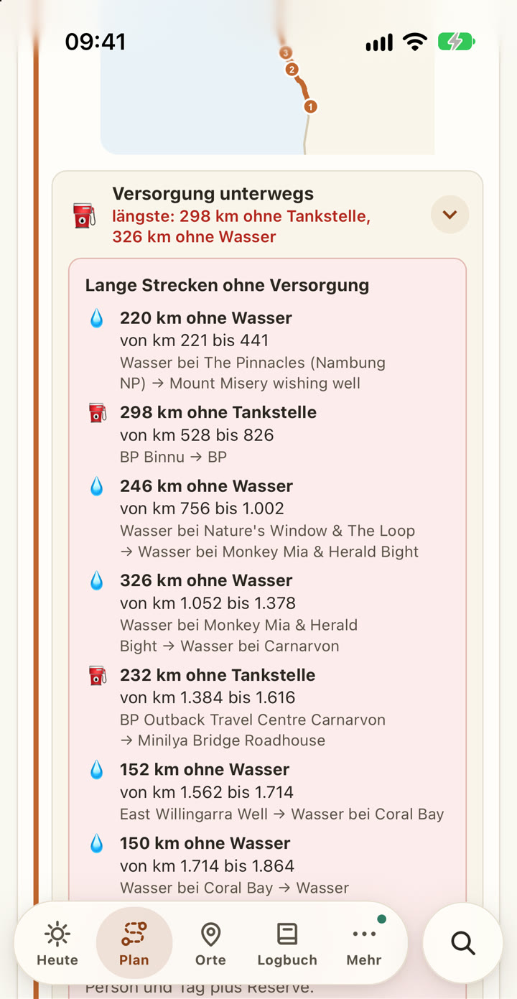
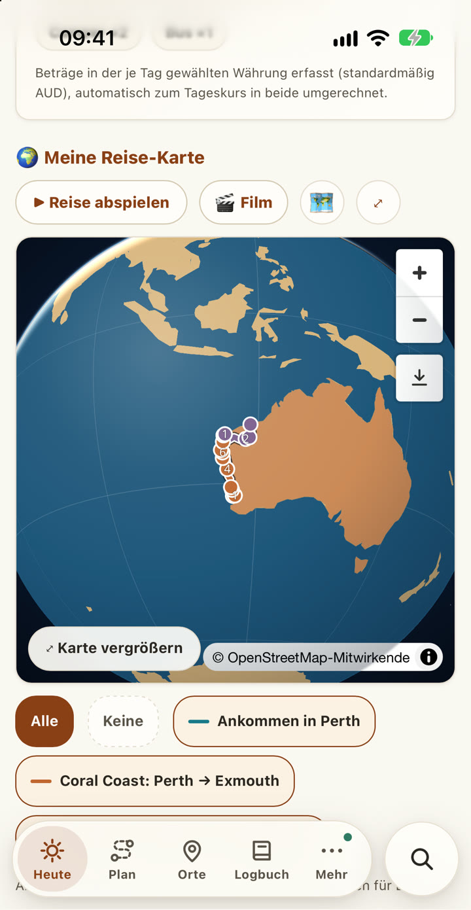

<div align="center">

# TravelBuddy

### Dein Roadtrip-Begleiter für die Strecken, auf denen das Netz aufhört.

Planen, navigieren, festhalten. Auf iPhone und Mac, komplett offline, ohne Konto und ohne Cloud.

**Version 1 · entwickelt für Western Australia**<br>
<sub>Weitere Regionen und Länder folgen.</sub>

<br>


</div>

> Alle Bilder zeigen eine ausgedachte **Beispielreise**. Echte Reisedaten, Buchungen oder Dokumente sind darin nicht zu sehen.

---

## Warum TravelBuddy

Zwischen Perth und Broome liegen 2.200 Kilometer. Dazwischen: Roadhouses, die teils 300 km auseinanderliegen, Kängurus in der Dämmerung, Buschfeuer, gesperrte Pisten und stundenlang kein Empfang. Genau dafür ist TravelBuddy gebaut.

| | |
|---|---|
| 📡 **Offline zuerst** | Karten, Orte, Routen, Belege und Notfallhilfe funktionieren ohne Netz. Einmal geplant, ist alles dabei. |
| ⛽ **Rechnet mit, wo es knapp wird** | Die längste Strecke ohne Tankstelle, lange Abschnitte ohne Wasser, die späteste Abfahrt vor Sonnenuntergang. |
| 🔥 **Warnt rechtzeitig** | Amtliche Warnungen zu Feuer, Flut und Unwetter, dazu Straßensperrungen auf deiner Route. |
| 📍 **144 handverlesene Orte** | Mit Bildern, Saison-Tipps, Sonnenzeiten und Markierungen wie „Muss-Sehen“, „Geheimtipp“ oder „Nur 4WD“. |
| 📖 **Hält fest, was du erlebst** | Logbuch mit Fotos, Kilometern und Tieren, daraus entstehen Reisetagebuch, Reise-Film und Reisebericht. |
| 🔒 **Gehört dir** | Kein Konto, kein Server, kein Tracking. Alle Daten bleiben auf deinem Gerät. |

---

## In einer Minute startklar

Beim ersten Öffnen führt dich TravelBuddy in acht kurzen Schritten durch alles. Du legst dabei gleich deine Reise an: Reisebeginn, erste Etappe, eine Buchung aus der Bestätigungsmail, Tickets und Dokumente aufs Gerät. Jeder Schritt lässt sich überspringen.

<table>
<tr>
<td align="center"><br><b>Willkommen</b><br>Deutsch oder Englisch</td>
<td align="center"><br><b>Erste Etappe</b><br>direkt im echten Formular</td>
<td align="center"><br><b>Buchungen</b><br>Mailtext einfügen, fertig</td>
</tr>
</table>

---

## Auf dem iPhone

<table>
<tr>
<td align="center"><br><b>Heute</b><br>Countdown, nächste Buchungen, Warnungen</td>
<td align="center"><br><b>Route</b><br>Stopps, km je Abschnitt, Auto oder Flug</td>
<td align="center"><br><b>Versorgung unterwegs</b><br>Lange Strecken ohne Sprit und Wasser</td>
</tr>
<tr>
<td align="center"><br><b>Orte</b><br>144 Orte mit Bild und Saison</td>
<td align="center"><br><b>Offline-Karte</b><br>Tankstellen, Wasser, Camps, Rastplätze</td>
<td align="center"><br><b>Logbuch</b><br>Jeder Reisetag am Band seiner Etappe</td>
</tr>
</table>

<div align="center">
&nbsp;&nbsp;

<br><sub>Alle Etappen und Routen auf der 3D-Weltkugel · Route mit Stopps auf dem Mac</sub>
</div>

---

## Funktionen

### 🗺️ Planen
- **Etappen und Routen:** Etappen sind Zeitabschnitte mit Datum, Routen die Strecken darin. Neue Stopps landen dort, wo sie den kleinsten Umweg machen.
- **Was die App an jeder Route rechnet:** Kilometer und Fahrzeit, die längste Strecke ohne Tankstelle, lange Strecken ohne Wasser, Sehenswertes bis 25 km neben der Strecke, Wetter an der Strecke.
- **Fahrtage:** Strecke, Fahrzeit mit Pausen und die späteste Abfahrt, um vor Sonnenuntergang anzukommen.
- **Routen-Ideen** für die Süd- und Nord-Schleife ab Perth, **Wanderungen**, **Kalender** zum Drucken und als Tabelle.

### 🚙 Unterwegs
- **Offline-Karte** für ganz Australien, im Detail Westküste, Ostküste, Melbourne, Cairns und Whitsundays.
- **Versorgung:** Tankstellen, Wasserstellen, Toiletten, Camps, Rastplätze, Läden, Werkstätten und Kliniken entlang der Route.
- **Gefahrenlage:** Warnungen aus Western Australia, Victoria und Queensland, dazu die **Straßenlage WA** mit Sperrungen auf deiner Route.
- **Notfall,** auch ohne Netz: Standort zum Vorlesen, Notrufnummern, nächste Klinik und Werkstatt.
- **Sonne und Sterne:** goldene und blaue Stunde, Mondphase und Milchstraße an jedem Ort.
- **Musik aus der Gegend** wandert automatisch in deine Spotify-Playlist, lokale Bands mit ihrem bekanntesten Song zuerst.

### 📖 Erinnern
- **Logbuch** mit Text, Fotos, Sprachnotiz, Kilometern, Wetter und Stimmung. Fotos landen anhand ihrer Bilddaten von selbst am richtigen Tag.
- **Tierwelt:** ein Sammelalbum mit 20 Tieren Westaustraliens.
- **Reisetagebuch** zum Drucken, **Reise-Film** im Hochformat und **Reisebericht** für Familie und Freunde, ohne Buchungen, Kosten und genaue Koordinaten.

### 🎟️ Organisieren
- **Buchung aus Mail:** Bestätigung einfügen, Datum, Ort, Buchungsnummer und Preis werden erkannt.
- **Tickets und Dokumente** öffnen sich auch offline, auf Wunsch geschützt mit **Face ID oder Touch ID**. Sie verlassen nie das Gerät.
- **Budget in Euro und AU$** zum Tageskurs, Packliste fürs Outback, Checkliste vor der Abreise und der Check „Bereit für unterwegs?“.
- **Eine Suche für alles:** Orte, Tage, Tiere, Buchungen, Notizen.

### ✨ Für jeden lesbar
- **Schriftgröße und Gesamtgröße** in je vier Stufen, getrennt einstellbar.
- **Hell und dunkel,** Deutsch und Englisch, Bedienung nach WCAG 2.2 AA geprüft.
- Und im Suchfeld verstecken sich ein paar kleine Spiele. 🦘

---

## Offline und online

| Ohne Netz | Mit Netz |
|---|---|
| Alle eigenen Daten, Plan, Logbuch, Tagebuch | Echte Straßenroute für neue Strecken |
| Gespeicherte Routen mit km, Fahrzeit und allen Hinweisen | Wetter und Wetter an der Strecke |
| Offline-Karte, Tankstellen, Wasser, Camps entlang der Route | Neue Warnungen und Straßensperrungen |
| Fahrtage, Sonnenzeiten, Notfall, Packliste, Quiz | Tageskurs für die Ausgaben |
| Belege auf dem Gerät, letzter Stand der Gefahrenlage | Musik unterwegs |

---

## Datenschutz

- Kein Konto, kein Server, keine Werbung, kein Tracking.
- Alle Daten bleiben im Speicher deines Geräts. Mac und iPhone gleichst du über eine Backup-Datei ab, zum Beispiel per AirDrop. Beim Import wird zusammengeführt, nichts wird gelöscht.
- Tickets, Ausweise und Fotos fürs Tagebuch bleiben auf dem Gerät und kommen nicht ins Backup.
- Ein eigener Test (`tests/basic-privat.test.mjs`) wacht darüber, dass keine persönlichen Daten im Code oder im Build landen.

---

## Selbst bauen

```
npm install
npm run dev        # Entwicklung
npm run build      # fertige App in dist/
```

TravelBuddy ist eine statische Web-App: `dist/` auf einen beliebigen Webspace mit HTTPS legen, fertig. Schritt für Schritt mit Netlify: **[docs/VEROEFFENTLICHEN.md](docs/VEROEFFENTLICHEN.md)**. Das Handbuch liegt in `docs/handbuch/` und als PDF in der App.

Tests laufen einzeln, zum Beispiel `node tests/plan.test.mjs`. Insgesamt sind es **1.189 automatische Prüfungen** in 27 Testdateien, darunter eine Regel gegen Rundungsfehler: Teile ergeben immer genau die angezeigte Summe.

---

## Technik

| Bereich | Eingesetzt |
|---|---|
| App | [Svelte 5](https://svelte.dev) mit Runes, [Vite](https://vite.dev), installierbare Web-App (PWA) mit [Workbox](https://developer.chrome.com/docs/workbox) |
| Karten | [MapLibre GL](https://maplibre.org), Offline-Kacheln als [PMTiles](https://protomaps.com/docs/pmtiles) aus [Protomaps](https://protomaps.com) und [OpenStreetMap](https://www.openstreetmap.org), Weltkugel aus [Natural Earth](https://www.naturalearthdata.com) |
| Routen | [OSRM](https://project-osrm.org) für Straßenrouten, eigene Offline-Auswertung für Tank- und Wasserlücken, Versorgung und Fahrtage |
| Daten unterwegs | [Open-Meteo](https://open-meteo.com), DFES Emergency WA, VicEmergency, Queensland Fire Department, Main Roads WA, [frankfurter.app](https://frankfurter.app) |
| Orte | Nominatim, Wikipedia und Wikimedia Commons |
| Sonne und Mond | [SunCalc](https://github.com/mourner/suncalc), offline |
| Sicherheit | WebAuthn mit PRF-Erweiterung (Face ID, Touch ID), AES-GCM, alles im Browser |
| Musik | Spotify Web API, MusicBrainz, Last.fm |

---

## Fahrplan

- [x] **Version 1: Western Australia** mit Planung, Logbuch, Offline-Karte, Versorgung und Gefahrenlage
- [x] Einführung beim ersten Öffnen, Schrift- und Gesamtgröße einstellbar
- [x] Quellcode hier auf GitHub
- [ ] Im App Store
- [ ] Weitere Regionen Australiens im Detail
- [ ] Weitere Länder

---

<details>
<summary><b>🇬🇧 In English</b></summary>

<br>

**TravelBuddy** is an offline-first road trip companion for iPhone and Mac: plan stages and routes, see where fuel and water get scarce, get official fire, flood and road warnings, keep a logbook and turn it into a travel journal. No account, no cloud, no tracking. Everything stays on your device.

**Version 1 was built for Western Australia**, with 144 hand-picked places, offline maps and supply points along the route. More regions and countries will follow. The app is available in German and English and walks you through setup the first time you open it.

Build it with `npm install && npm run build` and host `dist/` on any static HTTPS host.

</details>

---

## Daten und Bilder

Kartendaten © [OpenStreetMap](https://www.openstreetmap.org/copyright)-Mitwirkende · Kacheln [Protomaps](https://protomaps.com) · Ortsfotos von Wikimedia Commons (CC BY-SA, Nachweis in der App) · Grenzen und Küsten: Natural Earth.

<div align="center">

**Roadtrip-Designer by Kotdesigner**

</div>
